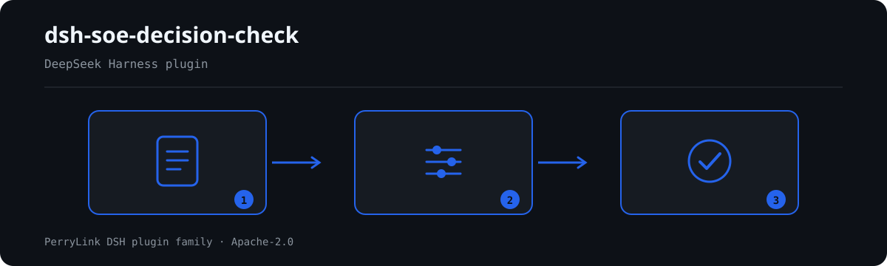

# dsh-soe-decision-check — Registro de asuntos de decisión «三重一大» (tres importantes y uno grande) de una empresa estatal y verificación de su rastro procedimental

[English](README.md) · [简体中文](README-zh.md) · [Español](README-es.md) · [Português](README-pt.md) · [हिन्दी](README-hi.md)

[](https://dsh.market/)
[](https://dshfind.com/en/plugins/PerryLink/dsh-soe-decision-check?ref=badge)

`dsh-soe-decision-check` lee un registro de asuntos de decisión «三重一大» —la cabecera de la empresa más una fila por asunto— y comprueba el rastro procedimental de ese mismo registro: que cada asunto registre su propuesta o su fundamento, que un asunto marcado como previamente estudiado registre la fecha del estudio, que la fecha del estudio no sea posterior a la fecha de la reunión, que se registre una decisión y que un asunto decidido registre su votación, que la categoría del asunto proceda de la lista de valores que usted configure, que el registro declare la empresa y el órgano decisor, y que los números de asunto no se repitan.

## Install

```sh
dsh plugin --profile <name> add dsh-soe-decision-check
dsh --profile <name> --dump-config | grep 'dsh-soe-decision-check'
```

## Cómo se ve la salida



*Resumen del flujo: documento → reglas → hallazgos. Los ejemplos siguientes usan la superficie de comandos real.*


Salida real de este plugin sobre su propio fixture de prueba `SD-001` — no es un montaje. El paquete de reglas no inventa citas, así que cada hallazgo nombra la cláusula aplicada y advierte que su texto no se obtuvo.

## Qué responde

### Ejemplos

La tabla siguiente es el conjunto de ejemplos: la primera fila es el caso detallado y las demás son casos breves.


#### Salida detallada

**Herramienta** `soe_decision_check`

**Entrada**

~~~json
{"meetingAt":"2026-03-05","rows":[{"前置研究":"是","前置研究日期":"2026-03-10","会议日期":"2026-03-05"}]}
~~~
 
**Salida**

~~~json
{
  "id": "dsh-soe-decision-check.SD-003.de09b5a6",
  "ruleId": "SD-003",
  "severity": "warn",
  "locator": {
    "row": 1,
    "field": "consultedAt"
  },
  "found": "第 1 行「consultedAt」为 2026-03-10，晚于 「meetingAt」的 2026-03-05",
  "expected": "「consultedAt」不应晚于 2026-03-05",
  "fix": "前置研究日期不应晚于会议审议日期；核对两个日期的填写"
}
~~~

*Observado en `dsh-soe-decision-check/tests/fixtures/SD-003/SD-003-unsafe.json`*

| Usted pregunta | Qué responde |
|---|---|
| Un asunto no tiene rellenos ni la propuesta ni el fundamento. ¿Se informa de algo? | Sí. `SD-001` exige que cada fila que traiga una de esas dos columnas tenga al menos una rellena, e informa de la fila cuando ambas están vacías. Comprueba que haya al menos una, no si el asunto pertenece al ámbito «三重一大», ni si el procedimiento o la competencia fueron los adecuados. |
| El registro marca un asunto como previamente estudiado, pero la fecha del estudio está vacía. | `SD-002` lee la propia columna 前置研究 del registro e informa de la fila cuando su valor cuenta como previamente estudiado y la fecha (`consultedAt`) está vacía. Qué valores cuentan lo fija `conditionValues` de la regla (por defecto 是, Y, yes, true, 已研究, √). Comprueba que la fecha esté puesta, no que el estudio previo fuera sustantivo ni que se adoptara su conclusión. Si ninguna fila trae tal valor, la regla se informa a sí misma en `skipped` en lugar de pasar. |
| La fecha del estudio es posterior a la de la reunión, o no se puede leer como fecha. | `SD-003` compara la fecha del estudio (`consultedAt`) con la de la reunión (`meetingAt`) e informa cuando la primera es posterior; el mismo día cuenta como no posterior. Una fecha que no puede analizar se informa aparte, no se omite en silencio. Solo compara esas dos fechas: no juzga si el procedimiento se cumplió de verdad. |
| Una fila no registra decisión; otra registra decisión pero no votación. | `SD-004` exige la columna de la decisión (`decision`) en cada fila que la traiga, y `SD-005` exige después la de la votación (`voteResult`) solo en las filas con decisión registrada. Ninguna comprueba si los votos alcanzaron la proporción exigida: esa proporción figura en las medidas de aplicación de su empresa y la regla no la calcula. |
| `SD-006` nunca informa de nada en mi registro. | Su vocabulario de categorías viene vacío, así que sin `values` configurado `SD-006` se informa a sí misma en `skipped` en lugar de pasar en silencio. Configure sus propias categorías y solo comprobará que la categoría rellena (`category`, 事项类别) esté en la lista; no decide si el asunto pertenece al ámbito «三重一大». |
| El mismo 序号 aparece en dos filas. | `SD-008` informa del `matterNo` repetido, ignorando los espacios, porque la repetición impide señalar el asunto en el acta. Que un mismo asunto se delibere en varias reuniones es normal: distinga esas filas por el número de reunión en lugar de reutilizar el número de orden. La regla solo comprueba la unicidad. |

## Normas que sigue

| Documento | Número | Reglas que lo citan |
|---|---|---|
| 《关于进一步推进国有企业贯彻落实"三重一大"决策制度的意见》 | 中办发〔2010〕17号（中共中央办公厅、国务院办公厅印发；⚠️ 党内文件，非法律、行政法规或部门规章；全文分三部分，按（一）至（二十三）编号，不设"第X条"） | SD-001, SD-002, SD-003, SD-004, SD-005, SD-006, SD-007, SD-008 |

**Boundary:** this plugin checks a **三重一大决策事项台账** for the procedural trail a register can be held to —
that each matter records its proposal and its basis, that a matter marked as pre-studied records a study date,
that the pre-study date is not later than the meeting date, that a decision and a vote record exist, that the
matter category comes from your vocabulary, that the register names the enterprise and the deciding body, and
that numbers are unique. It does **not** decide whether a decision was compliant, whether authority was
exceeded, whether an amount reaches the "large fund operation" threshold, or who is accountable.

> ### ⚠️ What this plugin deliberately does not know
>
> **What counts as a "三重一大" matter, and at what amount, is set by each enterprise's own implementing
> measures** — and the thresholds differ by industry, level and scale. So this plugin **hard-codes no amount
> threshold and no matter list.** Instead:
>
> - `SD-002` reads the register's **own 前置研究 column** to decide whether a matter needed pre-study, and the
>   values that count as "pre-studied" are configurable.
> - `SD-005` requires a vote record **only when a decision is recorded**, and it **does not check whether the
>   votes meet a required proportion** — that proportion comes from the implementing measures, and a register
>   rarely records the quorum and voting rule needed to compute it.
> - `SD-006`'s category vocabulary ships **empty**; with nothing configured it reports itself in `skipped`.
>
> **Every `excerpt` in the rule pack is a verbatim quotation of the clause it cites, and the citation
> gate re-checks each segment against the record in `rules/evidence/`.** The pack states a requirement
> verbatim when the clause states it, and stops at `warn` when the clause only implies it: a check that
> rests on a general principle is capped below `error` and says so in its own `note`. What the pack will
> not do is paraphrase a clause and present the paraphrase as a quotation.


## Compatibility

| Superficie | Estado |
|---|---|
| Harness | Rango de peers `>=0.1.2-rc.1 <0.2.0 \|\| >=0.2.0-0 <0.3.0` — verificado para aceptar tanto `0.2.0-rc.2` como `0.2.1-rc.2`. **`engines.dsh` se declara como `>=0.2.1-0 <0.3.0`** y el host lo aplica desde 0.2.1 |
| Node | `^22.19.0 || >=24.0.0` |
| Plataformas | Todas (ESM puro; sin código nativo, sin red, sin llamada al modelo) |
| Modo de herramienta | Funciona en `native` y `ptc`; para un directorio completo use `ptc` |

## What it does

La tabla de reglas, los campos y el comportamiento detallado están en [README.md](README.md#what-it-does) (versión principal en inglés). El plugin sólo enumera divergencias literales frente a las cláusulas citadas e indica en `skipped` cada comprobación que no pudo ejecutarse.

## Configuration

Todos los parámetros ajustables viven en el esquema Schemastery de `src/config.ts`, por lo que se cambian desde `cordis.yml` sin tocar el código; los umbrales por regla están en el paquete de reglas bajo `rules/`.

| Clave | Tipo | Predeterminado | Descripción |
|---|---|---|---|
| `rulesFile` | string | `rules/soe-decision-check.yaml` | Ruta del paquete de reglas, relativa a la raíz del paquete |
| `disabledRules` | string[] | `[]` | Ids de reglas que se dejan de ejecutar; cada una aparece en `skipped` |
| `onlyRules` | string[] | `[]` | Ejecutar solo estas reglas; vacío ejecuta todas |
| `skipNotes` | string | `""` | Nota añadida a cada motivo de `skipped` |
| `timeoutMs` | number | `120000` | Presupuesto de tiempo de espera cooperativo de la herramienta |

## Material format

Acepta JSON o YAML. El ejemplo completo de campos está en [README.md](README.md#material-format) (versión principal en inglés). Los campos son opcionales en la capa de lectura y los valida el motor, de modo que una exportación parcial produce hallazgos sobre lo que falta en lugar de un fallo.

## Rule sources

Los datos de las reglas están separados del código: cada regla lleva documento, número, cláusula en la numeración propia de la fuente, extracto literal y URL de origen. El cargador impone que el extracto sea una cita real de al menos ocho caracteres y que una comprobación basada sólo en un principio general (`kind: derived-from-principle`, tope `warn`) o en una política local (`kind: institutional-configuration`, tope `info`) nunca se declare `error`.

Los límites verificados y las conclusiones deliberadamente **no** afirmadas están en [README.md](README.md#rule-sources) (versión principal en inglés) y en `rules/evidence/`.

## Troubleshooting

- **El plugin se instala pero la herramienta no aparece**: compruebe que `main` resuelve a `lib/index.mjs` y que `pnpm run build` lo generó.
- **`dsh plugin add` rechaza el paquete**: la faixa de peers cubre `0.1.x` y `0.2.x`; fuera de ella, conceda una exención explícita con `dsh plugin --profile <name> allow-version <pkg@ver> --dsh-version <runtime> --accept-risk`.
- **Una regla no se ejecutó**: lea el arreglo `skipped`.
- **`check` informa `manifest-peers` como fallo**: es un problema conocido de `dsh-plugin-dev`; el runtime aplica la compatibilidad al instalar.
- **Los horarios parecen desplazados**: toda la aritmética es de hora local sobre las cadenas entregadas.

## Development

```sh
pnpm install
pnpm run typecheck
pnpm test
pnpm run build
node ../scripts/sync-shared.mjs dsh-soe-decision-check
```

El último comando copia el kit compartido de `../_shared` a `src/shared/`; vuelva a ejecutarlo tras cada cambio compartido.

## PerryLink DSH Plugin Family

Este proyecto forma parte de la familia de plugins de DeepSeek Harness de [PerryLink](https://github.com/PerryLink). El registro permanece plegado abajo para que cada README conserve una primera pantalla corta; expándelo para ver cada fila y su estado.

<details>
<summary>Expandir todos los plugins</summary>

| Plugin | Estado |
|---|---|
| **[dsh-aqua-input-check](https://github.com/PerryLink/dsh-aqua-input-check)** |  |
| **[dsh-archive-check](https://github.com/PerryLink/dsh-archive-check)** |  |
| **[dsh-auto-review](https://github.com/PerryLink/dsh-auto-review)** |  |
| **[dsh-autotier](https://github.com/PerryLink/dsh-autotier)** |  |
| **[dsh-bid-ca-precheck](https://github.com/PerryLink/dsh-bid-ca-precheck)** |  |
| **[dsh-bid-qual-check](https://github.com/PerryLink/dsh-bid-qual-check)** |  |
| **[dsh-cert-mcp](https://github.com/PerryLink/dsh-cert-mcp)** |  |
| **[dsh-checkpoint-rewind](https://github.com/PerryLink/dsh-checkpoint-rewind)** |  |
| **[dsh-click](https://github.com/PerryLink/dsh-click)** |  |
| **[dsh-composer-history](https://github.com/PerryLink/dsh-composer-history)** |  |
| **[dsh-contract-stance](https://github.com/PerryLink/dsh-contract-stance)** |  |
| **[dsh-customs-doc-check](https://github.com/PerryLink/dsh-customs-doc-check)** |  |
| **[dsh-data-quality](https://github.com/PerryLink/dsh-data-quality)** |  |
| **[dsh-demurrage-ledger](https://github.com/PerryLink/dsh-demurrage-ledger)** |  |
| **[dsh-doublecheck](https://github.com/PerryLink/dsh-doublecheck)** |  |
| **[dsh-drill-script-check](https://github.com/PerryLink/dsh-drill-script-check)** |  |
| **[dsh-eia-guide-check](https://github.com/PerryLink/dsh-eia-guide-check)** |  |
| **[dsh-emergency-plan](https://github.com/PerryLink/dsh-emergency-plan)** |  |
| **[dsh-essay-rubric-check](https://github.com/PerryLink/dsh-essay-rubric-check)** |  |
| **[dsh-evidence-check](https://github.com/PerryLink/dsh-evidence-check)** |  |
| **[dsh-export-ctl-check](https://github.com/PerryLink/dsh-export-ctl-check)** |  |
| **[dsh-fast](https://github.com/PerryLink/dsh-fast)** |  |
| **[dsh-fmea-table-check](https://github.com/PerryLink/dsh-fmea-table-check)** |  |
| **[dsh-forecast-penalty](https://github.com/PerryLink/dsh-forecast-penalty)** |  |
| **[dsh-fund-research](https://github.com/PerryLink/dsh-fund-research)** |  |
| **[dsh-github](https://github.com/PerryLink/dsh-github)** |  |
| **[dsh-gongwen-flow-check](https://github.com/PerryLink/dsh-gongwen-flow-check)** |  |
| **[dsh-gongwen-word-check](https://github.com/PerryLink/dsh-gongwen-word-check)** |  |
| **[dsh-guard-plan-qc](https://github.com/PerryLink/dsh-guard-plan-qc)** |  |
| **[dsh-hazchem-check](https://github.com/PerryLink/dsh-hazchem-check)** |  |
| **[dsh-hazplan-check](https://github.com/PerryLink/dsh-hazplan-check)** |  |
| **[dsh-hidden-risk-map](https://github.com/PerryLink/dsh-hidden-risk-map)** |  |
| **[dsh-hs-classify](https://github.com/PerryLink/dsh-hs-classify)** |  |
| **[dsh-icd-rule-check](https://github.com/PerryLink/dsh-icd-rule-check)** |  |
| **[dsh-industry-research](https://github.com/PerryLink/dsh-industry-research)** |  |
| **[dsh-lawcite-adapter](https://github.com/PerryLink/dsh-lawcite-adapter)** |  |
| **[dsh-laya](https://github.com/PerryLink/dsh-laya)** |  |
| **[dsh-lc-doc-check](https://github.com/PerryLink/dsh-lc-doc-check)** |  |
| **[dsh-learning-gap-check](https://github.com/PerryLink/dsh-learning-gap-check)** |  |
| **[dsh-library](https://github.com/PerryLink/dsh-library)** |  |
| **[dsh-local-ai](https://github.com/PerryLink/dsh-local-ai)** |  |
| **[dsh-lsp-actions](https://github.com/PerryLink/dsh-lsp-actions)** |  |
| **[dsh-mask](https://github.com/PerryLink/dsh-mask)** |  |
| **[dsh-mcp-panel](https://github.com/PerryLink/dsh-mcp-panel)** |  |
| **[dsh-medrec-qc](https://github.com/PerryLink/dsh-medrec-qc)** |  |
| **[dsh-memento](https://github.com/PerryLink/dsh-memento)** |  |
| **[dsh-nsfc-form-check](https://github.com/PerryLink/dsh-nsfc-form-check)** |  |
| **[dsh-nurse-record-check](https://github.com/PerryLink/dsh-nurse-record-check)** |  |
| **[dsh-observe](https://github.com/PerryLink/dsh-observe)** |  |
| **[dsh-origin-rvc-check](https://github.com/PerryLink/dsh-origin-rvc-check)** |  |
| **[dsh-ota-review-check](https://github.com/PerryLink/dsh-ota-review-check)** |  |
| **[dsh-output-styles](https://github.com/PerryLink/dsh-output-styles)** |  |
| **[dsh-paper-doc-adapter](https://github.com/PerryLink/dsh-paper-doc-adapter)** |  |
| **[dsh-permission-rules](https://github.com/PerryLink/dsh-permission-rules)** |  |
| **[dsh-permit-report-check](https://github.com/PerryLink/dsh-permit-report-check)** |  |
| **[dsh-pipeline-check](https://github.com/PerryLink/dsh-pipeline-check)** |  |
| **[dsh-pleading-draft](https://github.com/PerryLink/dsh-pleading-draft)** |  |
| **[dsh-plugin-doctor](https://github.com/PerryLink/dsh-plugin-doctor)** |  |
| **[dsh-plugin-guide](https://github.com/PerryLink/dsh-plugin-guide)** |  |
| **[dsh-plugin-kit](https://github.com/PerryLink/dsh-plugin-kit)** |  |
| **[dsh-plugin-upgrade](https://github.com/PerryLink/dsh-plugin-upgrade)** |  |
| **[dsh-policy-brief-draft](https://github.com/PerryLink/dsh-policy-brief-draft)** |  |
| **[dsh-power-loss-split](https://github.com/PerryLink/dsh-power-loss-split)** |  |
| **[dsh-power-ticket-check](https://github.com/PerryLink/dsh-power-ticket-check)** |  |
| **[dsh-ppap-check](https://github.com/PerryLink/dsh-ppap-check)** |  |
| **[dsh-protest-deadline](https://github.com/PerryLink/dsh-protest-deadline)** |  |
| **[dsh-railway-window](https://github.com/PerryLink/dsh-railway-window)** |  |
| **[dsh-repair-order-qc](https://github.com/PerryLink/dsh-repair-order-qc)** |  |
| **[dsh-research-report](https://github.com/PerryLink/dsh-research-report)** |  |
| **[dsh-review-reply-check](https://github.com/PerryLink/dsh-review-reply-check)** |  |
| **[dsh-rulefile-check](https://github.com/PerryLink/dsh-rulefile-check)** |  |
| **[dsh-safety-brief-check](https://github.com/PerryLink/dsh-safety-brief-check)** |  |
| **[dsh-score](https://github.com/PerryLink/dsh-score)** |  |
| **[dsh-session-sync](https://github.com/PerryLink/dsh-session-sync)** |  |
| **[dsh-site-log-check](https://github.com/PerryLink/dsh-site-log-check)** |  |
| **[dsh-skill-pack-security](https://github.com/PerryLink/dsh-skill-pack-security)** |  |
| **[dsh-soe-decision-check](https://github.com/PerryLink/dsh-soe-decision-check)** |  |
| **[dsh-soilwater-check](https://github.com/PerryLink/dsh-soilwater-check)** |  |
| **[dsh-sop-sync-check](https://github.com/PerryLink/dsh-sop-sync-check)** |  |
| **[dsh-spc-gbt-adapter](https://github.com/PerryLink/dsh-spc-gbt-adapter)** |  |
| **[dsh-talk](https://github.com/PerryLink/dsh-talk)** |  |
| **[dsh-tender-extract](https://github.com/PerryLink/dsh-tender-extract)** |  |
| **[dsh-tender-matrix](https://github.com/PerryLink/dsh-tender-matrix)** |  |
| **[dsh-test-drive](https://github.com/PerryLink/dsh-test-drive)** |  |
| **[dsh-ticktick](https://github.com/PerryLink/dsh-ticktick)** |  |
| **[dsh-translate](https://github.com/PerryLink/dsh-translate)** |  |
| **[dsh-warranty-calc](https://github.com/PerryLink/dsh-warranty-calc)** |  |
| **[dsh-budget](https://github.com/PerryLink/dsh-budget)** | 🧊 CONGELADO — ver el README del repositorio |
| **[dsh-claude-move](https://github.com/PerryLink/dsh-claude-move)** | 🧊 CONGELADO — ver el README del repositorio |
| **[dsh-defend](https://github.com/PerryLink/dsh-defend)** | 🧊 CONGELADO — ver el README del repositorio |
| **[dsh-draw](https://github.com/PerryLink/dsh-draw)** | 🧊 CONGELADO — ver el README del repositorio |
| **[dsh-reach](https://github.com/PerryLink/dsh-reach)** | 🧊 CONGELADO — ver el README del repositorio |
| **[dsh-background-agents](https://github.com/PerryLink/dsh-background-agents)** | 🚫 RETIRADO — ver el README del repositorio |
| **[dsh-session-pin](https://github.com/PerryLink/dsh-session-pin)** | 🚫 RETIRADO — ver el README del repositorio |
| **[dsh-team-rooms](https://github.com/PerryLink/dsh-team-rooms)** | 🚫 RETIRADO — ver el README del repositorio |

</details>

## License

[Apache License 2.0](LICENSE) © 2026 dsh-soe-decision-check contributors.
