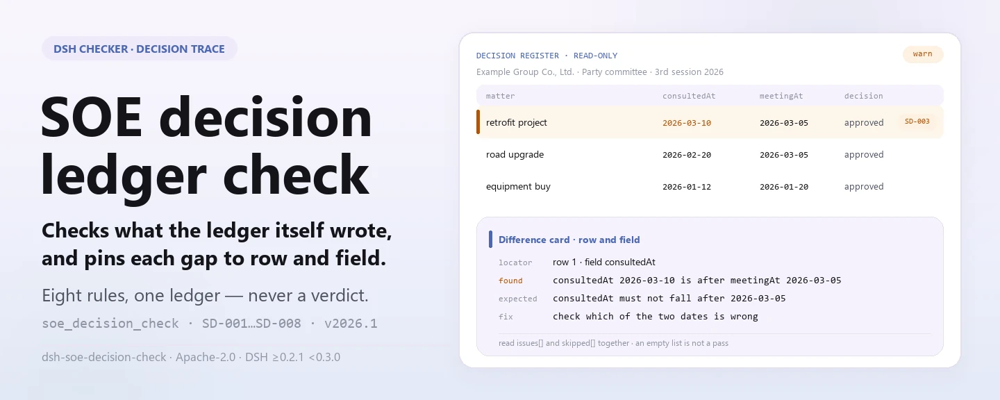

<div align="center">

<picture>
  <source media="(prefers-color-scheme: dark)" srcset="docs/assets/dsh-soe-decision-check-hero-en-dark.webp">
  
</picture>

# dsh-soe-decision-check

**Turn one “three-important-and-one-large” decision register into a list of what is inconsistent, where, and what to fix — differences only, never a compliance verdict.**

A DeepSeek Harness checker for state-owned enterprise governance and compliance staff: it reads one decision register — the enterprise header plus one row per matter — applies a versioned rule pack, and returns findings you can locate and re-check line by line.

[Install](#three-step-setup) · [Configuration](#configuration) · [FAQ](#faq) · [简体中文](README.md) · [English](README.en.md) · [Español](README.es.md) · [Português](README.pt.md) · [हिन्दी](README.hi.md)

[](LICENSE)
[](#compatibility)
[](https://github.com/PerryLink/dsh-soe-decision-check/actions/workflows/ci.yml)
[](#compatibility)

[](https://github.com/PerryLink/dsh-soe-decision-check/stargazers)
[](https://dshfind.com/en/plugins/PerryLink/dsh-soe-decision-check?ref=badge)
[](https://securityscorecards.dev/viewer/?uri=github.com/PerryLink/dsh-soe-decision-check)
[](https://dsh.market/)
[](https://gitee.com/perrylink/dsh-soe-decision-check)

```sh
dsh plugin --profile <name> add dsh-soe-decision-check
```

</div>

<sub>Community plugin, not affiliated with DeepSeek. Canonical repository: <https://github.com/PerryLink/dsh-soe-decision-check> (Gitee is a mirror).</sub>

## What it is

`dsh-soe-decision-check` reads one “three-important-and-one-large” decision register — the enterprise header plus one row per matter — and checks that register's own procedural trail: that each matter records its proposal or its basis, that a matter marked as pre-studied records a study date, that the pre-study date is not later than the meeting date, that a decision is recorded and a decided matter records its vote, that the matter category comes from the vocabulary you configure, that the register names the enterprise and the deciding body, and that matter numbers are unique.

“Three-important-and-one-large” is the SOE decision category set the Chinese rule pack cites: major decisions, key personnel appointments, major project arrangements, and large-sum fund operations.

What the register already states, the checker compares line by line; what the register does not state, it neither fills in nor guesses. The output is a list of findings carrying `locator` (which row, which field), `found` (what was read), `expected` (what it should have been), and `fix` (what to change), for a human to review. Pure ESM: no network, no model call, and the original file is never modified.

<picture>
  <source media="(prefers-color-scheme: dark)" srcset="docs/assets/dsh-soe-decision-check-flow-v5-dark.svg">
  
</picture>

## Three-step setup

1. **Install**:

   ```sh
   dsh plugin --profile <name> add dsh-soe-decision-check
   ```

   The latest `main`, or a tarball packed from this repository, works too:

   ```sh
   dsh plugin --profile web add github:PerryLink/dsh-soe-decision-check
   dsh plugin --profile web add ./dsh-soe-decision-check-<version>.tgz
   ```

   The shipped entry is `lib/index.mjs` (the `tsdown` build artifact); the package carries `rules/`, `locale/`, and `cordis.patch.yml`.

2. **Minimal config** (the defaults work; switch the rule pack or run a subset when needed):

   ```yaml
   - insert:
       - id: dsh-soe-decision-check
         name: dsh-soe-decision-check
         config:
           rulesFile: rules/soe-decision-check.yaml
           disabledRules: []
   ```

3. **Verify it mounts**:

   ```sh
   dsh --profile <name> --dump-config | grep 'dsh-soe-decision-check'
   ```

   In a repository checkout you can also run the sample (`pnpm install` runs `tsdown` through `prepare`, which builds `lib/`):

   ```sh
   node samples/quickstart/run.mjs
   ```

   ```text
   soe_decision_check: 1 issue(s) — error 0, warn 1, info 0
   skipped: 1
   ```

   The sample input is `samples/quickstart/input/` and the expected result is `samples/quickstart/expected/result.json`; `skipped: 1` is `SD-006` — its category vocabulary ships empty, so unconfigured it reports itself as skipped.

**Uninstall**: `dsh plugin --profile <name> remove dsh-soe-decision-check` (or remove the row from the profile patch).

<details>
<summary>Entering from WorkBuddy / Coze</summary>

Search for “Documents and Governance Suite” in WorkBuddy / Coze — this check is one part of it; availability as listed in the store.

</details>

## Core capabilities

Registers one tool, `soe_decision_check`: read one register, apply one versioned rule pack, return one report. The rule pack is data, not code — replacing `rules/*.yaml` switches the rule set without touching TypeScript.

### Rule table

| Rule | Check | Severity | Basis kind |
|---|---|---|---|
| `SD-001` | a matter records its proposal or its basis | warn | principle |
| `SD-002` | a pre-studied matter records the study date | warn | principle |
| `SD-003` | the pre-study date is not later than the meeting | warn | principle |
| `SD-004` | a decision is recorded | warn | principle |
| `SD-005` | a decided matter records the vote | warn | principle |
| `SD-006` | the category comes from your vocabulary (off by default) | info | principle |
| `SD-007` | the register names the enterprise and deciding body | warn | principle |
| `SD-008` | matter numbers are unique | warn | principle |

*Basis kind `principle` is `derived-from-principle` in the rule pack: the clause does not state the requirement directly and the check rests on a general principle, so its severity is capped below `error`.*

### Examples

These are the plugin's real entry points; install once, then call one.

**Detailed output** — tool `soe_decision_check`

**Input**

```json
{"meetingAt":"2026-03-05","rows":[{"前置研究":"是","前置研究日期":"2026-03-10","会议日期":"2026-03-05"}]}
```

**Output**

```json
{
  "id": "dsh-soe-decision-check.SD-003.de09b5a6",
  "ruleId": "SD-003",
  "severity": "warn",
  "locator": {
    "row": 1,
    "field": "consultedAt"
  },
  "found": "第 1 行「consultedAt」为 2026-03-10，晚于 「meetingAt」的 2026-03-05",
  "expected": "「consultedAt」不应晚于 2026-03-05",
  "fix": "前置研究日期不应晚于会议审议日期；核对两个日期的填写"
}
```

*Observed from `dsh-soe-decision-check/tests/fixtures/SD-003/SD-003-unsafe.json`*

**Brief examples**: `soe_decision_check` · `node samples/quickstart/run.mjs`

### Questions it answers

| You ask | What it answers |
|---|---|
| A matter has neither its proposal nor its basis filled in. Does the check say anything? | Yes. `SD-001` requires at least one of those two columns on every row that carries either one, and reports the row when both are blank. It checks that at least one is filled, not whether the matter belongs to the “three-important-and-one-large” scope, and not whether the decision procedure or the authority behind it was appropriate. |
| The register marks a matter as pre-studied, but the study date is empty. | `SD-002` reads the register's own pre-study column and reports the row when its value counts as pre-studied while the study date (`consultedAt`) is blank. Which values count is set by the rule's `conditionValues` (six default tokens, listed under Configuration). It checks that the date is filled, not whether the pre-study was substantive or whether its conclusion was adopted. When no row carries such a value, the rule reports itself in `skipped` instead of passing; widen the list when your register words the column differently. |
| The study date is later than the meeting date — or cannot be read as a date at all. | `SD-003` compares the study date (`consultedAt`) with the meeting date (`meetingAt`) and reports a study date later than the meeting; the same day counts as not later. A date it cannot parse is reported as its own finding rather than skipped. It compares those two dates only — it does not judge whether the procedure was really carried out; a finding usually means one of the two dates is wrong, or the row belongs to a later meeting. |
| One row records no decision; another records a decision but no vote result. | `SD-004` requires the decision column (`decision`) on every row that carries it, and `SD-005` then requires the vote column (`voteResult`) only on rows where a decision is recorded. Neither checks whether the votes reached a required proportion: that proportion comes from your enterprise's implementing measures, and the rule does not compute it — a vote that passed easily can still be reported, because what is missing is the record, not the majority. |
| `SD-006` never reports anything on my register. | Its category vocabulary ships empty, so with no `values` configured `SD-006` reports itself in `skipped` rather than passing silently. Configure your own matter categories and it checks only that a filled category (`category`) is one of them; it does not decide whether the matter belongs to the “three-important-and-one-large” scope. |
| The same matter number appears on two rows. | `SD-008` reports the repeated `matterNo`, ignoring whitespace, because a repeat makes the matter impossible to point at in the minutes. Deliberating one matter at several meetings is normal: distinguish those rows by meeting number instead of reusing the sequence number. The rule checks uniqueness only. |

### Material format

The tool accepts JSON or YAML (Excel can be converted to either first — in chat too, when the platform supports it):

```yaml
company: 某某集团有限公司
body: 党委会
meetingNo: 2026 年第 3 次
rows:
  - { 序号: '1', 决策事项: 某某技改项目立项, 事项类别: 重大项目安排,
      议题内容: 提请审议某某技改项目立项及投资概算,
      决策依据: 公司"三重一大"决策制度实施办法第 12 条, 涉及金额: 4800万元,
      前置研究: 是, 前置研究日期: 2026-02-20, 会议日期: 2026-03-05,
      决议结论: 同意立项，投资概算控制在 4800 万元以内,
      表决结果: 应到 9 人，实到 9 人，同意 9 票, 承办部门: 发展策划部 }
```

Column names are matched case-insensitively and ignoring spaces, underscores and hyphens; the register's own column names are kept, so a finding names the column it read. Dates may be `2026-03-05` or `2026-03-05 09:30`.

## Standards it follows

| Document | Number | Cited by rules |
|---|---|---|
| Opinions on Further Advancing the Implementation of the “Three-Important-and-One-Large” Decision-Making System in State-Owned Enterprises (CPC Central Office and State Council General Office) | Zhongbanfa [2010] No. 17 — a Party document, not a law, administrative regulation or departmental rule; three parts, numbered (i)–(xxiii), with no per-article numbering | SD-001, SD-002, SD-003, SD-004, SD-005, SD-006, SD-007, SD-008 |

Original citation, verbatim:

```text
《关于进一步推进国有企业贯彻落实"三重一大"决策制度的意见》 · 中办发〔2010〕17号
```

Rule data is separated from code, and every rule carries the document, number, clause in the source's own numbering, verbatim excerpt, and source URL. The loader enforces: an excerpt must be a real quotation of at least eight characters, and a check resting only on a general principle (`kind: derived-from-principle`, severity capped at `warn`) or on local institutional configuration (`kind: institutional-configuration`, capped at `info`) may never be labelled `error`. A rule pack that inflates its basis fails at load instead of producing an over-confident report.

The pack's header states the citation gap in full, and each rule's `note` repeats the part that matters for that rule. The load-time check that an excerpt must be a real quotation of at least eight characters cannot tell a quotation from a description — so this pack leans on the header, the per-rule notes, and a test asserting that every `excerpt` admits the gap.

The boundaries confirmed during verification and the conclusions deliberately not drawn are recorded in the packaged `rules/evidence/` directory.

## Configuration

Every tunable is a Schemastery field in `src/config.ts`, changeable from `cordis.yml` without editing code; per-check thresholds live in the rule pack under `rules/`. An id-targeted override replaces the whole row — restate every key you need.

All 5 keys:

| Key | Default | Meaning |
|---|---|---|
| `rulesFile` | `rules/soe-decision-check.yaml` | Rule-pack path, relative to the package root |
| `disabledRules` | `[]` | Rule ids to stop running; each appears in `skipped` |
| `onlyRules` | `[]` | Run only these rule ids; empty runs every rule |
| `skipNotes` | `""` | Note appended to every `skipped` reason, e.g. naming your implementing measures |
| `timeoutMs` | `120000` | Cooperative tool timeout budget, in milliseconds |

<details>
<summary>Full configuration table (5 keys + types)</summary>

| Key | Type | Default | Meaning |
|---|---|---|---|
| `rulesFile` | string | `rules/soe-decision-check.yaml` | Rule-pack path, relative to the package root |
| `disabledRules` | string[] | `[]` | Rule ids to stop running; each appears in `skipped` |
| `onlyRules` | string[] | `[]` | Run only these rule ids; empty runs every rule |
| `skipNotes` | string | `""` | Note appended to every `skipped` reason, e.g. naming your implementing measures |
| `timeoutMs` | number | `120000` | Cooperative tool timeout budget, in milliseconds |

</details>

Rule-level parameters live in the rule pack:

- `SD-002` `conditionValues` — the values in your pre-study column that mark a matter as pre-studied; the shipped default is the list below.
- `SD-005` `conditionField` / `requiredFields` — what triggers the vote requirement; the decision column by default, requiring the vote column.
- `SD-006` `values` — your matter categories, e.g. the four the pack documents for one enterprise (list below). Empty means no check.
- `SD-007` `fields` — the header fields that must be present; enterprise and deciding body by default. Add `meetingNo` if your register records the meeting number in the header.

The two literal lists, verbatim:

```text
SD-002 conditionValues (default): 是, Y, yes, true, 已研究, √
SD-006 values (one enterprise):   重大决策, 重要人事任免, 重大项目安排, 大额度资金运作
```

Example override in your profile patch:

```yaml
- insert:
    - id: dsh-soe-decision-check
      name: dsh-soe-decision-check
      config:
        onlyRules: [SD-001, SD-002, SD-003]
        skipNotes: 本机构按实施细则第 12 条口径
```

## FAQ

<details>
<summary>Is the register modified? Where does the data go, and is anything uploaded?</summary>

The tool only reads the material file you name: it writes no files, does not modify the original, makes no network requests, calls no model, and stores no credentials. `package.json#dsh.demo` declares `reads` as the material file you specify, `writes` as empty, and `network: false`. The report is returned in the current session; no extra copy is written anywhere.

</details>

<details>
<summary>If the result is empty, does that mean the register is fine?</summary>

No. An empty result means only that no literal difference could be reported; every check that could not run appears in `skipped` with its rule id and reason. `SD-006` (empty category vocabulary) and `SD-002` (no row marked pre-studied) both report themselves in `skipped` rather than passing silently — an empty result can never be read as “nothing is wrong”.

</details>

<details>
<summary>Does it fight other plugins over tool names, service keys, or slots?</summary>

No. The plugin registers exactly one tool, `soe_decision_check`; it registers no command, provides no service key, registers no client slot and no `webServer` prefix, and observes no session event. The bundle patch only `insert`s its own row. The point-by-point argument is in “Interoperability with other DSH plugins”.

</details>

<details>
<summary>How big is the performance overhead?</summary>

Pure ESM, zero network, zero model calls: one read of the material, one pass of per-row rule comparisons, no round trip to an external service. For a year of meetings use `ptc` tool mode so the schema cost is paid once.

</details>

<details>
<summary>It installs, but the tool never appears — or the package is rejected as incompatible.</summary>

First check that `main` resolves to `lib/index.mjs` and that the file was built; a wrong `main` makes the loader skip the entry silently. If `dsh plugin add` refuses the package, check whether your runtime sits inside the peer range (it covers `0.1.x` and `0.2.x`); if it must sit outside, grant an explicit exemption: `dsh plugin --profile <name> allow-version dsh-soe-decision-check@<version> --dsh-version <runtime> --accept-risk`. If `check` reports `manifest-peers` as failed, that is a known upstream issue in `dsh-plugin-dev`, whose static checker compares against a hard-coded peer range; the runtime enforces peer compatibility at install time.

</details>

## Security boundaries

- **Differences only, no verdict.** The report never pronounces on compliance, authority, whether an amount reaches the large-fund-operation threshold, or who is accountable; it lists literal differences between the material and the clauses it cites, for a human to review.
- **Read-only.** The tool reads only the material file you name: it writes no files, does not modify the original, makes no network requests, calls no model, and stores no credentials.
- **An empty result is not a pass.** Every check that could not run appears in `skipped` with its reason; a check that is deliberately unconfigured (such as `SD-006`) reports itself in `skipped` instead of passing silently.
- **Fail closed.** With neither `file` nor `material`, an unparseable material, or a missing rule pack, the tool throws and names what it tried; it never assembles an empty report.
- **Citation discipline.** Every rule's `excerpt` is a verbatim quotation of the clause it cites; when the verbatim text is unavailable, the rule says so through its `kind` and `note`, and its severity is capped below `error`. The pack never paraphrases a clause and presents the paraphrase as a quotation.

## Known limitations

> ### ⚠️ What this plugin deliberately does not know
>
> **What counts as a “three-important-and-one-large” matter, and at what amount, is set by each enterprise's own implementing measures** — and the thresholds differ by industry, level and scale. So this plugin **hard-codes no amount threshold and no matter list.** Instead:
>
> - `SD-002` reads the register's **own pre-study column** to decide whether a matter needed pre-study, and the values that count as “pre-studied” are configurable.
> - `SD-005` requires a vote record **only when a decision is recorded**, and it **does not check whether the votes meet a required proportion** — that proportion comes from the implementing measures, and a register rarely records the quorum and voting rule needed to compute it.
> - `SD-006`'s category vocabulary ships **empty**; with nothing configured it reports itself in `skipped`.
>
> **Every `excerpt` in this plugin's rule pack is a verbatim quotation of the clause it cites, and the citation gate re-checks each segment against the record in `rules/evidence/`.** The pack states a requirement verbatim when the clause states it, and stops at `warn` when the clause only implies it: a check that rests on a general principle is capped below `error` and says so in its own `note`. What the pack will not do is paraphrase a clause and present the paraphrase as a quotation.
>
> One further boundary is worth stating: this checks that the **trail** exists. A study recorded on the right date does not prove the pre-study was substantive, and the plugin makes no finding about that.

- **The trail only, not the substance.** Complete dates and columns do not prove that the decision procedure was actually carried out; the plugin reports only what the register itself can show line by line.
- **No proportional majority.** `SD-005` checks that a vote is recorded, not that it reached a required proportion — that needs the quorum and the voting rule, which a register rarely records in full.
- **`SD-006` is off out of the box.** The category vocabulary comes from your institution; with no `values` configured it reports itself in `skipped`, and the plugin hard-codes no matter list and no amount threshold.
- **`SD-002` relies on the register's own values.** When no row carries a value from `conditionValues`, the rule reports itself in `skipped`; widen that list when the register words the column differently.
- **Wall-clock time.** Every date comparison is wall-clock arithmetic on the input strings, with no timezone conversion.
- **Measured on Linux only.** It is pure ESM with no native code and runs on any Node 22.19+; the only environment actually exercised is Linux.

## Interoperability with other DSH plugins

Verified against **DSH `0.2.0-rc.2`** (the runtime this README ships for) and against this repository's code. The plugin registers one tool and touches no other plugin surface:

- **No tool-name collision.** The single tool name, `soe_decision_check`, belongs to this plugin and collides with no built-in or third-party tool.
- **No service-key collision.** It provides no service key at all, so it cannot collide on one.
- **No slot collision.** It registers no client slot key, so it cannot contend for a `shadows-shipped-ui` seat.
- **No HTTP route collision.** It registers no `webServer` prefix.
- **No event-chain collision.** It observes no session event (there is no `ctx.on`), so there is no shared event chain to short-circuit; registration itself is a Cordis effect, removed on unload or hot reload.
- **No patch-layer collision.** The bundle patch only `insert`s its own row; it never overrides a built-in row's `config`.
- **No global mutation.** It does not patch prototypes, rewrite `process.env`, or replace the global fetch dispatcher.

The plugin declares `inject: ['tools']`: without the `tools` service it does not start, so it leaves behind no half-registered listener or timer.

## Compatibility

| Surface | Status |
|---|---|
| Harness | `engines.dsh` is `>=0.2.1-0 <0.3.0`, enforced by the host since 0.2.1; the peer range is `>=0.1.2-rc.1 <0.2.0 \|\| >=0.2.0-0 <0.3.0`, measured to accept both `0.2.0-rc.2` and `0.2.1-rc.2` |
| Node | `^22.19.0 \|\| >=24.0.0` |
| Platforms | Any host that runs plain ESM on Node 22.19+; no native code, no network, no model call. Tested on Linux only |
| Tool mode | Works in `native` and `ptc`; for a year of meetings use `ptc` so the schema cost is paid once |

## Ecosystem & quality

- [Gitee mirror](https://gitee.com/perrylink/dsh-soe-decision-check) (sync mirror; GitHub is canonical)
- [dshfind plugin page](https://dshfind.com/en/plugins/PerryLink/dsh-soe-decision-check) (installs and ranking)
- [OpenSSF Scorecard report](https://securityscorecards.dev/viewer/?uri=github.com/PerryLink/dsh-soe-decision-check) (driven by [.github/workflows/scorecard.yml](.github/workflows/scorecard.yml))
- [DSH Market](https://dsh.market/) (listed)
- [Choose a checker by material](https://perrylink.github.io/zh/checkers/choose/) (the selection index for the checker family this repository belongs to)

## Development

```sh
pnpm install                                              # node ^22.19 || >=24; prepare runs tsdown
pnpm run typecheck                                        # tsc --noEmit
pnpm test                                                 # vitest: shared table-plugin suite + paired fixtures per rule
pnpm run build                                            # tsdown -> lib/index.mjs + lib/index.d.mts
pnpm run check:readmes                                    # README consistency gate (Chinese source ↔ English)
node ../scripts/sync-shared.mjs dsh-soe-decision-check    # copy the shared kit from ../_shared into src/shared/
```

Pre-release gate: `pnpm run typecheck && pnpm test && pnpm run build && pnpm run verify:self-contained && pnpm run check:lockfile && pnpm run check:readmes`.

The plugin is **data-only**: `src/model.ts` declares the table shape, the shared kit supplies the reader and the check engine, and the rule pack declares every check. The README images are generated programmatically by [`scripts/gen-readme-assets.py`](scripts/gen-readme-assets.py) (Pillow for the hero, hand-written SVG for the structure figure) and are safe to re-run: `python scripts/gen-readme-assets.py` writes `docs/assets/dsh-soe-decision-check-hero-{zh,en}-{light,dark}.webp` and `docs/assets/dsh-soe-decision-check-flow-v5-{light,dark}.svg` (localized hero, token-only structure figure shared by all five languages). The older single-skin flow diagram and the demo images stay in `docs/assets/` for external deep links.

Topics: `deepseek-harness`, `dsh`, `dsh-plugin`, `cordis`, `soe`, `decision`

## Family & thanks

This project is part of the DeepSeek Harness plugin family from [PerryLink](https://github.com/PerryLink) (all Apache-2.0). If it is useful, **a star helps the next person find it** — nothing is gated behind it.

- [@PerryLink](https://github.com/PerryLink) — creator and maintainer: the rule pack (8 rules plus the `rules/evidence/` citation-verification record), the shared check engine, and the five-language docs.

Full index (62 checkers + general plugins): [choose a checker by material](https://perrylink.github.io/zh/checkers/choose/) · [all plugins](https://github.com/PerryLink). This repository is one of them.

<details>
<summary>Expand all plugins</summary>

| Plugin | Status |
|---|---|
| **[dsh-aqua-input-check](https://github.com/PerryLink/dsh-aqua-input-check)** |  |
| **[dsh-archive-check](https://github.com/PerryLink/dsh-archive-check)** |  |
| **[dsh-auto-review](https://github.com/PerryLink/dsh-auto-review)** |  |
| **[dsh-autotier](https://github.com/PerryLink/dsh-autotier)** | 🧊 FROZEN — see the repo README |
| **[dsh-bid-ca-precheck](https://github.com/PerryLink/dsh-bid-ca-precheck)** |  |
| **[dsh-bid-qual-check](https://github.com/PerryLink/dsh-bid-qual-check)** |  |
| **[dsh-cert-mcp](https://github.com/PerryLink/dsh-cert-mcp)** | 🧊 FROZEN — see the repo README |
| **[dsh-checkpoint-rewind](https://github.com/PerryLink/dsh-checkpoint-rewind)** |  |
| **[dsh-click](https://github.com/PerryLink/dsh-click)** |  |
| **[dsh-composer-history](https://github.com/PerryLink/dsh-composer-history)** |  |
| **[dsh-contract-stance](https://github.com/PerryLink/dsh-contract-stance)** |  |
| **[dsh-customs-doc-check](https://github.com/PerryLink/dsh-customs-doc-check)** |  |
| **[dsh-data-quality](https://github.com/PerryLink/dsh-data-quality)** | 🧊 FROZEN — see the repo README |
| **[dsh-demurrage-ledger](https://github.com/PerryLink/dsh-demurrage-ledger)** |  |
| **[dsh-doublecheck](https://github.com/PerryLink/dsh-doublecheck)** |  |
| **[dsh-drill-script-check](https://github.com/PerryLink/dsh-drill-script-check)** |  |
| **[dsh-eia-guide-check](https://github.com/PerryLink/dsh-eia-guide-check)** |  |
| **[dsh-emergency-plan](https://github.com/PerryLink/dsh-emergency-plan)** |  |
| **[dsh-essay-rubric-check](https://github.com/PerryLink/dsh-essay-rubric-check)** |  |
| **[dsh-evidence-check](https://github.com/PerryLink/dsh-evidence-check)** |  |
| **[dsh-export-ctl-check](https://github.com/PerryLink/dsh-export-ctl-check)** |  |
| **[dsh-fast](https://github.com/PerryLink/dsh-fast)** |  |
| **[dsh-fmea-table-check](https://github.com/PerryLink/dsh-fmea-table-check)** |  |
| **[dsh-forecast-penalty](https://github.com/PerryLink/dsh-forecast-penalty)** |  |
| **[dsh-fund-research](https://github.com/PerryLink/dsh-fund-research)** |  |
| **[dsh-github](https://github.com/PerryLink/dsh-github)** |  |
| **[dsh-gongwen-flow-check](https://github.com/PerryLink/dsh-gongwen-flow-check)** |  |
| **[dsh-gongwen-word-check](https://github.com/PerryLink/dsh-gongwen-word-check)** |  |
| **[dsh-guard-plan-qc](https://github.com/PerryLink/dsh-guard-plan-qc)** |  |
| **[dsh-hazchem-check](https://github.com/PerryLink/dsh-hazchem-check)** |  |
| **[dsh-hazplan-check](https://github.com/PerryLink/dsh-hazplan-check)** |  |
| **[dsh-hidden-risk-map](https://github.com/PerryLink/dsh-hidden-risk-map)** |  |
| **[dsh-hs-classify](https://github.com/PerryLink/dsh-hs-classify)** |  |
| **[dsh-icd-rule-check](https://github.com/PerryLink/dsh-icd-rule-check)** |  |
| **[dsh-industry-research](https://github.com/PerryLink/dsh-industry-research)** |  |
| **[dsh-lawcite-adapter](https://github.com/PerryLink/dsh-lawcite-adapter)** |  |
| **[dsh-laya](https://github.com/PerryLink/dsh-laya)** |  |
| **[dsh-lc-doc-check](https://github.com/PerryLink/dsh-lc-doc-check)** |  |
| **[dsh-learning-gap-check](https://github.com/PerryLink/dsh-learning-gap-check)** |  |
| **[dsh-library](https://github.com/PerryLink/dsh-library)** |  |
| **[dsh-local-ai](https://github.com/PerryLink/dsh-local-ai)** |  |
| **[dsh-lsp-actions](https://github.com/PerryLink/dsh-lsp-actions)** |  |
| **[dsh-mask](https://github.com/PerryLink/dsh-mask)** |  |
| **[dsh-mcp-panel](https://github.com/PerryLink/dsh-mcp-panel)** |  |
| **[dsh-medrec-qc](https://github.com/PerryLink/dsh-medrec-qc)** |  |
| **[dsh-memento](https://github.com/PerryLink/dsh-memento)** | 🧊 FROZEN — see the repo README |
| **[dsh-nsfc-form-check](https://github.com/PerryLink/dsh-nsfc-form-check)** |  |
| **[dsh-nurse-record-check](https://github.com/PerryLink/dsh-nurse-record-check)** |  |
| **[dsh-observe](https://github.com/PerryLink/dsh-observe)** |  |
| **[dsh-origin-rvc-check](https://github.com/PerryLink/dsh-origin-rvc-check)** |  |
| **[dsh-ota-review-check](https://github.com/PerryLink/dsh-ota-review-check)** |  |
| **[dsh-output-styles](https://github.com/PerryLink/dsh-output-styles)** |  |
| **[dsh-paper-doc-adapter](https://github.com/PerryLink/dsh-paper-doc-adapter)** |  |
| **[dsh-permission-rules](https://github.com/PerryLink/dsh-permission-rules)** |  |
| **[dsh-permit-report-check](https://github.com/PerryLink/dsh-permit-report-check)** |  |
| **[dsh-pipeline-check](https://github.com/PerryLink/dsh-pipeline-check)** |  |
| **[dsh-pleading-draft](https://github.com/PerryLink/dsh-pleading-draft)** |  |
| **[dsh-plugin-doctor](https://github.com/PerryLink/dsh-plugin-doctor)** | 🚫 RETIRED (repo archived) |
| **[dsh-plugin-guide](https://github.com/PerryLink/dsh-plugin-guide)** |  |
| **[dsh-plugin-kit](https://github.com/PerryLink/dsh-plugin-kit)** | 🚫 RETIRED (repo archived) |
| **[dsh-plugin-upgrade](https://github.com/PerryLink/dsh-plugin-upgrade)** | 🚫 RETIRED (repo archived) |
| **[dsh-policy-brief-draft](https://github.com/PerryLink/dsh-policy-brief-draft)** |  |
| **[dsh-power-loss-split](https://github.com/PerryLink/dsh-power-loss-split)** |  |
| **[dsh-power-ticket-check](https://github.com/PerryLink/dsh-power-ticket-check)** |  |
| **[dsh-ppap-check](https://github.com/PerryLink/dsh-ppap-check)** |  |
| **[dsh-protest-deadline](https://github.com/PerryLink/dsh-protest-deadline)** |  |
| **[dsh-railway-window](https://github.com/PerryLink/dsh-railway-window)** |  |
| **[dsh-repair-order-qc](https://github.com/PerryLink/dsh-repair-order-qc)** |  |
| **[dsh-research-report](https://github.com/PerryLink/dsh-research-report)** |  |
| **[dsh-review-reply-check](https://github.com/PerryLink/dsh-review-reply-check)** |  |
| **[dsh-rulefile-check](https://github.com/PerryLink/dsh-rulefile-check)** |  |
| **[dsh-safety-brief-check](https://github.com/PerryLink/dsh-safety-brief-check)** |  |
| **[dsh-score](https://github.com/PerryLink/dsh-score)** | 🧊 FROZEN — see the repo README |
| **[dsh-session-sync](https://github.com/PerryLink/dsh-session-sync)** |  |
| **[dsh-site-log-check](https://github.com/PerryLink/dsh-site-log-check)** |  |
| **[dsh-skill-pack-security](https://github.com/PerryLink/dsh-skill-pack-security)** |  |
| **[dsh-soe-decision-check](https://github.com/PerryLink/dsh-soe-decision-check)** |  |
| **[dsh-soilwater-check](https://github.com/PerryLink/dsh-soilwater-check)** |  |
| **[dsh-sop-sync-check](https://github.com/PerryLink/dsh-sop-sync-check)** |  |
| **[dsh-spc-gbt-adapter](https://github.com/PerryLink/dsh-spc-gbt-adapter)** |  |
| **[dsh-talk](https://github.com/PerryLink/dsh-talk)** |  |
| **[dsh-tender-extract](https://github.com/PerryLink/dsh-tender-extract)** |  |
| **[dsh-tender-matrix](https://github.com/PerryLink/dsh-tender-matrix)** |  |
| **[dsh-test-drive](https://github.com/PerryLink/dsh-test-drive)** |  |
| **[dsh-ticktick](https://github.com/PerryLink/dsh-ticktick)** | 🚫 RETIRED (repo archived) |
| **[dsh-translate](https://github.com/PerryLink/dsh-translate)** |  |
| **[dsh-warranty-calc](https://github.com/PerryLink/dsh-warranty-calc)** |  |
| **[dsh-budget](https://github.com/PerryLink/dsh-budget)** | 🧊 FROZEN — see the repo README |
| **[dsh-claude-move](https://github.com/PerryLink/dsh-claude-move)** | 🧊 FROZEN — see the repo README |
| **[dsh-defend](https://github.com/PerryLink/dsh-defend)** | 🧊 FROZEN — see the repo README |
| **[dsh-draw](https://github.com/PerryLink/dsh-draw)** | 🧊 FROZEN — see the repo README |
| **[dsh-reach](https://github.com/PerryLink/dsh-reach)** | 🧊 FROZEN — see the repo README |
| **[dsh-background-agents](https://github.com/PerryLink/dsh-background-agents)** | 🚫 RETIRED (repo archived) |
| **[dsh-session-pin](https://github.com/PerryLink/dsh-session-pin)** | 🚫 RETIRED (repo archived) |
| **[dsh-team-rooms](https://github.com/PerryLink/dsh-team-rooms)** | 🚫 RETIRED (repo archived) |

</details>

## License

[LICENSE](LICENSE) (Apache License 2.0) © 2026 dsh-soe-decision-check contributors

<p align="center"><sub>Apache-2.0 · Community plugin, not affiliated with DeepSeek.</sub></p>
