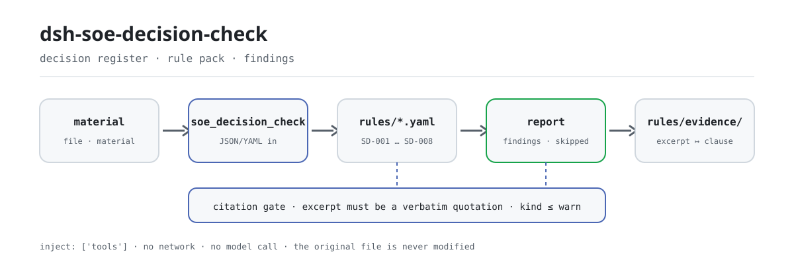

<div align="center">

<picture>
  <source media="(prefers-color-scheme: dark)" srcset="docs/assets/dsh-soe-decision-check-flow-dark.svg">
  
</picture>

# dsh-soe-decision-check

**Convierte un registro de asuntos de decisión «三重一大» en una lista de qué no cuadra, dónde y qué corregir: solo diferencias, nunca un veredicto de cumplimiento.**

Un verificador de DeepSeek Harness para el personal de gobierno corporativo y cumplimiento de empresas estatales: lee un registro de decisiones —la cabecera de la empresa más una fila por asunto—, aplica un paquete de reglas versionado y devuelve hallazgos que se pueden ubicar y revisar línea por línea.

[Instalar](#instalación-en-tres-pasos) · [Configuración](#configuración) · [FAQ](#faq) · [简体中文](README.md) · [English](README.en.md) · [Español](README.es.md) · [Português](README.pt.md) · [हिन्दी](README.hi.md)

[](LICENSE)
[](#compatibilidad)
[](https://github.com/PerryLink/dsh-soe-decision-check/actions/workflows/ci.yml)
[](#compatibilidad)

[](https://github.com/PerryLink/dsh-soe-decision-check/stargazers)
[](https://dshfind.com/en/plugins/PerryLink/dsh-soe-decision-check?ref=badge)
[](https://securityscorecards.dev/viewer/?uri=github.com/PerryLink/dsh-soe-decision-check)
[](https://dsh.market/)
[](https://gitee.com/perrylink/dsh-soe-decision-check)

```sh
dsh plugin --profile <name> add dsh-soe-decision-check
```

</div>

<sub>Plugin de la comunidad, no afiliado a DeepSeek. Repositorio canónico: <https://github.com/PerryLink/dsh-soe-decision-check> (Gitee es un espejo).</sub>

## Qué es

`dsh-soe-decision-check` lee un registro de asuntos de decisión «三重一大» —la cabecera de la empresa más una fila por asunto— y comprueba el rastro procedimental de ese mismo registro: que cada asunto registre su propuesta o su fundamento, que un asunto marcado como previamente estudiado registre la fecha del estudio, que la fecha del estudio no sea posterior a la fecha de la reunión, que se registre una decisión y que un asunto decidido registre su votación, que la categoría del asunto proceda de la lista de valores que usted configure, que el registro declare la empresa y el órgano decisor, y que los números de asunto no se repitan.

«三重一大» (tres importantes y uno grande) es el conjunto de categorías de decisión de empresa estatal que cita el paquete de reglas: decisiones importantes, nombramientos de personal clave, grandes proyectos y operaciones de fondos de gran cuantía.

Lo que el registro ya declara, el verificador lo compara línea por línea; lo que el registro no declara, no lo rellena ni lo adivina. La salida es una lista de hallazgos con `locator` (qué fila, qué campo), `found` (qué se leyó), `expected` (qué debería haber) y `fix` (qué corregir), para revisión humana. ESM puro: sin red, sin llamadas al modelo y sin modificar el archivo original.

## Instalación en tres pasos

1. **Instalar**:

   ```sh
   dsh plugin --profile <name> add dsh-soe-decision-check
   ```

   También sirven el último `main` o un tarball empaquetado desde este repositorio:

   ```sh
   dsh plugin --profile web add github:PerryLink/dsh-soe-decision-check
   dsh plugin --profile web add ./dsh-soe-decision-check-<version>.tgz
   ```

   Lo que se publica es `lib/index.mjs` (artefacto de `tsdown`), y el paquete incluye `rules/`, `locale/` y `cordis.patch.yml`.

2. **Configuración mínima** (los valores por defecto ya funcionan; cambie el paquete de reglas o ejecute un subconjunto cuando lo necesite):

   ```yaml
   - insert:
       - id: dsh-soe-decision-check
         name: dsh-soe-decision-check
         config:
           rulesFile: rules/soe-decision-check.yaml
           disabledRules: []
   ```

3. **Verificar que se monta**:

   ```sh
   dsh --profile <name> --dump-config | grep 'dsh-soe-decision-check'
   ```

   En un checkout del repositorio también puede ejecutar el ejemplo (`pnpm install` lanza `tsdown` mediante `prepare`, que construye `lib/`):

   ```sh
   node samples/quickstart/run.mjs
   ```

   ```text
   soe_decision_check: 1 issue(s) — error 0, warn 1, info 0
   skipped: 1
   ```

   La entrada del ejemplo está en `samples/quickstart/input/` y el resultado esperado en `samples/quickstart/expected/result.json`; `skipped: 1` es `SD-006`: su vocabulario de categorías viene vacío, así que sin configurar se informa a sí misma como omitida.

**Desinstalar**: `dsh plugin --profile <name> remove dsh-soe-decision-check` (o elimine la fila del patch del perfil).

<details>
<summary>Entrar desde WorkBuddy / Coze</summary>

Busque «Documents and Governance Suite» (文书与治理核对包) en WorkBuddy / Coze: esta verificación es una parte del conjunto; la disponibilidad es la que figure en la tienda.

</details>

## Capacidades clave

Registra una herramienta, `soe_decision_check`: lee un registro, aplica un paquete de reglas versionado y devuelve un informe. El paquete de reglas es datos, no código: reemplazar `rules/*.yaml` cambia el conjunto de reglas sin tocar TypeScript.

### Tabla de reglas

| Regla | Qué comprueba | Nivel | Tipo de base |
|---|---|---|---|
| `SD-001` | cada asunto registra su propuesta o su fundamento | warn | principle |
| `SD-002` | un asunto preestudiado registra la fecha del estudio | warn | principle |
| `SD-003` | la fecha del estudio no es posterior a la de la reunión | warn | principle |
| `SD-004` | hay una decisión registrada | warn | principle |
| `SD-005` | un asunto decidido registra la votación | warn | principle |
| `SD-006` | la categoría procede de su vocabulario (desactivada por defecto) | info | principle |
| `SD-007` | el registro declara la empresa y el órgano decisor | warn | principle |
| `SD-008` | los números de asunto son únicos | warn | principle |

*El tipo de base `principle` es `derived-from-principle` en el paquete de reglas: la cláusula no establece el requisito directamente y la comprobación se apoya en un principio general, por lo que su nivel queda por debajo de `error`.*

### Ejemplos

Estas son las superficies reales del plugin; instale una vez y llame a una.

**Salida detallada** — herramienta `soe_decision_check`

**Entrada**

```json
{"meetingAt":"2026-03-05","rows":[{"前置研究":"是","前置研究日期":"2026-03-10","会议日期":"2026-03-05"}]}
```

**Salida**

```json
{
  "id": "dsh-soe-decision-check.SD-003.de09b5a6",
  "ruleId": "SD-003",
  "severity": "warn",
  "locator": {
    "row": 1,
    "field": "consultedAt"
  },
  "found": "第 1 行「consultedAt」为 2026-03-10，晚于 「meetingAt」的 2026-03-05",
  "expected": "「consultedAt」不应晚于 2026-03-05",
  "fix": "前置研究日期不应晚于会议审议日期；核对两个日期的填写"
}
```

*Observed from `dsh-soe-decision-check/tests/fixtures/SD-003/SD-003-unsafe.json`*

**Ejemplos breves**: `soe_decision_check` · `node samples/quickstart/run.mjs`

### Preguntas que responde

| Usted pregunta | Qué responde |
|---|---|
| Un asunto no tiene rellenos ni la propuesta ni el fundamento. ¿Se informa de algo? | Sí. `SD-001` exige que cada fila que traiga una de esas dos columnas tenga al menos una rellena, e informa de la fila cuando ambas están vacías. Comprueba que haya al menos una, no si el asunto pertenece al ámbito «三重一大», ni si el procedimiento o la competencia fueron los adecuados. |
| El registro marca un asunto como previamente estudiado, pero la fecha del estudio está vacía. | `SD-002` lee la propia columna de estudio previo del registro e informa de la fila cuando su valor cuenta como previamente estudiado y la fecha (`consultedAt`) está vacía. Qué valores cuentan lo fija `conditionValues` de la regla (seis valores por defecto, listados en Configuración). Comprueba que la fecha esté puesta, no que el estudio previo fuera sustantivo ni que se adoptara su conclusión. Si ninguna fila trae tal valor, la regla se informa a sí misma en `skipped` en lugar de pasar; amplíe la lista cuando su registro use otra redacción. |
| La fecha del estudio es posterior a la de la reunión, o no se puede leer como fecha. | `SD-003` compara la fecha del estudio (`consultedAt`) con la de la reunión (`meetingAt`) e informa cuando la primera es posterior; el mismo día cuenta como no posterior. Una fecha que no puede analizar se informa aparte, no se omite en silencio. Solo compara esas dos fechas: no juzga si el procedimiento se cumplió de verdad; un hallazgo suele significar que una de las dos fechas está mal, o que la fila pertenece a una reunión posterior. |
| Una fila no registra decisión; otra registra decisión pero no votación. | `SD-004` exige la columna de la decisión (`decision`) en cada fila que la traiga, y `SD-005` exige después la de la votación (`voteResult`) solo en las filas con decisión registrada. Ninguna comprueba si los votos alcanzaron la proporción exigida: esa proporción figura en las medidas de aplicación de su empresa y la regla no la calcula; una votación aprobada con holgura puede seguir informándose, porque lo que falta es el registro, no la mayoría. |
| `SD-006` nunca informa de nada en mi registro. | Su vocabulario de categorías viene vacío, así que sin `values` configurado `SD-006` se informa a sí misma en `skipped` en lugar de pasar en silencio. Configure sus propias categorías y solo comprobará que la categoría rellena (`category`) esté en la lista; no decide si el asunto pertenece al ámbito «三重一大». |
| El mismo número de asunto aparece en dos filas. | `SD-008` informa del `matterNo` repetido, ignorando los espacios, porque la repetición impide señalar el asunto en el acta. Que un mismo asunto se delibere en varias reuniones es normal: distinga esas filas por el número de reunión en lugar de reutilizar el número de orden. La regla solo comprueba la unicidad. |

### Formato del material

La herramienta acepta JSON o YAML (Excel puede convertirse antes a cualquiera de los dos; también en el chat si la plataforma lo permite):

```yaml
company: 某某集团有限公司
body: 党委会
meetingNo: 2026 年第 3 次
rows:
  - { 序号: '1', 决策事项: 某某技改项目立项, 事项类别: 重大项目安排,
      议题内容: 提请审议某某技改项目立项及投资概算,
      决策依据: 公司"三重一大"决策制度实施办法第 12 条, 涉及金额: 4800万元,
      前置研究: 是, 前置研究日期: 2026-02-20, 会议日期: 2026-03-05,
      决议结论: 同意立项，投资概算控制在 4800 万元以内,
      表决结果: 应到 9 人，实到 9 人，同意 9 票, 承办部门: 发展策划部 }
```

Los nombres de columna se comparan sin distinguir mayúsculas y sin tener en cuenta espacios, guiones bajos ni guiones; se conservan los nombres propios del registro, de modo que cada hallazgo nombra la columna que leyó. Las fechas pueden ser `2026-03-05` o `2026-03-05 09:30`.

## Normas que sigue

| Documento | Número | Reglas que lo citan |
|---|---|---|
| 《关于进一步推进国有企业贯彻落实"三重一大"决策制度的意见》 | 中办发〔2010〕17号（中共中央办公厅、国务院办公厅印发；⚠️ 党内文件，非法律、行政法规或部门规章；全文分三部分，按（一）至（二十三）编号，不设"第X条"） | SD-001, SD-002, SD-003, SD-004, SD-005, SD-006, SD-007, SD-008 |

Los datos de las reglas están separados del código: cada regla lleva documento, número, cláusula en la numeración propia de la fuente, extracto literal y URL de origen. El cargador impone: el extracto debe ser una cita real de al menos ocho caracteres, y una comprobación basada solo en un principio general (`kind: derived-from-principle`, nivel máximo `warn`) o en configuración institucional local (`kind: institutional-configuration`, máximo `info`) nunca puede etiquetarse `error`. Un paquete de reglas que infle su base falla al cargar en lugar de producir un informe falsamente seguro.

La cabecera del paquete declara la laguna de citación completa, y la `note` de cada regla repite la parte que importa para esa regla. La comprobación de carga —que el extracto sea una cita real de al menos ocho caracteres— no distingue una cita de una descripción; por eso este paquete se apoya en la cabecera, en las notas por regla y en una prueba que afirma que cada `excerpt` reconoce la laguna.

Los límites confirmados durante la verificación y las conclusiones deliberadamente no formuladas están en el directorio `rules/evidence/` que acompaña al paquete.

## Configuración

Todos los parámetros ajustables son campos de Schemastery en `src/config.ts` y se cambian desde `cordis.yml` sin tocar el código; los umbrales por comprobación están en el paquete de reglas bajo `rules/`. Una sobrescritura por id reemplaza la fila entera: reenuncie todas las claves que necesite.

Las 5 claves:

| Clave | Predeterminado | Significado |
|---|---|---|
| `rulesFile` | `rules/soe-decision-check.yaml` | Ruta del paquete de reglas, relativa a la raíz del paquete |
| `disabledRules` | `[]` | Ids de reglas que se dejan de ejecutar; cada una aparece en `skipped` |
| `onlyRules` | `[]` | Ejecutar solo estas reglas; vacío ejecuta todas |
| `skipNotes` | `""` | Nota añadida a cada motivo de `skipped`, por ejemplo citando sus medidas de aplicación |
| `timeoutMs` | `120000` | Presupuesto de tiempo de espera cooperativo de la herramienta, en milisegundos |

<details>
<summary>Tabla de configuración completa (5 claves + tipos)</summary>

| Clave | Tipo | Predeterminado | Significado |
|---|---|---|---|
| `rulesFile` | string | `rules/soe-decision-check.yaml` | Ruta del paquete de reglas, relativa a la raíz del paquete |
| `disabledRules` | string[] | `[]` | Ids de reglas que se dejan de ejecutar; cada una aparece en `skipped` |
| `onlyRules` | string[] | `[]` | Ejecutar solo estas reglas; vacío ejecuta todas |
| `skipNotes` | string | `""` | Nota añadida a cada motivo de `skipped`, por ejemplo citando sus medidas de aplicación |
| `timeoutMs` | number | `120000` | Presupuesto de tiempo de espera cooperativo de la herramienta, en milisegundos |

</details>

Los parámetros por regla viven en el paquete de reglas:

- `SD-002` `conditionValues`: los valores de su columna de estudio previo que marcan un asunto como preestudiado; por defecto `[是, Y, yes, true, 已研究, √]`.
- `SD-005` `conditionField` / `requiredFields`: qué activa la exigencia de votación; por defecto la columna de decisión, exigiendo la de votación.
- `SD-006` `values`: sus categorías de asunto, por ejemplo `[重大决策, 重要人事任免, 重大项目安排, 大额度资金运作]`. Vacío significa que no se comprueba.
- `SD-007` `fields`: los campos de cabecera que deben estar presentes; por defecto empresa y órgano decisor. Añada `meetingNo` si su registro anota el número de reunión en la cabecera.

Ejemplo de sobrescritura en el patch del perfil:

```yaml
- insert:
    - id: dsh-soe-decision-check
      name: dsh-soe-decision-check
      config:
        onlyRules: [SD-001, SD-002, SD-003]
        skipNotes: 本机构按实施细则第 12 条口径
```

## FAQ

<details>
<summary>¿Se modifica el registro? ¿Dónde van los datos? ¿Se sube algo?</summary>

La herramienta solo lee el archivo de material que usted indica: no escribe archivos, no modifica el original, no hace peticiones de red, no llama a ningún modelo y no guarda credenciales. `package.json#dsh.demo` declara `reads` como el archivo de material indicado, `writes` vacío y `network: false`. El informe se devuelve en la sesión actual; no se escribe ninguna copia adicional.

</details>

<details>
<summary>Si el resultado viene vacío, ¿significa que el registro está bien?</summary>

No. Un resultado vacío solo significa que no había diferencias literales que informar; toda comprobación que no pudo ejecutarse aparece en `skipped` con su id de regla y su motivo. `SD-006` (vocabulario de categorías vacío) y `SD-002` (ninguna fila marcada como preestudiada) se informan a sí mismas en `skipped` en lugar de pasar en silencio: un resultado vacío nunca puede leerse como «no hay nada mal».

</details>

<details>
<summary>¿Compite con otros plugins por nombres de herramienta, claves de servicio o slots?</summary>

No. El plugin registra exactamente una herramienta, `soe_decision_check`; no registra comandos, no provee ninguna clave de servicio, no registra ningún slot de cliente ni prefijo `webServer`, y no observa ningún evento de sesión. El patch del bundle solo hace `insert` de su propia fila. El argumento punto por punto está en «Interoperabilidad con otros plugins DSH».

</details>

<details>
<summary>¿Cuánta sobrecarga de rendimiento supone?</summary>

ESM puro, cero red, cero llamadas al modelo: una lectura del material, una pasada de comparaciones fila por fila, sin idas y vueltas a servicios externos. Para un año de reuniones use el modo de herramienta `ptc`, de modo que el coste del esquema se pague una vez.

</details>

<details>
<summary>Se instala, pero la herramienta no aparece — o el paquete se rechaza por incompatibilidad.</summary>

Primero confirme que `main` resuelve a `lib/index.mjs` y que el archivo se construyó; un `main` equivocado hace que el cargador omita la entrada en silencio. Si `dsh plugin add` rechaza el paquete, compruebe si su runtime cae dentro del rango de peers (cubre `0.1.x` y `0.2.x`); si debe quedar fuera, conceda una exención explícita: `dsh plugin --profile <name> allow-version dsh-soe-decision-check@<version> --dsh-version <runtime> --accept-risk`. Si `check` informa `manifest-peers` como fallo, es un problema conocido de `dsh-plugin-dev`, cuyo verificador estático compara con un rango de peers codificado; el runtime aplica la compatibilidad de peers al instalar.

</details>

## Límites de seguridad

- **Solo diferencias, sin veredicto.** El informe nunca se pronuncia sobre cumplimiento, competencia, si un importe alcanza el umbral de operación de fondos de gran cuantía, ni sobre quién es responsable; enumera diferencias literales entre el material y las cláusulas que cita, para revisión humana.
- **Solo lectura.** La herramienta lee solo el archivo de material que usted indica: no escribe archivos, no modifica el original, no hace peticiones de red, no llama a ningún modelo y no guarda credenciales.
- **Un resultado vacío no es un aprobado.** Toda comprobación que no pudo ejecutarse aparece en `skipped` con su motivo; una comprobación deliberadamente sin configurar (como `SD-006`) se informa a sí misma en `skipped` en lugar de pasar en silencio.
- **Fallo cerrado.** Sin `file` ni `material`, con un material que no se puede analizar o con un paquete de reglas ausente, la herramienta lanza un error y nombre lo que intentó; nunca arma un informe vacío.
- **Disciplina de citación.** Cada `excerpt` de una regla es una cita literal de la cláusula que cita; cuando el texto literal no está disponible, la regla lo dice mediante su `kind` y su `note`, y su nivel queda por debajo de `error`. El paquete nunca parafrasea una cláusula y presenta la paráfrasis como cita.

## Limitaciones conocidas

> ### ⚠️ Lo que este plugin deliberadamente no sabe
>
> **Qué cuenta como asunto «三重一大» y a partir de qué importe lo fija cada empresa en sus medidas de aplicación** —y los umbrales difieren por sector, nivel y escala. Por eso este plugin **no codifica ningún umbral de importe ni ninguna lista de asuntos.** En su lugar:
>
> - `SD-002` lee la **propia columna de estudio previo** del registro para decidir si un asunto necesitaba estudio previo, y los valores que cuentan como «preestudiado» son configurables.
> - `SD-005` exige registro de votación **solo cuando hay una decisión registrada**, y **no comprueba si los votos alcanzan la proporción exigida**: esa proporción viene de las medidas de aplicación, y un registro rara vez anota el quórum y la regla de votación necesarios para calcularla.
> - El vocabulario de categorías de `SD-006` viene **vacío**; sin nada configurado se informa a sí mismo en `skipped`.
>
> **Cada `excerpt` del paquete de reglas es una cita literal de la cláusula que cita, y la puerta de citación revisa cada segmento contra el registro en `rules/evidence/`.** El paquete enuncia un requisito literalmente cuando la cláusula lo enuncia, y se detiene en `warn` cuando la cláusula solo lo implica: una comprobación que se apoya en un principio general queda por debajo de `error` y lo dice en su propia `note`. Lo que el paquete no hará es parafrasear una cláusula y presentar la paráfrasis como cita.
>
> Conviene añadir otro límite: esto comprueba que el **rastro** exista. Un estudio anotado en la fecha correcta no demuestra que el estudio previo fuera sustantivo, y el plugin no formula ningún hallazgo al respecto.

- **Solo el rastro, no la sustancia.** Fechas y columnas completas no demuestran que el procedimiento de decisión se haya cumplido de verdad; el plugin solo informa lo que el propio registro puede mostrar línea por línea.
- **Sin mayoría proporcional.** `SD-005` comprueba que haya una votación registrada, no que haya alcanzado la proporción exigida: eso requiere el quórum y la regla de votación, que un registro rara vez anota completos.
- **`SD-006` viene desactivada.** El vocabulario de categorías procede de su institución; sin `values` configurado se informa a sí misma en `skipped`, y el plugin no codifica ninguna lista de asuntos ni umbral de importe.
- **`SD-002` depende de los valores del propio registro.** Cuando ninguna fila trae un valor de `conditionValues`, la regla se informa a sí misma en `skipped`; amplíe esa lista cuando el registro use otra redacción.
- **Hora de reloj de pared.** Toda comparación de fechas es aritmética de reloj de pared sobre las cadenas de entrada, sin conversión de zona horaria.
- **Medido solo en Linux.** Es ESM puro sin código nativo y corre en cualquier Node 22.19+; el único entorno realmente ejercitado es Linux.

## Interoperabilidad con otros plugins DSH

Verificado contra **DSH `0.2.0-rc.2`** (el runtime para el que se publica este README) y contra el código de este repositorio. El plugin registra una herramienta y no toca ninguna otra superficie de plugin:

- **Sin colisión de nombres de herramienta.** El único nombre de herramienta, `soe_decision_check`, es de este plugin y no colisiona con ninguna herramienta incluida ni de terceros.
- **Sin colisión de clave de servicio.** No provee ninguna clave de servicio, así que no puede colisionar en una.
- **Sin colisión de slot.** No registra ninguna clave de slot de cliente, así que no disputa un asiento `shadows-shipped-ui`.
- **Sin colisión de ruta HTTP.** No registra ningún prefijo `webServer`.
- **Sin colisión en la cadena de eventos.** No observa ningún evento de sesión (no hay `ctx.on`), así que no hay cadena de eventos compartida que cortocircuitar; el registro mismo es un efecto Cordis que se retira al descargar o recargar en caliente.
- **Sin colisión en la capa de patch.** El patch del bundle solo hace `insert` de su propia fila; nunca sobrescribe el `config` de una fila incluida.
- **Sin mutación global.** No parchea prototipos, no reescribe `process.env` ni reemplaza el dispatcher global de fetch.

El plugin declara `inject: ['tools']`: sin el servicio `tools` no arranca, así que no deja ningún listener ni temporizador a medio registrar.

## Compatibilidad

| Superficie | Estado |
|---|---|
| Harness | `engines.dsh` es `>=0.2.1-0 <0.3.0`, aplicado por el host desde 0.2.1; el rango de peers es `>=0.1.2-rc.1 <0.2.0 \|\| >=0.2.0-0 <0.3.0`, medido para aceptar tanto `0.2.0-rc.2` como `0.2.1-rc.2` |
| Node | `^22.19.0 \|\| >=24.0.0` |
| Plataformas | Cualquier host que ejecute ESM puro sobre Node 22.19+; sin código nativo, sin red, sin llamadas al modelo. Probado solo en Linux |
| Modo de herramienta | Funciona en `native` y `ptc`; para un año de reuniones use `ptc`, así el coste del esquema se paga una vez |

## Ecosistema y calidad

- [Espejo de Gitee](https://gitee.com/perrylink/dsh-soe-decision-check) (espejo sincronizado; GitHub es el canónico)
- [Página del plugin en dshfind](https://dshfind.com/en/plugins/PerryLink/dsh-soe-decision-check) (instalaciones y ranking)
- [Informe de OpenSSF Scorecard](https://securityscorecards.dev/viewer/?uri=github.com/PerryLink/dsh-soe-decision-check) (impulsado por [.github/workflows/scorecard.yml](.github/workflows/scorecard.yml))
- [DSH Market](https://dsh.market/) (listado)
- [Elegir un verificador por material](https://perrylink.github.io/zh/checkers/choose/) (índice de selección de la familia de verificadores a la que pertenece este repositorio)

## Desarrollo

```sh
pnpm install                                              # node ^22.19 || >=24; prepare ejecuta tsdown
pnpm run typecheck                                        # tsc --noEmit
pnpm test                                                 # vitest: suite compartida de plugins de tabla + fixtures emparejados por regla
pnpm run build                                            # tsdown -> lib/index.mjs + lib/index.d.mts
pnpm run check:readmes                                    # puerta de consistencia de los README (fuente china ↔ inglés)
node ../scripts/sync-shared.mjs dsh-soe-decision-check    # copia el kit compartido de ../_shared a src/shared/
```

Puerta previa a la publicación: `pnpm run typecheck && pnpm test && pnpm run build && pnpm run verify:self-contained && pnpm run check:lockfile && pnpm run check:readmes`.

El plugin es **solo datos**: `src/model.ts` declara la forma de la tabla, el kit compartido aporta el lector y el motor de comprobación, y el paquete de reglas declara cada comprobación. Las imágenes del README se generan programáticamente con [`scripts/gen-readme-assets.py`](scripts/gen-readme-assets.py) (Python + Pillow) y se pueden reejecutar sin riesgo.

Topics: `deepseek-harness`, `dsh`, `dsh-plugin`, `cordis`, `soe`, `decision`

## Familia y agradecimientos

Este proyecto forma parte de la familia de plugins de DeepSeek Harness de [PerryLink](https://github.com/PerryLink) (todos Apache-2.0). Si te resulta útil, **una estrella ayuda a que la siguiente persona lo encuentre** — no hay nada bloqueado tras ella.

- [@PerryLink](https://github.com/PerryLink) — creador y mantenedor: el paquete de reglas (8 reglas y el registro de verificación de citas en `rules/evidence/`), el motor de comprobación compartido y la documentación en cinco idiomas.

Índice completo (62 verificadores + plugins generales): [elegir un verificador por material](https://perrylink.github.io/zh/checkers/choose/) · [todos los plugins](https://github.com/PerryLink). Este repositorio es uno de ellos.

<details>
<summary>Expandir todos los plugins</summary>

| Plugin | Estado |
|---|---|
| **[dsh-aqua-input-check](https://github.com/PerryLink/dsh-aqua-input-check)** |  |
| **[dsh-archive-check](https://github.com/PerryLink/dsh-archive-check)** |  |
| **[dsh-auto-review](https://github.com/PerryLink/dsh-auto-review)** |  |
| **[dsh-autotier](https://github.com/PerryLink/dsh-autotier)** | 🧊 CONGELADO — ver el README del repo |
| **[dsh-bid-ca-precheck](https://github.com/PerryLink/dsh-bid-ca-precheck)** |  |
| **[dsh-bid-qual-check](https://github.com/PerryLink/dsh-bid-qual-check)** |  |
| **[dsh-cert-mcp](https://github.com/PerryLink/dsh-cert-mcp)** | 🧊 CONGELADO — ver el README del repo |
| **[dsh-checkpoint-rewind](https://github.com/PerryLink/dsh-checkpoint-rewind)** |  |
| **[dsh-click](https://github.com/PerryLink/dsh-click)** |  |
| **[dsh-composer-history](https://github.com/PerryLink/dsh-composer-history)** |  |
| **[dsh-contract-stance](https://github.com/PerryLink/dsh-contract-stance)** |  |
| **[dsh-customs-doc-check](https://github.com/PerryLink/dsh-customs-doc-check)** |  |
| **[dsh-data-quality](https://github.com/PerryLink/dsh-data-quality)** | 🧊 CONGELADO — ver el README del repo |
| **[dsh-demurrage-ledger](https://github.com/PerryLink/dsh-demurrage-ledger)** |  |
| **[dsh-doublecheck](https://github.com/PerryLink/dsh-doublecheck)** |  |
| **[dsh-drill-script-check](https://github.com/PerryLink/dsh-drill-script-check)** |  |
| **[dsh-eia-guide-check](https://github.com/PerryLink/dsh-eia-guide-check)** |  |
| **[dsh-emergency-plan](https://github.com/PerryLink/dsh-emergency-plan)** |  |
| **[dsh-essay-rubric-check](https://github.com/PerryLink/dsh-essay-rubric-check)** |  |
| **[dsh-evidence-check](https://github.com/PerryLink/dsh-evidence-check)** |  |
| **[dsh-export-ctl-check](https://github.com/PerryLink/dsh-export-ctl-check)** |  |
| **[dsh-fast](https://github.com/PerryLink/dsh-fast)** |  |
| **[dsh-fmea-table-check](https://github.com/PerryLink/dsh-fmea-table-check)** |  |
| **[dsh-forecast-penalty](https://github.com/PerryLink/dsh-forecast-penalty)** |  |
| **[dsh-fund-research](https://github.com/PerryLink/dsh-fund-research)** |  |
| **[dsh-github](https://github.com/PerryLink/dsh-github)** |  |
| **[dsh-gongwen-flow-check](https://github.com/PerryLink/dsh-gongwen-flow-check)** |  |
| **[dsh-gongwen-word-check](https://github.com/PerryLink/dsh-gongwen-word-check)** |  |
| **[dsh-guard-plan-qc](https://github.com/PerryLink/dsh-guard-plan-qc)** |  |
| **[dsh-hazchem-check](https://github.com/PerryLink/dsh-hazchem-check)** |  |
| **[dsh-hazplan-check](https://github.com/PerryLink/dsh-hazplan-check)** |  |
| **[dsh-hidden-risk-map](https://github.com/PerryLink/dsh-hidden-risk-map)** |  |
| **[dsh-hs-classify](https://github.com/PerryLink/dsh-hs-classify)** |  |
| **[dsh-icd-rule-check](https://github.com/PerryLink/dsh-icd-rule-check)** |  |
| **[dsh-industry-research](https://github.com/PerryLink/dsh-industry-research)** |  |
| **[dsh-lawcite-adapter](https://github.com/PerryLink/dsh-lawcite-adapter)** |  |
| **[dsh-laya](https://github.com/PerryLink/dsh-laya)** |  |
| **[dsh-lc-doc-check](https://github.com/PerryLink/dsh-lc-doc-check)** |  |
| **[dsh-learning-gap-check](https://github.com/PerryLink/dsh-learning-gap-check)** |  |
| **[dsh-library](https://github.com/PerryLink/dsh-library)** |  |
| **[dsh-local-ai](https://github.com/PerryLink/dsh-local-ai)** |  |
| **[dsh-lsp-actions](https://github.com/PerryLink/dsh-lsp-actions)** |  |
| **[dsh-mask](https://github.com/PerryLink/dsh-mask)** |  |
| **[dsh-mcp-panel](https://github.com/PerryLink/dsh-mcp-panel)** |  |
| **[dsh-medrec-qc](https://github.com/PerryLink/dsh-medrec-qc)** |  |
| **[dsh-memento](https://github.com/PerryLink/dsh-memento)** | 🧊 CONGELADO — ver el README del repo |
| **[dsh-nsfc-form-check](https://github.com/PerryLink/dsh-nsfc-form-check)** |  |
| **[dsh-nurse-record-check](https://github.com/PerryLink/dsh-nurse-record-check)** |  |
| **[dsh-observe](https://github.com/PerryLink/dsh-observe)** |  |
| **[dsh-origin-rvc-check](https://github.com/PerryLink/dsh-origin-rvc-check)** |  |
| **[dsh-ota-review-check](https://github.com/PerryLink/dsh-ota-review-check)** |  |
| **[dsh-output-styles](https://github.com/PerryLink/dsh-output-styles)** |  |
| **[dsh-paper-doc-adapter](https://github.com/PerryLink/dsh-paper-doc-adapter)** |  |
| **[dsh-permission-rules](https://github.com/PerryLink/dsh-permission-rules)** |  |
| **[dsh-permit-report-check](https://github.com/PerryLink/dsh-permit-report-check)** |  |
| **[dsh-pipeline-check](https://github.com/PerryLink/dsh-pipeline-check)** |  |
| **[dsh-pleading-draft](https://github.com/PerryLink/dsh-pleading-draft)** |  |
| **[dsh-plugin-doctor](https://github.com/PerryLink/dsh-plugin-doctor)** | 🚫 RETIRADO (repo archivado) |
| **[dsh-plugin-guide](https://github.com/PerryLink/dsh-plugin-guide)** |  |
| **[dsh-plugin-kit](https://github.com/PerryLink/dsh-plugin-kit)** | 🚫 RETIRADO (repo archivado) |
| **[dsh-plugin-upgrade](https://github.com/PerryLink/dsh-plugin-upgrade)** | 🚫 RETIRADO (repo archivado) |
| **[dsh-policy-brief-draft](https://github.com/PerryLink/dsh-policy-brief-draft)** |  |
| **[dsh-power-loss-split](https://github.com/PerryLink/dsh-power-loss-split)** |  |
| **[dsh-power-ticket-check](https://github.com/PerryLink/dsh-power-ticket-check)** |  |
| **[dsh-ppap-check](https://github.com/PerryLink/dsh-ppap-check)** |  |
| **[dsh-protest-deadline](https://github.com/PerryLink/dsh-protest-deadline)** |  |
| **[dsh-railway-window](https://github.com/PerryLink/dsh-railway-window)** |  |
| **[dsh-repair-order-qc](https://github.com/PerryLink/dsh-repair-order-qc)** |  |
| **[dsh-research-report](https://github.com/PerryLink/dsh-research-report)** |  |
| **[dsh-review-reply-check](https://github.com/PerryLink/dsh-review-reply-check)** |  |
| **[dsh-rulefile-check](https://github.com/PerryLink/dsh-rulefile-check)** |  |
| **[dsh-safety-brief-check](https://github.com/PerryLink/dsh-safety-brief-check)** |  |
| **[dsh-score](https://github.com/PerryLink/dsh-score)** | 🧊 CONGELADO — ver el README del repo |
| **[dsh-session-sync](https://github.com/PerryLink/dsh-session-sync)** |  |
| **[dsh-site-log-check](https://github.com/PerryLink/dsh-site-log-check)** |  |
| **[dsh-skill-pack-security](https://github.com/PerryLink/dsh-skill-pack-security)** |  |
| **[dsh-soe-decision-check](https://github.com/PerryLink/dsh-soe-decision-check)** |  |
| **[dsh-soilwater-check](https://github.com/PerryLink/dsh-soilwater-check)** |  |
| **[dsh-sop-sync-check](https://github.com/PerryLink/dsh-sop-sync-check)** |  |
| **[dsh-spc-gbt-adapter](https://github.com/PerryLink/dsh-spc-gbt-adapter)** |  |
| **[dsh-talk](https://github.com/PerryLink/dsh-talk)** |  |
| **[dsh-tender-extract](https://github.com/PerryLink/dsh-tender-extract)** |  |
| **[dsh-tender-matrix](https://github.com/PerryLink/dsh-tender-matrix)** |  |
| **[dsh-test-drive](https://github.com/PerryLink/dsh-test-drive)** |  |
| **[dsh-ticktick](https://github.com/PerryLink/dsh-ticktick)** | 🚫 RETIRADO (repo archivado) |
| **[dsh-translate](https://github.com/PerryLink/dsh-translate)** |  |
| **[dsh-warranty-calc](https://github.com/PerryLink/dsh-warranty-calc)** |  |
| **[dsh-budget](https://github.com/PerryLink/dsh-budget)** | 🧊 CONGELADO — ver el README del repo |
| **[dsh-claude-move](https://github.com/PerryLink/dsh-claude-move)** | 🧊 CONGELADO — ver el README del repo |
| **[dsh-defend](https://github.com/PerryLink/dsh-defend)** | 🧊 CONGELADO — ver el README del repo |
| **[dsh-draw](https://github.com/PerryLink/dsh-draw)** | 🧊 CONGELADO — ver el README del repo |
| **[dsh-reach](https://github.com/PerryLink/dsh-reach)** | 🧊 CONGELADO — ver el README del repo |
| **[dsh-background-agents](https://github.com/PerryLink/dsh-background-agents)** | 🚫 RETIRADO (repo archivado) |
| **[dsh-session-pin](https://github.com/PerryLink/dsh-session-pin)** | 🚫 RETIRADO (repo archivado) |
| **[dsh-team-rooms](https://github.com/PerryLink/dsh-team-rooms)** | 🚫 RETIRADO (repo archivado) |

</details>

## Licencia

[LICENSE](LICENSE) (Apache License 2.0) © 2026 dsh-soe-decision-check contributors

<p align="center"><sub>Apache-2.0 · Plugin de la comunidad, sin afiliación con DeepSeek.</sub></p>
