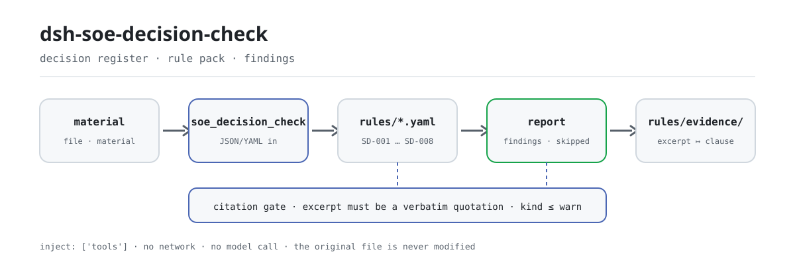

<div align="center">

<picture>
  <source media="(prefers-color-scheme: dark)" srcset="docs/assets/dsh-soe-decision-check-flow-dark.svg">
  
</picture>

# dsh-soe-decision-check

**«三重一大» निर्णय रजिस्टर को «कौन-सी पंक्ति, कौन-सा स्तंभ, क्या कम है» की सूची में बदलें — केवल अंतर, अनुपालन का फ़ैसला नहीं।**

राज्य उद्यमों के गवर्नेंस और अनुपालन कर्मचारियों के लिए DeepSeek Harness जाँचकर्ता: एक निर्णय रजिस्टर पढ़ता है — उद्यम का हेडर और प्रत्येक विषय की एक पंक्ति — संस्करण-युक्त नियम-पैक लागू करता है, और ऐसे निष्कर्ष लौटाता है जिन्हें पंक्ति-दर-पंक्ति ढूँढा और दोबारा जाँचा जा सके।

[इंस्टॉल](#तीन-चरणों-में-शुरुआत) · [कॉन्फ़िगरेशन](#कॉन्फ़िगरेशन) · [FAQ](#faq) · [简体中文](README.md) · [English](README.en.md) · [Español](README.es.md) · [Português](README.pt.md) · [हिन्दी](README.hi.md)

[](LICENSE)
[](#संगतता)
[](https://github.com/PerryLink/dsh-soe-decision-check/actions/workflows/ci.yml)
[](#संगतता)

[](https://github.com/PerryLink/dsh-soe-decision-check/stargazers)
[](https://dshfind.com/en/plugins/PerryLink/dsh-soe-decision-check?ref=badge)
[](https://securityscorecards.dev/viewer/?uri=github.com/PerryLink/dsh-soe-decision-check)
[](https://dsh.market/)
[](https://gitee.com/perrylink/dsh-soe-decision-check)

```sh
dsh plugin --profile <name> add dsh-soe-decision-check
```

</div>

<sub>समुदाय प्लगइन, DeepSeek से संबद्ध नहीं। केवल रेपो: <https://github.com/PerryLink/dsh-soe-decision-check> (Gitee एक मिरर है)।</sub>

## यह क्या है

`dsh-soe-decision-check` «三重一大» निर्णय रजिस्टर पढ़ता है — उद्यम का हेडर और प्रत्येक विषय की एक पंक्ति — और उसी रजिस्टर की प्रक्रियात्मक रिकॉर्ड-शृंखला जाँचता है: क्या प्रत्येक विषय अपनी प्रस्ताव-सामग्री या निर्णय-आधार दर्ज करता है, क्या पूर्व-अध्ययन किया हुआ चिह्नित विषय अध्ययन की तिथि दर्ज करता है, क्या अध्ययन की तिथि बैठक की तिथि के बाद नहीं है, क्या निर्णय दर्ज है और निर्णीत विषय मतदान परिणाम दर्ज करता है, क्या विषय-श्रेणी आपके द्वारा कॉन्फ़िगर किए गए मानों में से है, क्या रजिस्टर उद्यम और निर्णय लेने वाला निकाय घोषित करता है, और क्या विषय-क्रमांक अद्वितीय हैं।

«三重一大» (तीन महत्वपूर्ण और एक बड़ा) वही उद्यम-निर्णय श्रेणियाँ हैं जिन्हें नियम-पैक उद्धृत करता है: महत्वपूर्ण निर्णय, प्रमुख कार्मिक नियुक्तियाँ, प्रमुख परियोजनाएँ और बड़ी राशि की निधि-संचालन।

रजिस्टर जो पहले से कहता है, जाँचकर्ता उसे पंक्ति-दर-पंक्ति मिलाता है; जो रजिस्टर नहीं कहता, उसे न भरता है न अनुमान लगाता है। आउटपुट ऐसे निष्कर्षों की सूची है जिसमें `locator` (कौन-सी पंक्ति, कौन-सा फ़ील्ड), `found` (क्या पढ़ा गया), `expected` (क्या होना चाहिए था) और `fix` (क्या सुधारें) होते हैं, मानवीय पुनरीक्षण के लिए। शुद्ध ESM: कोई नेटवर्क नहीं, कोई मॉडल कॉल नहीं, और मूल फ़ाइल कभी नहीं बदलती।

## तीन चरणों में शुरुआत

1. **इंस्टॉल करें**:

   ```sh
   dsh plugin --profile <name> add dsh-soe-decision-check
   ```

   नवीनतम `main` या इस रेपो से बनाया गया tarball भी काम करता है:

   ```sh
   dsh plugin --profile web add github:PerryLink/dsh-soe-decision-check
   dsh plugin --profile web add ./dsh-soe-decision-check-<version>.tgz
   ```

   प्रकाशित प्रवेश-बिंदु `lib/index.mjs` है (`tsdown` का आर्टिफ़ैक्ट), और पैकेज के साथ `rules/`, `locale/` व `cordis.patch.yml` आते हैं।

2. **न्यूनतम कॉन्फ़िगरेशन** (डिफ़ॉल्ट चलते हैं; ज़रूरत पर नियम-पैक बदलें या कुछ नियम ही चलाएँ):

   ```yaml
   - insert:
       - id: dsh-soe-decision-check
         name: dsh-soe-decision-check
         config:
           rulesFile: rules/soe-decision-check.yaml
           disabledRules: []
   ```

3. **जाँचें कि यह माउंट हुआ**:

   ```sh
   dsh --profile <name> --dump-config | grep 'dsh-soe-decision-check'
   ```

   रेपो checkout में नमूना भी चला सकते हैं (`pnpm install` का `prepare` पहले `tsdown` चलाकर `lib/` बनाता है):

   ```sh
   node samples/quickstart/run.mjs
   ```

   ```text
   soe_decision_check: 1 issue(s) — error 0, warn 1, info 0
   skipped: 1
   ```

   नमूना `samples/quickstart/input/` में है और अपेक्षित परिणाम `samples/quickstart/expected/result.json` में; `skipped: 1` वह `SD-006` है — उसकी श्रेणी-सूची खाली मिलती है, इसलिए बिना कॉन्फ़िगर के वह स्वयं को skipped बताता है।

**अनइंस्टॉल**: `dsh plugin --profile <name> remove dsh-soe-decision-check` (या प्रोफ़ाइल patch से वह पंक्ति हटा दें)।

<details>
<summary>WorkBuddy / Coze से शुरू करें</summary>

WorkBuddy / Coze में «Documents and Governance Suite» (文书与治理核对包) खोजें — यह जाँच उसी समूह का एक हिस्सा है; उपलब्धता स्टोर में जैसी सूचीबद्ध हो वैसी है।

</details>

## मुख्य क्षमताएँ

एक टूल पंजीकृत करता है, `soe_decision_check`: एक रजिस्टर पढ़ो, संस्करण-युक्त नियम-पैक लगाओ, एक रिपोर्ट लौटाओ। नियम-पैक डेटा है, कोड नहीं — `rules/*.yaml` बदलने से TypeScript छुए बिना नियम-समुच्चय बदल जाता है।

### नियम तालिका

| नियम | क्या जाँचता है | स्तर | आधार प्रकार |
|---|---|---|---|
| `SD-001` | प्रत्येक विषय अपनी प्रस्ताव-सामग्री या निर्णय-आधार दर्ज करता है | warn | principle |
| `SD-002` | पूर्व-अध्ययन किया विषय अध्ययन की तिथि दर्ज करता है | warn | principle |
| `SD-003` | अध्ययन की तिथि बैठक की तिथि के बाद नहीं है | warn | principle |
| `SD-004` | निर्णय दर्ज है | warn | principle |
| `SD-005` | निर्णीत विषय मतदान परिणाम दर्ज करता है | warn | principle |
| `SD-006` | श्रेणी आपकी सूची से आती है (डिफ़ॉल्ट रूप से बंद) | info | principle |
| `SD-007` | रजिस्टर उद्यम और निर्णय लेने वाला निकाय घोषित करता है | warn | principle |
| `SD-008` | विषय-क्रमांक अद्वितीय हैं | warn | principle |

*आधार प्रकार `principle` नियम-पैक में `derived-from-principle` है: धारा आवश्यकता को सीधे नहीं कहती और जाँच सामान्य सिद्धांत पर टिकी है, इसलिए स्तर `error` से नीचे सीमित रहता है।*

### उदाहरण

ये प्लगइन की वास्तविक सतहें हैं; एक बार इंस्टॉल करें और एक चलाएँ।

**विस्तृत आउटपुट** — टूल `soe_decision_check`

**इनपुट**

```json
{"meetingAt":"2026-03-05","rows":[{"前置研究":"是","前置研究日期":"2026-03-10","会议日期":"2026-03-05"}]}
```

**आउटपुट**

```json
{
  "id": "dsh-soe-decision-check.SD-003.de09b5a6",
  "ruleId": "SD-003",
  "severity": "warn",
  "locator": {
    "row": 1,
    "field": "consultedAt"
  },
  "found": "第 1 行「consultedAt」为 2026-03-10，晚于 「meetingAt」的 2026-03-05",
  "expected": "「consultedAt」不应晚于 2026-03-05",
  "fix": "前置研究日期不应晚于会议审议日期；核对两个日期的填写"
}
```

*Observed from `dsh-soe-decision-check/tests/fixtures/SD-003/SD-003-unsafe.json`*

**संक्षिप्त उदाहरण**: `soe_decision_check` · `node samples/quickstart/run.mjs`

### यह किन सवालों का जवाब देता है

| आपका सवाल | इसका जवाब |
|---|---|
| किसी विषय में न प्रस्ताव-सामग्री भरी है न निर्णय-आधार। क्या कुछ बताया जाता है? | हाँ। `SD-001` उन दोनों में से कोई स्तंभ रखने वाली हर पंक्ति में कम से कम एक भरा होने की अपेक्षा करता है और दोनों खाली होने पर वह पंक्ति दर्ज करता है। यह केवल यह देखता है कि कम से कम एक भरा है, यह नहीं कि विषय «三重一大» के दायरे में है, और यह भी नहीं कि प्रक्रिया या अधिकार उपयुक्त थे। |
| रजिस्टर किसी विषय को पूर्व-अध्ययन किया हुआ बताता है, पर अध्ययन की तिथि खाली है। | `SD-002` रजिस्टर के अपने पूर्व-अध्ययन स्तंभ को पढ़ता है और तब वह पंक्ति दर्ज करता है जब उसका मान पूर्व-अध्ययन माना जाता हो और तिथि (`consultedAt`) खाली हो। कौन-से मान गिने जाएँ, यह नियम का `conditionValues` तय करता है (छह डिफ़ॉल्ट मान, कॉन्फ़िगरेशन में सूचीबद्ध)। यह देखता है कि तिथि भरी है, यह नहीं कि पूर्व-अध्ययन सारवान था या उसका निष्कर्ष अपनाया गया। ऐसा कोई मान किसी पंक्ति में न हो तो यह नियम चुपचाप पास होने के बजाय स्वयं को `skipped` में बताता है; रजिस्टर का शब्द अलग हो तो वह सूची बढ़ाएँ। |
| अध्ययन की तिथि बैठक की तिथि के बाद है, या तिथि के रूप में पढ़ी ही नहीं जा सकती। | `SD-003` अध्ययन की तिथि (`consultedAt`) की तुलना बैठक की तिथि (`meetingAt`) से करता है और अध्ययन की तिथि बाद की होने पर दर्ज करता है; एक ही दिन बाद का नहीं माना जाता। जो तिथि पढ़ी न जा सके, वह अलग से दर्ज होती है, चुपचाप छोड़ी नहीं जाती। यह केवल उन दो तिथियों की तुलना करता है, यह नहीं आँकता कि प्रक्रिया वास्तव में निभाई गई; निष्कर्ष का अर्थ आम तौर पर यह होता है कि दोनों में से एक तिथि गलत है, या वह पंक्ति किसी बाद की बैठक की है। |
| एक पंक्ति में निर्णय दर्ज नहीं है; दूसरी में निर्णय है पर मतदान परिणाम नहीं। | `SD-004` निर्णय स्तंभ (`decision`) को उन सभी पंक्तियों में अपेक्षित करता है जो वह स्तंभ रखती हैं, और `SD-005` तब मतदान स्तंभ (`voteResult`) केवल उन पंक्तियों में अपेक्षित करता है जहाँ निर्णय दर्ज है। इनमें से कोई यह नहीं जाँचता कि मत आवश्यक अनुपात तक पहुँचे; वह अनुपात आपके उद्यम के कार्यान्वयन नियमों में है और इस नियम में उसकी गणना नहीं होती — आसानी से पार हो चुका मतदान भी दर्ज हो सकता है, क्योंकि कमी बहुमत की नहीं, रिकॉर्ड की है। |
| मेरे रजिस्टर पर `SD-006` कभी कुछ नहीं बताता। | उसकी श्रेणी-सूची खाली मिलती है, इसलिए `values` कॉन्फ़िगर न होने पर `SD-006` चुपचाप पास होने के बजाय स्वयं को `skipped` में बताता है। अपनी विषय-श्रेणियाँ कॉन्फ़िगर करें तो यह केवल यह देखता है कि भरी हुई श्रेणी (`category`) सूची में है; यह नहीं तय करता कि विषय «三重一大» के दायरे में है। |
| एक ही विषय-क्रमांक दो पंक्तियों में आया है। | `SD-008` दोहराया गया `matterNo` दर्ज करता है (तुलना में रिक्त स्थान छोड़ दिए जाते हैं), क्योंकि दोहराव से कार्यवृत्त में विषय की सही पहचान नहीं हो पाती। एक ही विषय का कई बैठकों में विचार किया जाना सामान्य है: ऐसी पंक्तियों को क्रमांक दोहराने के बजाय बैठक क्रमांक से अलग दिखाएँ। यह नियम केवल अद्वितीयता देखता है। |

### सामग्री का प्रारूप

टूल JSON या YAML स्वीकार करता है (Excel को पहले इनमें से किसी एक में बदला जा सकता है — प्लेटफ़ॉर्म अनुमति दे तो चैट में भी):

```yaml
company: 某某集团有限公司
body: 党委会
meetingNo: 2026 年第 3 次
rows:
  - { 序号: '1', 决策事项: 某某技改项目立项, 事项类别: 重大项目安排,
      议题内容: 提请审议某某技改项目立项及投资概算,
      决策依据: 公司"三重一大"决策制度实施办法第 12 条, 涉及金额: 4800万元,
      前置研究: 是, 前置研究日期: 2026-02-20, 会议日期: 2026-03-05,
      决议结论: 同意立项，投资概算控制在 4800 万元以内,
      表决结果: 应到 9 人，实到 9 人，同意 9 票, 承办部门: 发展策划部 }
```

स्तंभ नाम बड़े/छोटे अक्षरों में भेद किए बिना, और रिक्त स्थान, अंडरस्कोर व हाइफ़न छोड़कर मिलाए जाते हैं; रजिस्टर के अपने स्तंभ नाम सुरक्षित रहते हैं, इसलिए हर निष्कर्ष उसी स्तंभ का नाम बताता है जिसे उसने पढ़ा। तिथियाँ `2026-03-05` या `2026-03-05 09:30` हो सकती हैं।

## यह किन मानकों पर आधारित है

| दस्तावेज़ | संख्यांक | इन्हें उद्धृत करने वाले नियम |
|---|---|---|
| 《关于进一步推进国有企业贯彻落实"三重一大"决策制度的意见》 | 中办发〔2010〕17号（中共中央办公厅、国务院办公厅印发；⚠️ 党内文件，非法律、行政法规或部门规章；全文分三部分，按（一）至（二十三）编号，不设"第X条"） | SD-001, SD-002, SD-003, SD-004, SD-005, SD-006, SD-007, SD-008 |

नियम-डेटा कोड से अलग है: प्रत्येक नियम में दस्तावेज़, संख्या, स्रोत की अपनी क्रमांकन-प्रणाली के अनुसार धारा, शब्दशः उद्धरण और स्रोत URL होता है। लोडर लागू करता है: उद्धरण कम से कम आठ अक्षरों का वास्तविक उद्धरण हो, और जिस जाँच का आधार केवल सामान्य सिद्धांत (`kind: derived-from-principle`, अधिकतम `warn`) या स्थानीय संस्थागत कॉन्फ़िगरेशन (`kind: institutional-configuration`, अधिकतम `info`) हो, उसे कभी `error` न कहा जाए। अपना आधार बढ़ा-चढ़ाकर बताने वाला नियम-पैक लोड पर विफल होता है, न कि झूठी-निश्चिंत रिपोर्ट बनाता है।

पैक का हेडर उद्धरण-अंतराल पूरा घोषित करता है, और प्रत्येक नियम का `note` उस नियम के लिए महत्वपूर्ण हिस्सा दोहराता है। लोड-समय की वह जाँच —कि उद्धरण कम से कम आठ अक्षरों का वास्तविक उद्धरण हो— उद्धरण और विवरण में भेद नहीं कर सकती; इसलिए यह पैक हेडर, प्रति-नियम notes और उस परीक्षण पर टिका है जो कहता है कि हर `excerpt` इस अंतराल को स्वीकार करता है।

सत्यापन के दौरान पुष्ट सीमाएँ और जान-बूझकर **न** कहे गए निष्कर्ष पैकेज के साथ आने वाले `rules/evidence/` निर्देशिका में दर्ज हैं।

## कॉन्फ़िगरेशन

सभी समायोज्य पैरामीटर `src/config.ts` की Schemastery स्कीमा में हैं और कोड बदले बिना `cordis.yml` से बदले जा सकते हैं; प्रति-जाँच सीमाएँ `rules/` के नियम-पैक में हैं। id के आधार पर ओवरराइड पूरी पंक्ति बदल देता है — ज़रूरी सभी कुंजियाँ दोबारा लिखें।

कुल 5 कुंजियाँ:

| कुंजी | डिफ़ॉल्ट | अर्थ |
|---|---|---|
| `rulesFile` | `rules/soe-decision-check.yaml` | नियम-पैक का पथ, पैकेज रूट के सापेक्ष |
| `disabledRules` | `[]` | बंद करने वाले नियम id; प्रत्येक `skipped` में दिखता है |
| `onlyRules` | `[]` | केवल ये नियम चलाएँ; खाली होने पर सभी नियम चलते हैं |
| `skipNotes` | `""` | हर `skipped` कारण के आगे जोड़ी जाने वाली टिप्पणी, जैसे अपने कार्यान्वयन नियमों का हवाला |
| `timeoutMs` | `120000` | उपकरण का सहकारी समय-सीमा बजट, मिलीसेकंड में |

<details>
<summary>पूरी कॉन्फ़िगरेशन तालिका (5 कुंजियाँ + प्रकार)</summary>

| कुंजी | प्रकार | डिफ़ॉल्ट | अर्थ |
|---|---|---|---|
| `rulesFile` | string | `rules/soe-decision-check.yaml` | नियम-पैक का पथ, पैकेज रूट के सापेक्ष |
| `disabledRules` | string[] | `[]` | बंद करने वाले नियम id; प्रत्येक `skipped` में दिखता है |
| `onlyRules` | string[] | `[]` | केवल ये नियम चलाएँ; खाली होने पर सभी नियम चलते हैं |
| `skipNotes` | string | `""` | हर `skipped` कारण के आगे जोड़ी जाने वाली टिप्पणी, जैसे अपने कार्यान्वयन नियमों का हवाला |
| `timeoutMs` | number | `120000` | उपकरण का सहकारी समय-सीमा बजट, मिलीसेकंड में |

</details>

प्रति-नियम पैरामीटर नियम-पैक में रहते हैं:

- `SD-002` `conditionValues` — आपके पूर्व-अध्ययन स्तंभ के वे मान जो विषय को पूर्व-अध्ययन मानते हैं; डिफ़ॉल्ट `[是, Y, yes, true, 已研究, √]`।
- `SD-005` `conditionField` / `requiredFields` — मतदान की अपेक्षा किससे शुरू होती है; डिफ़ॉल्ट निर्णय स्तंभ, जो मतदान स्तंभ माँगता है।
- `SD-006` `values` — आपकी विषय-श्रेणियाँ, जैसे `[重大决策, 重要人事任免, 重大项目安排, 大额度资金运作]`। खाली का अर्थ है कोई जाँच नहीं।
- `SD-007` `fields` — हेडर में अनिवार्य फ़ील्ड; डिफ़ॉल्ट उद्यम और निर्णय निकाय। यदि रजिस्टर हेडर में बैठक क्रमांक लिखता है तो `meetingNo` जोड़ें।

प्रोफ़ाइल patch में ओवरराइड का उदाहरण:

```yaml
- insert:
    - id: dsh-soe-decision-check
      name: dsh-soe-decision-check
      config:
        onlyRules: [SD-001, SD-002, SD-003]
        skipNotes: 本机构按实施细则第 12 条口径
```

## FAQ

<details>
<summary>क्या रजिस्टर बदला जाता है? डेटा कहाँ जाता है? कुछ अपलोड होता है?</summary>

टूल केवल वही सामग्री फ़ाइल पढ़ता है जो आप बताते हैं: कोई फ़ाइल नहीं लिखता, मूल नहीं बदलता, कोई नेटवर्क अनुरोध नहीं करता, किसी मॉडल को नहीं बुलाता और कोई क्रेडेंशियल नहीं रखता। `package.json#dsh.demo` में `reads` आपकी बताई सामग्री फ़ाइल, `writes` खाली और `network: false` घोषित है। रिपोर्ट उसी सत्र में लौटती है; कोई अतिरिक्त प्रति नहीं लिखी जाती।

</details>

<details>
<summary>अगर परिणाम खाली आया, तो क्या रजिस्टर ठीक है?</summary>

नहीं। खाली परिणाम का अर्थ केवल यह है कि बताने योग्य कोई शाब्दिक अंतर नहीं था; जो भी जाँच नहीं चल सकी वह अपने नियम id और कारण के साथ `skipped` में आती है। `SD-006` (खाली श्रेणी-सूची) और `SD-002` (कोई पंक्ति पूर्व-अध्ययन के रूप में चिह्नित नहीं) दोनों चुपचाप पास होने के बजाय स्वयं को `skipped` में बताते हैं — खाली परिणाम को कभी «कुछ ग़लत नहीं» नहीं पढ़ा जा सकता।

</details>

<details>
<summary>क्या यह अन्य प्लगइनों से टूल नाम, सर्विस कुंजी या slot के लिए टकराता है?</summary>

नहीं। प्लगइन ठीक एक टूल, `soe_decision_check`, पंजीकृत करता है; कोई कमांड नहीं, कोई सर्विस कुंजी नहीं, कोई क्लाइंट slot नहीं, कोई `webServer` प्रीफ़िक्स नहीं, और कोई सत्र-इवेंट नहीं देखता। बंडल patch केवल अपनी पंक्ति `insert` करता है। बिंदु-दर-बिंदु तर्क «अन्य DSH प्लगइनों के साथ इंटरऑपरेबिलिटी» में है।

</details>

<details>
<summary>प्रदर्शन पर कितना भार पड़ता है?</summary>

शुद्ध ESM, शून्य नेटवर्क, शून्य मॉडल कॉल: सामग्री की एक बार पढ़ाई, नियमों की पंक्ति-दर-पंक्ति एक तुलना, किसी बाहरी सेवा से कोई आना-जाना नहीं। पूरे वर्ष की बैठकों के लिए `ptc` टूल मोड चुनें, ताकि schema की लागत एक ही बार लगे।

</details>

<details>
<summary>इंस्टॉल हो गया पर टूल दिखता नहीं — या पैकेज असंगति कहकर अस्वीकार हो जाता है।</summary>

पहले जाँचें कि `main` `lib/index.mjs` पर जाता है और वह फ़ाइल बनी है; ग़लत `main` पर लोडर प्रविष्टि चुपचाप छोड़ देता है। अगर `dsh plugin add` पैकेज अस्वीकार करे, देखें कि runtime peer रेंज (`0.1.x` और `0.2.x` को कवर करती है) के भीतर है या नहीं; बाहर ही रखना हो तो स्पष्ट छूट दें: `dsh plugin --profile <name> allow-version dsh-soe-decision-check@<version> --dsh-version <runtime> --accept-risk`। यदि `check` में `manifest-peers` विफल दिखे, तो यह `dsh-plugin-dev` की ज्ञात अपस्ट्रीम समस्या है, जिसका स्थैतिक जाँचकर्ता कोडित peer रेंज से तुलना करता है; runtime इंस्टॉल के समय peer अनुकूलता लागू करता है।

</details>

## सुरक्षा सीमाएँ

- **केवल अंतर, कोई निर्णय नहीं।** रिपोर्ट अनुपालन, अधिकार-सीमा, राशि «बड़ी निधि-संचालन» सीमा तक पहुँचती है या नहीं, और कौन ज़िम्मेदार है — इन पर कभी निर्णय नहीं देती; यह सामग्री और उद्धृत धाराओं के बीच शाब्दिक अंतर गिनाती है, मानवीय पुनरीक्षण के लिए।
- **केवल पढ़ना।** टूल केवल आपकी बताई सामग्री फ़ाइल पढ़ता है: कोई फ़ाइल नहीं लिखता, मूल नहीं बदलता, कोई नेटवर्क अनुरोध नहीं करता, किसी मॉडल को नहीं बुलाता और कोई क्रेडेंशियल नहीं रखता।
- **खाली परिणाम पास नहीं है।** जो भी जाँच नहीं चल सकी वह अपने कारण के साथ `skipped` में आती है; जान-बूझकर बिना कॉन्फ़िगर छोड़ी गई जाँच (जैसे `SD-006`) चुपचाप पास होने के बजाय स्वयं को `skipped` में बताती है।
- **फेल क्लोज़्ड।** न `file` न `material`, या सामग्री पढ़ी न जा सके, या नियम-पैक न मिले — तो टूल त्रुटि देता है और जो-जो आज़माया वह बताता है; कभी खाली रिपोर्ट नहीं गढ़ता।
- **उद्धरण अनुशासन।** हर नियम का `excerpt` उसी धारा का शब्दशः उद्धरण है; जब शब्दशः पाठ उपलब्ध न हो, नियम अपने `kind` और `note` से यह बता देता है, और स्तर `error` से नीचे रहता है। पैक कभी धारा को पैराफ़्रेज़ करके उस पैराफ़्रेज़ को उद्धरण के रूप में प्रस्तुत नहीं करता।

## ज्ञात सीमाएँ

> ### ⚠️ यह प्लगइन जान-बूझकर क्या नहीं जानता
>
> **«三重一大» में क्या गिना जाए और कितनी राशि से, यह प्रत्येक उद्यम के अपने कार्यान्वयन नियम तय करते हैं** — और सीमाएँ उद्योग, स्तर व पैमाने के अनुसार अलग होती हैं। इसलिए यह प्लगइन **कोई राशि-सीमा और कोई विषय-सूची कोडित नहीं करता।** इसके बजाय:
>
> - `SD-002` यह तय करने के लिए रजिस्टर का **अपना पूर्व-अध्ययन स्तंभ** पढ़ता है कि किसी विषय को पूर्व-अध्ययन चाहिए था या नहीं, और «पूर्व-अध्ययन» माने जाने वाले मान कॉन्फ़िगर-योग्य हैं।
> - `SD-005` मतदान रिकॉर्ड **केवल तब** माँगता है जब निर्णय दर्ज हो, और यह **नहीं जाँचता कि मत आवश्यक अनुपात तक पहुँचे** — वह अनुपात कार्यान्वयन नियमों से आता है, और रजिस्टर उसकी गणना के लिए ज़रूरी quorum व मतदान नियम शायद ही दर्ज करता है।
> - `SD-006` की श्रेणी-सूची **खाली** मिलती है; कुछ भी कॉन्फ़िगर न हो तो वह स्वयं को `skipped` में बताता है।
>
> **इस नियम-पैक का हर `excerpt` उसी धारा का शब्दशः उद्धरण है, और उद्धरण-द्वार हर खंड को `rules/evidence/` के रिकॉर्ड से मिलाता है।** धारा जो कहती है, पैक वही शब्दशः कहता है, और जहाँ धारा केवल संकेत देती है वहाँ `warn` पर रुक जाता है: सामान्य सिद्धांत पर टिकी जाँच `error` से नीचे सीमित रहती है और अपने `note` में यह कहती है। पैक जो नहीं करेगा — किसी धारा को पैराफ़्रेज़ करके उस पैराफ़्रेज़ को उद्धरण बताना।
>
> एक और सीमा लिखने योग्य है: यह जाँचता है कि **रिकॉर्ड-शृंखला** मौजूद है। सही तिथि पर दर्ज अध्ययन यह सिद्ध नहीं करता कि पूर्व-अध्ययन सारवान था, और प्लगइन इस पर कोई निष्कर्ष नहीं देता।

- **केवल रिकॉर्ड, सार नहीं।** पूरी तिथियाँ और भरे स्तंभ यह सिद्ध नहीं करते कि निर्णय-प्रक्रिया वास्तव में निभाई गई; प्लगइन केवल वही बताता है जो रजिस्टर स्वयं पंक्ति-दर-पंक्ति दिखा सकता है।
- **कोई आनुपातिक बहुमत नहीं।** `SD-005` यह जाँचता है कि मतदान दर्ज है, यह नहीं कि वह आवश्यक अनुपात तक पहुँचा — उसके लिए quorum और मतदान नियम चाहिए, जो रजिस्टर शायद ही पूरे दर्ज करता है।
- **`SD-006` बॉक्स से बंद है।** श्रेणी-सूची आपकी संस्था से आती है; `values` कॉन्फ़िगर न होने पर वह स्वयं को `skipped` में बताती है, और प्लगइन कोई विषय-सूची या राशि-सीमा कोडित नहीं करता।
- **`SD-002` रजिस्टर के अपने मानों पर निर्भर है।** जब कोई पंक्ति `conditionValues` का कोई मान न रखे, नियम स्वयं को `skipped` में बताता है; रजिस्टर का शब्द अलग हो तो वह सूची बढ़ाएँ।
- **वॉल-क्लॉक समय।** सभी तिथि तुलनाएँ इनपुट स्ट्रिंग पर वॉल-क्लॉक गणना हैं, कोई टाइमज़ोन रूपांतरण नहीं।
- **केवल Linux पर मापा गया।** यह शुद्ध ESM है, कोई नेटिव कोड नहीं, और किसी भी Node 22.19+ पर चलता है; वास्तव में जाँचा गया वातावरण केवल Linux है।

## अन्य DSH प्लगइनों के साथ इंटरऑपरेबिलिटी

**DSH `0.2.0-rc.2`** (वह runtime जिसके लिए यह README प्रकाशित है) और इस रेपो के कोड के विरुद्ध सत्यापित। प्लगइन एक टूल पंजीकृत करता है और किसी अन्य प्लगइन-सतह को नहीं छूता:

- **कोई टूल-नाम टकराव नहीं।** एकमात्र टूल नाम `soe_decision_check` इसी प्लगइन का है और किसी अंतर्निहित या तीसरे पक्ष के टूल से नहीं टकराता।
- **कोई सर्विस-की टकराव नहीं।** यह कोई सर्विस key प्रदान नहीं करता, इसलिए टकराव संभव नहीं।
- **कोई स्लॉट टकराव नहीं।** यह कोई क्लाइंट slot key पंजीकृत नहीं करता, इसलिए `shadows-shipped-ui` सीट के लिए प्रतिस्पर्धा नहीं करता।
- **कोई HTTP रूट टकराव नहीं।** यह कोई `webServer` प्रीफ़िक्स पंजीकृत नहीं करता।
- **कोई इवेंट-शृंखला टकराव नहीं।** यह कोई सत्र-इवेंट नहीं देखता (कोई `ctx.on` नहीं), इसलिए शॉर्ट-सर्किट करने योग्य कोई साझा इवेंट-शृंखला नहीं; पंजीकरण स्वयं एक Cordis effect है जो अनलोड या हॉट-रिलोड पर हट जाता है।
- **कोई patch-लेयर टकराव नहीं।** बंडल patch केवल अपनी पंक्ति `insert` करता है; कभी किसी अंतर्निहित पंक्ति का `config` ओवरराइड नहीं करता।
- **कोई वैश्विक परिवर्तन नहीं।** यह प्रोटोटाइप नहीं बदलता, `process.env` नहीं लिखता, और वैश्विक fetch dispatcher प्रतिस्थापित नहीं करता।

प्लगइन `inject: ['tools']` घोषित करता है: `tools` सेवा के बिना वह शुरू ही नहीं होता, इसलिए आधा-पंजीकृत listener या timer पीछे नहीं छोड़ता।

## संगतता

| सतह | स्थिति |
|---|---|
| Harness | `engines.dsh` `>=0.2.1-0 <0.3.0` है, 0.2.1 से host इसे लागू करता है; peer रेंज `>=0.1.2-rc.1 <0.2.0 \|\| >=0.2.0-0 <0.3.0` है, जिसे `0.2.0-rc.2` और `0.2.1-rc.2` दोनों स्वीकारते मापा गया |
| Node | `^22.19.0 \|\| >=24.0.0` |
| प्लेटफ़ॉर्म | कोई भी host जो Node 22.19+ पर शुद्ध ESM चलाए; कोई नेटिव कोड नहीं, कोई नेटवर्क नहीं, कोई मॉडल कॉल नहीं। केवल Linux पर परीक्षित |
| टूल मोड | `native` और `ptc` दोनों में चलता है; पूरे वर्ष की बैठकों के लिए `ptc`, ताकि schema लागत एक बार लगे |

## इकोसिस्टम और गुणवत्ता

- [Gitee मिरर](https://gitee.com/perrylink/dsh-soe-decision-check) (सिंक मिरर; GitHub कैनोनिकल है)
- [dshfind प्लगइन पेज](https://dshfind.com/en/plugins/PerryLink/dsh-soe-decision-check) (इंस्टॉल और रैंकिंग)
- [OpenSSF Scorecard रिपोर्ट](https://securityscorecards.dev/viewer/?uri=github.com/PerryLink/dsh-soe-decision-check) ([.github/workflows/scorecard.yml](.github/workflows/scorecard.yml) द्वारा संचालित)
- [DSH Market](https://dsh.market/) (सूचीबद्ध)
- [सामग्री के अनुसार जाँचकर्ता चुनें](https://perrylink.github.io/zh/checkers/choose/) (उस जाँचकर्ता-परिवार का चयन-सूचकांक जिसका यह रेपो हिस्सा है)

## डेवलपमेंट

```sh
pnpm install                                              # node ^22.19 || >=24; prepare tsdown चलाता है
pnpm run typecheck                                        # tsc --noEmit
pnpm test                                                 # vitest: साझा टेबल-प्लगइन सूट + प्रति-नियम युग्मित fixtures
pnpm run build                                            # tsdown -> lib/index.mjs + lib/index.d.mts
pnpm run check:readmes                                    # README संगति द्वार (चीनी स्रोत ↔ अंग्रेज़ी)
node ../scripts/sync-shared.mjs dsh-soe-decision-check    # ../_shared का साझा किट src/shared/ में कॉपी करें
```

प्रकाशन-पूर्व द्वार: `pnpm run typecheck && pnpm test && pnpm run build && pnpm run verify:self-contained && pnpm run check:lockfile && pnpm run check:readmes`.

प्लगइन **data-only** है: `src/model.ts` तालिका का आकार घोषित करता है, साझा किट पढ़ने वाला और जाँच-इंजन देता है, और नियम-पैक हर जाँच घोषित करता है। README की छवियाँ [`scripts/gen-readme-assets.py`](scripts/gen-readme-assets.py) (Python + Pillow) से प्रोग्रामेटिक रूप में बनती हैं और सुरक्षित रूप से दोबारा चलाई जा सकती हैं।

Topics: `deepseek-harness`, `dsh`, `dsh-plugin`, `cordis`, `soe`, `decision`

## परिवार और आभार

यह प्रोजेक्ट [PerryLink](https://github.com/PerryLink) के DeepSeek Harness प्लगइन परिवार का हिस्सा है (सभी Apache-2.0)। अगर यह उपयोगी लगे, तो **एक स्टार अगले व्यक्ति को इसे खोजने में मदद करता है** — इसके पीछे कुछ भी लॉक नहीं है।

- [@PerryLink](https://github.com/PerryLink) — निर्माता और रखरखावकर्ता: नियम-पैक (8 नियम और `rules/evidence/` उद्धरण-सत्यापन रिकॉर्ड), साझा जाँच-इंजन, और पाँच-भाषा दस्तावेज़।

पूरी सूची (62 जाँचकर्ता + सामान्य प्लगइन): [सामग्री के अनुसार जाँचकर्ता चुनें](https://perrylink.github.io/zh/checkers/choose/) · [सभी प्लगइन](https://github.com/PerryLink)। यह रेपो उनमें से एक है।

<details>
<summary>सभी प्लगइन खोलें</summary>

| प्लगइन | स्थिति |
|---|---|
| **[dsh-aqua-input-check](https://github.com/PerryLink/dsh-aqua-input-check)** |  |
| **[dsh-archive-check](https://github.com/PerryLink/dsh-archive-check)** |  |
| **[dsh-auto-review](https://github.com/PerryLink/dsh-auto-review)** |  |
| **[dsh-autotier](https://github.com/PerryLink/dsh-autotier)** | 🧊 फ़्रोज़न — रेपो README देखें |
| **[dsh-bid-ca-precheck](https://github.com/PerryLink/dsh-bid-ca-precheck)** |  |
| **[dsh-bid-qual-check](https://github.com/PerryLink/dsh-bid-qual-check)** |  |
| **[dsh-cert-mcp](https://github.com/PerryLink/dsh-cert-mcp)** | 🧊 फ़्रोज़न — रेपो README देखें |
| **[dsh-checkpoint-rewind](https://github.com/PerryLink/dsh-checkpoint-rewind)** |  |
| **[dsh-click](https://github.com/PerryLink/dsh-click)** |  |
| **[dsh-composer-history](https://github.com/PerryLink/dsh-composer-history)** |  |
| **[dsh-contract-stance](https://github.com/PerryLink/dsh-contract-stance)** |  |
| **[dsh-customs-doc-check](https://github.com/PerryLink/dsh-customs-doc-check)** |  |
| **[dsh-data-quality](https://github.com/PerryLink/dsh-data-quality)** | 🧊 फ़्रोज़न — रेपो README देखें |
| **[dsh-demurrage-ledger](https://github.com/PerryLink/dsh-demurrage-ledger)** |  |
| **[dsh-doublecheck](https://github.com/PerryLink/dsh-doublecheck)** |  |
| **[dsh-drill-script-check](https://github.com/PerryLink/dsh-drill-script-check)** |  |
| **[dsh-eia-guide-check](https://github.com/PerryLink/dsh-eia-guide-check)** |  |
| **[dsh-emergency-plan](https://github.com/PerryLink/dsh-emergency-plan)** |  |
| **[dsh-essay-rubric-check](https://github.com/PerryLink/dsh-essay-rubric-check)** |  |
| **[dsh-evidence-check](https://github.com/PerryLink/dsh-evidence-check)** |  |
| **[dsh-export-ctl-check](https://github.com/PerryLink/dsh-export-ctl-check)** |  |
| **[dsh-fast](https://github.com/PerryLink/dsh-fast)** |  |
| **[dsh-fmea-table-check](https://github.com/PerryLink/dsh-fmea-table-check)** |  |
| **[dsh-forecast-penalty](https://github.com/PerryLink/dsh-forecast-penalty)** |  |
| **[dsh-fund-research](https://github.com/PerryLink/dsh-fund-research)** |  |
| **[dsh-github](https://github.com/PerryLink/dsh-github)** |  |
| **[dsh-gongwen-flow-check](https://github.com/PerryLink/dsh-gongwen-flow-check)** |  |
| **[dsh-gongwen-word-check](https://github.com/PerryLink/dsh-gongwen-word-check)** |  |
| **[dsh-guard-plan-qc](https://github.com/PerryLink/dsh-guard-plan-qc)** |  |
| **[dsh-hazchem-check](https://github.com/PerryLink/dsh-hazchem-check)** |  |
| **[dsh-hazplan-check](https://github.com/PerryLink/dsh-hazplan-check)** |  |
| **[dsh-hidden-risk-map](https://github.com/PerryLink/dsh-hidden-risk-map)** |  |
| **[dsh-hs-classify](https://github.com/PerryLink/dsh-hs-classify)** |  |
| **[dsh-icd-rule-check](https://github.com/PerryLink/dsh-icd-rule-check)** |  |
| **[dsh-industry-research](https://github.com/PerryLink/dsh-industry-research)** |  |
| **[dsh-lawcite-adapter](https://github.com/PerryLink/dsh-lawcite-adapter)** |  |
| **[dsh-laya](https://github.com/PerryLink/dsh-laya)** |  |
| **[dsh-lc-doc-check](https://github.com/PerryLink/dsh-lc-doc-check)** |  |
| **[dsh-learning-gap-check](https://github.com/PerryLink/dsh-learning-gap-check)** |  |
| **[dsh-library](https://github.com/PerryLink/dsh-library)** |  |
| **[dsh-local-ai](https://github.com/PerryLink/dsh-local-ai)** |  |
| **[dsh-lsp-actions](https://github.com/PerryLink/dsh-lsp-actions)** |  |
| **[dsh-mask](https://github.com/PerryLink/dsh-mask)** |  |
| **[dsh-mcp-panel](https://github.com/PerryLink/dsh-mcp-panel)** |  |
| **[dsh-medrec-qc](https://github.com/PerryLink/dsh-medrec-qc)** |  |
| **[dsh-memento](https://github.com/PerryLink/dsh-memento)** | 🧊 फ़्रोज़न — रेपो README देखें |
| **[dsh-nsfc-form-check](https://github.com/PerryLink/dsh-nsfc-form-check)** |  |
| **[dsh-nurse-record-check](https://github.com/PerryLink/dsh-nurse-record-check)** |  |
| **[dsh-observe](https://github.com/PerryLink/dsh-observe)** |  |
| **[dsh-origin-rvc-check](https://github.com/PerryLink/dsh-origin-rvc-check)** |  |
| **[dsh-ota-review-check](https://github.com/PerryLink/dsh-ota-review-check)** |  |
| **[dsh-output-styles](https://github.com/PerryLink/dsh-output-styles)** |  |
| **[dsh-paper-doc-adapter](https://github.com/PerryLink/dsh-paper-doc-adapter)** |  |
| **[dsh-permission-rules](https://github.com/PerryLink/dsh-permission-rules)** |  |
| **[dsh-permit-report-check](https://github.com/PerryLink/dsh-permit-report-check)** |  |
| **[dsh-pipeline-check](https://github.com/PerryLink/dsh-pipeline-check)** |  |
| **[dsh-pleading-draft](https://github.com/PerryLink/dsh-pleading-draft)** |  |
| **[dsh-plugin-doctor](https://github.com/PerryLink/dsh-plugin-doctor)** | 🚫 रिटायर्ड (रेपो संग्रहीत) |
| **[dsh-plugin-guide](https://github.com/PerryLink/dsh-plugin-guide)** |  |
| **[dsh-plugin-kit](https://github.com/PerryLink/dsh-plugin-kit)** | 🚫 रिटायर्ड (रेपो संग्रहीत) |
| **[dsh-plugin-upgrade](https://github.com/PerryLink/dsh-plugin-upgrade)** | 🚫 रिटायर्ड (रेपो संग्रहीत) |
| **[dsh-policy-brief-draft](https://github.com/PerryLink/dsh-policy-brief-draft)** |  |
| **[dsh-power-loss-split](https://github.com/PerryLink/dsh-power-loss-split)** |  |
| **[dsh-power-ticket-check](https://github.com/PerryLink/dsh-power-ticket-check)** |  |
| **[dsh-ppap-check](https://github.com/PerryLink/dsh-ppap-check)** |  |
| **[dsh-protest-deadline](https://github.com/PerryLink/dsh-protest-deadline)** |  |
| **[dsh-railway-window](https://github.com/PerryLink/dsh-railway-window)** |  |
| **[dsh-repair-order-qc](https://github.com/PerryLink/dsh-repair-order-qc)** |  |
| **[dsh-research-report](https://github.com/PerryLink/dsh-research-report)** |  |
| **[dsh-review-reply-check](https://github.com/PerryLink/dsh-review-reply-check)** |  |
| **[dsh-rulefile-check](https://github.com/PerryLink/dsh-rulefile-check)** |  |
| **[dsh-safety-brief-check](https://github.com/PerryLink/dsh-safety-brief-check)** |  |
| **[dsh-score](https://github.com/PerryLink/dsh-score)** | 🧊 फ़्रोज़न — रेपो README देखें |
| **[dsh-session-sync](https://github.com/PerryLink/dsh-session-sync)** |  |
| **[dsh-site-log-check](https://github.com/PerryLink/dsh-site-log-check)** |  |
| **[dsh-skill-pack-security](https://github.com/PerryLink/dsh-skill-pack-security)** |  |
| **[dsh-soe-decision-check](https://github.com/PerryLink/dsh-soe-decision-check)** |  |
| **[dsh-soilwater-check](https://github.com/PerryLink/dsh-soilwater-check)** |  |
| **[dsh-sop-sync-check](https://github.com/PerryLink/dsh-sop-sync-check)** |  |
| **[dsh-spc-gbt-adapter](https://github.com/PerryLink/dsh-spc-gbt-adapter)** |  |
| **[dsh-talk](https://github.com/PerryLink/dsh-talk)** |  |
| **[dsh-tender-extract](https://github.com/PerryLink/dsh-tender-extract)** |  |
| **[dsh-tender-matrix](https://github.com/PerryLink/dsh-tender-matrix)** |  |
| **[dsh-test-drive](https://github.com/PerryLink/dsh-test-drive)** |  |
| **[dsh-ticktick](https://github.com/PerryLink/dsh-ticktick)** | 🚫 रिटायर्ड (रेपो संग्रहीत) |
| **[dsh-translate](https://github.com/PerryLink/dsh-translate)** |  |
| **[dsh-warranty-calc](https://github.com/PerryLink/dsh-warranty-calc)** |  |
| **[dsh-budget](https://github.com/PerryLink/dsh-budget)** | 🧊 फ़्रोज़न — रेपो README देखें |
| **[dsh-claude-move](https://github.com/PerryLink/dsh-claude-move)** | 🧊 फ़्रोज़न — रेपो README देखें |
| **[dsh-defend](https://github.com/PerryLink/dsh-defend)** | 🧊 फ़्रोज़न — रेपो README देखें |
| **[dsh-draw](https://github.com/PerryLink/dsh-draw)** | 🧊 फ़्रोज़न — रेपो README देखें |
| **[dsh-reach](https://github.com/PerryLink/dsh-reach)** | 🧊 फ़्रोज़न — रेपो README देखें |
| **[dsh-background-agents](https://github.com/PerryLink/dsh-background-agents)** | 🚫 रिटायर्ड (रेपो संग्रहीत) |
| **[dsh-session-pin](https://github.com/PerryLink/dsh-session-pin)** | 🚫 रिटायर्ड (रेपो संग्रहीत) |
| **[dsh-team-rooms](https://github.com/PerryLink/dsh-team-rooms)** | 🚫 रिटायर्ड (रेपो संग्रहीत) |

</details>

## लाइसेंस

[LICENSE](LICENSE) (Apache License 2.0) © 2026 dsh-soe-decision-check contributors

<p align="center"><sub>Apache-2.0 · समुदाय प्लगइन, DeepSeek से संबद्ध नहीं।</sub></p>
