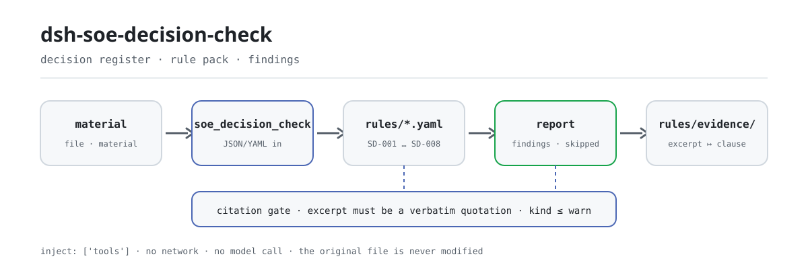

<div align="center">

<picture>
  <source media="(prefers-color-scheme: dark)" srcset="docs/assets/dsh-soe-decision-check-flow-dark.svg">
  
</picture>

# dsh-soe-decision-check

**把一份「三重一大」决策台账逐行核对成「哪一行、哪一栏、差什么」的清单——只列差异，不判合规。**

面向国企、事业单位办公室与纪检的 DeepSeek Harness 核对插件：读取企业表头加每个议题一行，按版本化规则库核对程序留痕，输出可定位、可逐条复核的发现。

[安装](#三步上手) · [配置](#配置) · [FAQ](#faq) · [简体中文](README.md) · [English](README.en.md) · [Español](README.es.md) · [Português](README.pt.md) · [हिन्दी](README.hi.md)

[](LICENSE)
[](#兼容性)
[](https://github.com/PerryLink/dsh-soe-decision-check/actions/workflows/ci.yml)
[](#兼容性)

[](https://github.com/PerryLink/dsh-soe-decision-check/stargazers)
[](https://dshfind.com/en/plugins/PerryLink/dsh-soe-decision-check?ref=badge)
[](https://securityscorecards.dev/viewer/?uri=github.com/PerryLink/dsh-soe-decision-check)
[](https://dsh.market/)
[](https://gitee.com/perrylink/dsh-soe-decision-check)

```sh
dsh plugin --profile <name> add dsh-soe-decision-check
```

</div>

<sub>社区插件，与 DeepSeek 官方无关。唯一仓库：<https://github.com/PerryLink/dsh-soe-decision-check>（Gitee 为镜像）。</sub>

## 它是什么

`dsh-soe-decision-check` 读取一份「三重一大」决策事项台账——企业表头加每个议题一行——核对这份台账自身的程序留痕：每个议题是否记录了议题内容或决策依据、标注为经前置研究的议题是否记录了研究日期、前置研究日期是否不晚于会议审议日期、是否记录了决议结论、已决议的议题是否记录了表决结果、事项类别是否出自你配置的取值口径、台账是否声明企业与决策机构、议题序号是否唯一。

台账里已经写明的东西，它逐条核对；台账里没有的东西，它不补、不猜。输出是一份带 `locator`（第几行、哪一栏）、`found`（读到了什么）、`expected`（本应是什么）、`fix`（改哪里）的清单，供人工复核。纯 ESM：无联网、不调用模型、不改原件。

## 三步上手

1. **安装**：

   ```sh
   dsh plugin --profile <name> add dsh-soe-decision-check
   ```

   也可以从 git 最新 main 或本仓库打出的 tarball 安装：

   ```sh
   dsh plugin --profile web add github:PerryLink/dsh-soe-decision-check
   dsh plugin --profile web add ./dsh-soe-decision-check-<version>.tgz
   ```

   发布内容为 `lib/index.mjs`（`tsdown` 构建产物），随包带 `rules/`、`locale/` 与 `cordis.patch.yml`。

2. **最小配置**（默认即可用；按需切换规则库或只跑部分规则）：

   ```yaml
   - insert:
       - id: dsh-soe-decision-check
         name: dsh-soe-decision-check
         config:
           rulesFile: rules/soe-decision-check.yaml
           disabledRules: []
   ```

3. **验证已生效**：

   ```sh
   dsh --profile <name> --dump-config | grep 'dsh-soe-decision-check'
   ```

   在仓库 checkout 里还能直接跑样例（`pnpm install` 的 `prepare` 会先构建 `lib/`）：

   ```sh
   node samples/quickstart/run.mjs
   ```

   ```text
   soe_decision_check: 1 issue(s) — error 0, warn 1, info 0
   skipped: 1
   ```

   样例在 `samples/quickstart/input/`，期望输出在 `samples/quickstart/expected/result.json`；`skipped: 1` 是 `SD-006`——类别取值出厂为空，未配置时它报告自己进入 `skipped`。

**卸载**：`dsh plugin --profile <name> remove dsh-soe-decision-check`（或从 profile patch 删掉该行）。

<details>
<summary>从 WorkBuddy / 扣子进入</summary>

在 WorkBuddy / 扣子搜索「文书与治理核对包」——本检查是其中一项，上架以商城为准。

</details>

## 核心能力

注册一个工具 `soe_decision_check`：读一份台账，套一个版本化规则库，回一份报告。规则库是数据不是代码——替换 `rules/*.yaml` 即可切换规则集，无需改动 TypeScript。

### 规则表

| 规则 | 核对什么 | 级别 | 依据类型 |
|---|---|---|---|
| `SD-001` | 每个议题记录议题内容或决策依据 | warn | principle |
| `SD-002` | 经前置研究的议题记录研究日期 | warn | principle |
| `SD-003` | 前置研究日期不晚于会议审议日期 | warn | principle |
| `SD-004` | 记录了决议结论 | warn | principle |
| `SD-005` | 已决议的议题记录表决结果 | warn | principle |
| `SD-006` | 事项类别出自你的取值口径（默认关闭） | info | principle |
| `SD-007` | 台账声明企业与决策机构 | warn | principle |
| `SD-008` | 议题序号唯一 | warn | principle |

*依据类型 `principle` 即规则库里的 `derived-from-principle`：条款未直接规定、只能由原则性条款推出，严重级因此封顶在 `error` 之下。*

### 示例

以下为插件真实入口；安装后调用一次即可。

**详细输出** — 工具 `soe_decision_check`

**输入**

```json
{"meetingAt":"2026-03-05","rows":[{"前置研究":"是","前置研究日期":"2026-03-10","会议日期":"2026-03-05"}]}
```

**输出**

```json
{
  "id": "dsh-soe-decision-check.SD-003.de09b5a6",
  "ruleId": "SD-003",
  "severity": "warn",
  "locator": {
    "row": 1,
    "field": "consultedAt"
  },
  "found": "第 1 行「consultedAt」为 2026-03-10，晚于 「meetingAt」的 2026-03-05",
  "expected": "「consultedAt」不应晚于 2026-03-05",
  "fix": "前置研究日期不应晚于会议审议日期；核对两个日期的填写"
}
```

*Observed from `dsh-soe-decision-check/tests/fixtures/SD-003/SD-003-unsafe.json`*

**简短示例**：`soe_decision_check` · `node samples/quickstart/run.mjs`

### 你会问

| 你会问 | 它怎么答 |
|---|---|
| 某个议题的议题内容与决策依据都没有填写，会被报出吗？ | 会。`SD-001` 要求携带这两栏中任一栏的行至少填写一项，两项皆空即报出该行。它只核对是否至少填了一项，不判断该事项是否属于「三重一大」范围，也不判断决策程序与权限是否适当。 |
| 台账标了「已经前置研究」，但前置研究日期空着。 | `SD-002` 读取台账自己的前置研究栏，取值属于「已研究」而研究日期（`consultedAt`）为空时逐行报出。哪些取值算「已研究」由本条的 `conditionValues` 规定（默认为 是、Y、yes、true、已研究、√）。它只核对日期栏是否填写，不判断前置研究是否实质开展、结论是否被采纳；没有任何一行取到这类值时，本条报告自己进入 `skipped`，而不是静默通过。台账用词不同就调整该列表。 |
| 前置研究日期晚于会议日期，或者根本读不成日期。 | `SD-003` 比较研究日期（`consultedAt`）与会议日期（`meetingAt`），研究日期晚于会议即报出；同一天视为不晚于。无法解析的日期会单独报出，不会静默跳过。它只比较这两个日期，不判断该程序是否实质履行；报出时通常是两个日期有一个填错，或该行属于另一次会议。 |
| 有一行没有决议结论，另有一行有决议结论却没有表决结果。 | `SD-004` 要求携带决议结论栏（`decision`）的行都填写，`SD-005` 只在已填写决议结论的行上要求表决结果栏（`voteResult`）。两条都不核对票数是否达到规定的通过比例——比例出自本企业实施办法，本条不作计算；表决顺利通过却仍被报出，说明缺的是「记录」而不是「通过」。 |
| `SD-006` 在我的台账上从来不报任何东西。 | 它的类别取值出厂为空，未配置 `values` 时 `SD-006` 报告自己进入 `skipped`，而不是静默通过。配置本机构的事项类别后，它只核对已填写的类别（`category`，事项类别）是否在册，不判断该事项是否属于「三重一大」范围。 |
| 序号在两行上重复出现。 | `SD-008` 会报出重复的 `matterNo`（比较时忽略空白字符），因为序号重复会让人无法在会议记录中准确指认议题。同一议题在多次会议中审议属于正常情形：请在会议届次上加以区分，不要复用序号。本条只核对唯一性。 |

### 材料格式

工具接受 JSON 或 YAML（Excel 可先转成两者之一；平台支持时，对话里也能代转）：

```yaml
company: 某某集团有限公司
body: 党委会
meetingNo: 2026 年第 3 次
rows:
  - { 序号: '1', 决策事项: 某某技改项目立项, 事项类别: 重大项目安排,
      议题内容: 提请审议某某技改项目立项及投资概算,
      决策依据: 公司"三重一大"决策制度实施办法第 12 条, 涉及金额: 4800万元,
      前置研究: 是, 前置研究日期: 2026-02-20, 会议日期: 2026-03-05,
      决议结论: 同意立项，投资概算控制在 4800 万元以内,
      表决结果: 应到 9 人，实到 9 人，同意 9 票, 承办部门: 发展策划部 }
```

栏名匹配不区分大小写，并忽略空格、下划线与连字符；发现里保留台账自己的栏名，因此每条发现都会写明它读的是哪一栏。日期可写 `2026-03-05` 或 `2026-03-05 09:30`。

## 依据的标准

| 文件 | 文号 | 引用它的规则 |
|---|---|---|
| 《关于进一步推进国有企业贯彻落实"三重一大"决策制度的意见》 | 中办发〔2010〕17号（中共中央办公厅、国务院办公厅印发；⚠️ 党内文件，非法律、行政法规或部门规章；全文分三部分，按（一）至（二十三）编号，不设"第X条"） | SD-001, SD-002, SD-003, SD-004, SD-005, SD-006, SD-007, SD-008 |

规则数据与代码分离，每条规则都带文件名、文号、按原文自身编号体系的条款号、逐字摘录与来源地址。加载期强制：摘录必须是真实引文且不少于八个字符；依据仅为原则性条款（`kind: derived-from-principle`，严重级上限 `warn`）或本机构配置（`kind: institutional-configuration`，上限 `info`）的检查不得标为 `error`。夸大依据的规则库会在加载期失败，而不会产出一份看起来很有底气的报告。

规则库的头部声明了完整的引文缺口，每条规则的 `note` 重复该条最要紧的那部分。加载期那道「摘录必须是不少于八个字符的真实引文」的校验分辨不出引文与描述——因此这份规则库依靠头部、逐条 `note`，以及一条断言「每条 `excerpt` 都承认该缺口」的测试。

核验中确认的边界与「刻意没有作出的结论」见随包的 `rules/evidence/` 目录。

## 配置

全部可调参数都在 `src/config.ts` 的 Schemastery schema 中，只改 `cordis.yml` 即可生效，无需改代码；逐条阈值在 `rules/` 下的规则库文件里。按 id 覆盖会替换整行——请重述所有需要的键。

全部 5 个键：

| 键 | 默认值 | 含义 |
|---|---|---|
| `rulesFile` | `rules/soe-decision-check.yaml` | 规则库文件路径，相对插件包根目录 |
| `disabledRules` | `[]` | 要停用的规则 id 列表；每条都会出现在 `skipped` 中 |
| `onlyRules` | `[]` | 只执行这些规则 id；留空表示执行全部规则 |
| `skipNotes` | `""` | 附加到每条 `skipped` 说明后的备注，例如标注本机构实施细则 |
| `timeoutMs` | `120000` | 工具协作式超时预算（毫秒） |

<details>
<summary>完整配置表（5 个键 + 类型）</summary>

| 键 | 类型 | 默认值 | 含义 |
|---|---|---|---|
| `rulesFile` | string | `rules/soe-decision-check.yaml` | 规则库文件路径，相对插件包根目录 |
| `disabledRules` | string[] | `[]` | 要停用的规则 id 列表；每条都会出现在 `skipped` 中 |
| `onlyRules` | string[] | `[]` | 只执行这些规则 id；留空表示执行全部规则 |
| `skipNotes` | string | `""` | 附加到每条 `skipped` 说明后的备注，例如标注本机构实施细则 |
| `timeoutMs` | number | `120000` | 工具协作式超时预算（毫秒） |

</details>

规则级参数写在规则库文件里：

- `SD-002` `conditionValues` —— 台账「前置研究」栏里算作「已研究」的取值，默认 `[是, Y, yes, true, 已研究, √]`。
- `SD-005` `conditionField` / `requiredFields` —— 什么触发表决要求；默认由决议结论栏触发，要求表决结果栏。
- `SD-006` `values` —— 本机构的事项类别，例如 `[重大决策, 重要人事任免, 重大项目安排, 大额度资金运作]`；留空表示不检查。
- `SD-007` `fields` —— 表头必须出现的字段，默认企业与决策机构；若台账在表头记录会议届次，把 `meetingNo` 加进去。

profile patch 覆盖示例：

```yaml
- insert:
    - id: dsh-soe-decision-check
      name: dsh-soe-decision-check
      config:
        onlyRules: [SD-001, SD-002, SD-003]
        skipNotes: 本机构按实施细则第 12 条口径
```

## FAQ

<details>
<summary>台账会不会被改？数据存哪、会不会上传？</summary>

工具只读你指定的材料文件：不写文件、不改原件、不联网、不调用模型、不存凭据。`package.json#dsh.demo` 的 `reads` 是「用户指定的材料文件」、`writes` 为空、`network: false`。报告只在本次会话里返回，没有额外的落盘副本。

</details>

<details>
<summary>结果为空，是不是就说明这份台账没问题？</summary>

不是。空结果只说明没有可报的字面差异；跑不起来的检查会逐条进入 `skipped` 并写明规则 id 与原因。`SD-006` 类别取值出厂为空、`SD-002` 没有任何一行标为「已研究」时，都会报告自己进入 `skipped`，而不是静默通过——空结果永远不能读作「没有违规」。

</details>

<details>
<summary>会和其他插件抢工具名、服务键或 slot 吗？</summary>

不会。插件只注册一个工具 `soe_decision_check`，不注册命令、不提供服务键、不注册客户端 slot、不注册 `webServer` 前缀、不监听任何会话事件；组合包 patch 只 `insert` 自己那一行。逐条论证见「与其他 DSH 插件的互操作性」。

</details>

<details>
<summary>性能开销多大？</summary>

纯 ESM、零网络、零模型调用：读一次材料，按规则逐行比对一次，没有外部服务往返。整年会议台账建议用 `ptc` 工具模式，schema 成本只付一次。

</details>

<details>
<summary>装上了，但工具不出现或报版本不兼容怎么办？</summary>

先确认 `main` 指向 `lib/index.mjs` 且该文件已构建——`main` 写错会让加载器静默跳过条目。`dsh plugin add` 报不兼容时，检查运行时是否落在 peer 范围（覆盖 `0.1.x` 与 `0.2.x`）内；确需越界时显式豁免：`dsh plugin --profile <name> allow-version dsh-soe-decision-check@<version> --dsh-version <runtime> --accept-risk`。若 `check` 报 `manifest-peers` 失败，那是对比硬编码 peer 范围的已知上游问题（`dsh-plugin-dev`）；安装期的 peer 校验以运行时为准。

</details>

## 安全边界

- **只列差异，不作定性结论。** 报告不判定决策是否合规、是否越权、金额是否达到「大额度资金运作」标准、应由谁承担责任；它列出材料与所引条款之间的字面差异，由人复核。
- **只读。** 工具只读你指定的材料文件，不写文件、不改原件、不联网、不调用模型、不存凭据。
- **空结果不等于通过。** 跑不起来的检查逐条进入 `skipped` 并写明原因；刻意没有配置的检查（如 `SD-006`）报告自己进入 `skipped`，而不是静默通过。
- **失败关闭。** 既未给出 `file` 也未给出 `material`、材料解析失败、规则库找不到时，工具抛错并指明试过的位置；不会拼一份空报告出来。
- **引文纪律。** 每条规则的 `excerpt` 都是它所引条款的逐字引文；未取得逐字原文时，规则标注 `kind` 并在 `note` 里说明，严重级封顶在 `error` 之下。规则库不会转述一段条款，再把转述当成引文。

## 已知限制

> ### ⚠️ 本插件刻意不知道哪些事
>
> **什么算「三重一大」事项、金额达到多少才算，由各企业自己的实施办法规定**——而阈值因行业、层级与规模而异。因此本插件**不硬编码任何金额阈值，也不硬编码任何事项清单。** 具体做法是：
>
> - `SD-002` 读取台账**自己的「前置研究」栏**来判断某事项是否需要前置研究，而哪些取值算作「已前置研究」是可配置的。
> - `SD-005` **只在记录了决定时**才要求有表决记录，而且它**不核对表决是否达到规定的比例**——该比例来自实施办法，而台账很少记录计算该比例所需的法定人数与表决规则。
> - `SD-006` 的事项类别取值清单出厂为**空**；在未配置任何取值时，它把自己记入 `skipped`。
>
> **规则库中的每一个 `excerpt` 都是它所引条款的逐字引文，且引文门会逐段回到 `rules/evidence/` 的记录里复核。**
> 条款怎么写，规则就怎么引；条款只是隐含，规则就停在 `warn`：由原则性条款推出的检查封顶在 `error` 之下，
> 并在自己的 `note` 里说明。规则库不会做的事是——转述一段条款，然后把转述当成引文。
>
> 还有一条边界值得写明：本插件核对的是**留痕是否存在**。研究日期填对了，并不证明前置研究实质开展过，插件也不对此作出任何判断。

- **只核对留痕，不证明实质。** 日期与栏目齐全不代表决策程序实质履行；插件只看台账自身能逐条指认的东西。
- **不计算通过比例。** `SD-005` 只核对表决结果是否记录，不核对票数是否达到规定比例——那需要应到人数与表决规则，台账里通常不全。
- **`SD-006` 出厂不检查。** 类别口径出自本机构，未配置 `values` 时它报告自己进入 `skipped`；本插件不硬编码任何事项清单或金额阈值。
- **`SD-002` 依赖台账自己的取值。** 没有一行取到 `conditionValues` 里的值时，本条报告自己进入 `skipped`；台账用词不同就调整该列表。
- **时间是墙上时钟。** 全部日期比较对输入字符串做墙上时钟运算，不做时区换算。
- **仅在 Linux 实测。** 纯 ESM、无原生代码，任何 Node 22.19+ 都能跑；但本仓实测环境只有 Linux。

## 与其他 DSH 插件的互操作性

已对照 **DSH `0.2.0-rc.2`**（本 README 面向的运行时）与本仓代码核验。本插件只注册一个工具，不触碰其他插件的面：

- **无工具名冲突。** 唯一工具名 `soe_decision_check` 由本插件独占，不与内置工具或其他插件的工具重名。
- **无服务键冲突。** 不提供任何服务键，因此不存在服务键冲突。
- **无 slot 冲突。** 不注册客户端 slot key，因此不参与 `shadows-shipped-ui` 座位争抢。
- **无 HTTP 路由冲突。** 不注册任何 `webServer` 前缀。
- **无事件链冲突。** 不监听任何会话事件（无 `ctx.on`），因此不存在共享事件链路的短路问题；注册本身是 Cordis effect，卸载或热重载即撤销。
- **无 patch 层冲突。** 组合包 patch 只 `insert` 自己那一行，从不覆写内置行的 `config`。
- **无全局改写。** 不改原型、不改写 `process.env`、不替换全局 fetch dispatcher。

插件声明 `inject: ['tools']`：`tools` 服务缺席时它不会启动，也不会留下半注册的监听器或定时器。

## 兼容性

| 维度 | 状态 |
|---|---|
| Harness | `engines.dsh` 为 `>=0.2.1-0 <0.3.0`，0.2.1 起由宿主单独裁决；peer 范围 `>=0.1.2-rc.1 <0.2.0 \|\| >=0.2.0-0 <0.3.0`，已实测同时接受 `0.2.0-rc.2` 与 `0.2.1-rc.2` |
| Node | `^22.19.0 \|\| >=24.0.0` |
| 平台 | 任何能跑纯 ESM 的 Node 22.19+；无原生代码、无联网、不调用模型。仅在 Linux 实测 |
| 工具模式 | `native` / `ptc` 均可；整年会议台账建议 `ptc`，schema 成本只付一次 |

## 生态与质量

- [Gitee 镜像](https://gitee.com/perrylink/dsh-soe-decision-check)（同步镜像，以 GitHub 为准）
- [dshfind 插件页](https://dshfind.com/en/plugins/PerryLink/dsh-soe-decision-check)（安装量与排名）
- [OpenSSF Scorecard 报告](https://securityscorecards.dev/viewer/?uri=github.com/PerryLink/dsh-soe-decision-check)（由 [.github/workflows/scorecard.yml](.github/workflows/scorecard.yml) 驱动）
- [DSH Market](https://dsh.market/)（已上架）
- [按材料选核查器](https://perrylink.github.io/zh/checkers/choose/)（本仓所属核查器族的选型索引）

## 开发

```sh
pnpm install                                              # node ^22.19 || >=24；prepare 会跑 tsdown
pnpm run typecheck                                        # tsc --noEmit
pnpm test                                                 # vitest：共享表格插件套件 + 每规则成对夹具
pnpm run build                                            # tsdown -> lib/index.mjs + lib/index.d.mts
pnpm run check:readmes                                    # README 一致性门（中文主版 ↔ 英文版）
node ../scripts/sync-shared.mjs dsh-soe-decision-check    # 把 ../_shared 的共享件同步进 src/shared/
```

发布前门禁：`pnpm run typecheck && pnpm test && pnpm run build && pnpm run verify:self-contained && pnpm run check:lockfile && pnpm run check:readmes`。

插件是 **data-only**：`src/model.ts` 声明表格形状，共享件提供读取器与检查引擎，规则库声明每一条检查。配图由 [`scripts/gen-readme-assets.py`](scripts/gen-readme-assets.py) 程序化生成（Python + Pillow），可重复执行。

Topics：`deepseek-harness`, `dsh`, `dsh-plugin`, `cordis`, `soe`, `decision`

## 家族与致谢

本项目是 [PerryLink](https://github.com/PerryLink) 维护的 DeepSeek Harness 插件家族成员（全部 Apache-2.0）。如果这个插件帮到了你，**给个 star**——它不解锁任何功能，但会让下一个人更容易找到它。

- [@PerryLink](https://github.com/PerryLink) —— 创建者与维护者：规则库（8 条规则与 `rules/evidence/` 引文核验记录）、共享核对引擎、五语文档。

完整清单（62 个核查器 + 通用插件）：[按材料选核查器](https://perrylink.github.io/zh/checkers/choose/) · [全部插件](https://github.com/PerryLink)。本仓只是其中一个。

<details>
<summary>展开全部插件</summary>

| 插件 | 状态 |
|---|---|
| **[dsh-aqua-input-check](https://github.com/PerryLink/dsh-aqua-input-check)** |  |
| **[dsh-archive-check](https://github.com/PerryLink/dsh-archive-check)** |  |
| **[dsh-auto-review](https://github.com/PerryLink/dsh-auto-review)** |  |
| **[dsh-autotier](https://github.com/PerryLink/dsh-autotier)** | 🧊 已冻结 — 见仓库 README |
| **[dsh-bid-ca-precheck](https://github.com/PerryLink/dsh-bid-ca-precheck)** |  |
| **[dsh-bid-qual-check](https://github.com/PerryLink/dsh-bid-qual-check)** |  |
| **[dsh-cert-mcp](https://github.com/PerryLink/dsh-cert-mcp)** | 🧊 已冻结 — 见仓库 README |
| **[dsh-checkpoint-rewind](https://github.com/PerryLink/dsh-checkpoint-rewind)** |  |
| **[dsh-click](https://github.com/PerryLink/dsh-click)** |  |
| **[dsh-composer-history](https://github.com/PerryLink/dsh-composer-history)** |  |
| **[dsh-contract-stance](https://github.com/PerryLink/dsh-contract-stance)** |  |
| **[dsh-customs-doc-check](https://github.com/PerryLink/dsh-customs-doc-check)** |  |
| **[dsh-data-quality](https://github.com/PerryLink/dsh-data-quality)** | 🧊 已冻结 — 见仓库 README |
| **[dsh-demurrage-ledger](https://github.com/PerryLink/dsh-demurrage-ledger)** |  |
| **[dsh-doublecheck](https://github.com/PerryLink/dsh-doublecheck)** |  |
| **[dsh-drill-script-check](https://github.com/PerryLink/dsh-drill-script-check)** |  |
| **[dsh-eia-guide-check](https://github.com/PerryLink/dsh-eia-guide-check)** |  |
| **[dsh-emergency-plan](https://github.com/PerryLink/dsh-emergency-plan)** |  |
| **[dsh-essay-rubric-check](https://github.com/PerryLink/dsh-essay-rubric-check)** |  |
| **[dsh-evidence-check](https://github.com/PerryLink/dsh-evidence-check)** |  |
| **[dsh-export-ctl-check](https://github.com/PerryLink/dsh-export-ctl-check)** |  |
| **[dsh-fast](https://github.com/PerryLink/dsh-fast)** |  |
| **[dsh-fmea-table-check](https://github.com/PerryLink/dsh-fmea-table-check)** |  |
| **[dsh-forecast-penalty](https://github.com/PerryLink/dsh-forecast-penalty)** |  |
| **[dsh-fund-research](https://github.com/PerryLink/dsh-fund-research)** |  |
| **[dsh-github](https://github.com/PerryLink/dsh-github)** |  |
| **[dsh-gongwen-flow-check](https://github.com/PerryLink/dsh-gongwen-flow-check)** |  |
| **[dsh-gongwen-word-check](https://github.com/PerryLink/dsh-gongwen-word-check)** |  |
| **[dsh-guard-plan-qc](https://github.com/PerryLink/dsh-guard-plan-qc)** |  |
| **[dsh-hazchem-check](https://github.com/PerryLink/dsh-hazchem-check)** |  |
| **[dsh-hazplan-check](https://github.com/PerryLink/dsh-hazplan-check)** |  |
| **[dsh-hidden-risk-map](https://github.com/PerryLink/dsh-hidden-risk-map)** |  |
| **[dsh-hs-classify](https://github.com/PerryLink/dsh-hs-classify)** |  |
| **[dsh-icd-rule-check](https://github.com/PerryLink/dsh-icd-rule-check)** |  |
| **[dsh-industry-research](https://github.com/PerryLink/dsh-industry-research)** |  |
| **[dsh-lawcite-adapter](https://github.com/PerryLink/dsh-lawcite-adapter)** |  |
| **[dsh-laya](https://github.com/PerryLink/dsh-laya)** |  |
| **[dsh-lc-doc-check](https://github.com/PerryLink/dsh-lc-doc-check)** |  |
| **[dsh-learning-gap-check](https://github.com/PerryLink/dsh-learning-gap-check)** |  |
| **[dsh-library](https://github.com/PerryLink/dsh-library)** |  |
| **[dsh-local-ai](https://github.com/PerryLink/dsh-local-ai)** |  |
| **[dsh-lsp-actions](https://github.com/PerryLink/dsh-lsp-actions)** |  |
| **[dsh-mask](https://github.com/PerryLink/dsh-mask)** |  |
| **[dsh-mcp-panel](https://github.com/PerryLink/dsh-mcp-panel)** |  |
| **[dsh-medrec-qc](https://github.com/PerryLink/dsh-medrec-qc)** |  |
| **[dsh-memento](https://github.com/PerryLink/dsh-memento)** | 🧊 已冻结 — 见仓库 README |
| **[dsh-nsfc-form-check](https://github.com/PerryLink/dsh-nsfc-form-check)** |  |
| **[dsh-nurse-record-check](https://github.com/PerryLink/dsh-nurse-record-check)** |  |
| **[dsh-observe](https://github.com/PerryLink/dsh-observe)** |  |
| **[dsh-origin-rvc-check](https://github.com/PerryLink/dsh-origin-rvc-check)** |  |
| **[dsh-ota-review-check](https://github.com/PerryLink/dsh-ota-review-check)** |  |
| **[dsh-output-styles](https://github.com/PerryLink/dsh-output-styles)** |  |
| **[dsh-paper-doc-adapter](https://github.com/PerryLink/dsh-paper-doc-adapter)** |  |
| **[dsh-permission-rules](https://github.com/PerryLink/dsh-permission-rules)** |  |
| **[dsh-permit-report-check](https://github.com/PerryLink/dsh-permit-report-check)** |  |
| **[dsh-pipeline-check](https://github.com/PerryLink/dsh-pipeline-check)** |  |
| **[dsh-pleading-draft](https://github.com/PerryLink/dsh-pleading-draft)** |  |
| **[dsh-plugin-doctor](https://github.com/PerryLink/dsh-plugin-doctor)** | 🚫 已退役（仓库已归档） |
| **[dsh-plugin-guide](https://github.com/PerryLink/dsh-plugin-guide)** |  |
| **[dsh-plugin-kit](https://github.com/PerryLink/dsh-plugin-kit)** | 🚫 已退役（仓库已归档） |
| **[dsh-plugin-upgrade](https://github.com/PerryLink/dsh-plugin-upgrade)** | 🚫 已退役（仓库已归档） |
| **[dsh-policy-brief-draft](https://github.com/PerryLink/dsh-policy-brief-draft)** |  |
| **[dsh-power-loss-split](https://github.com/PerryLink/dsh-power-loss-split)** |  |
| **[dsh-power-ticket-check](https://github.com/PerryLink/dsh-power-ticket-check)** |  |
| **[dsh-ppap-check](https://github.com/PerryLink/dsh-ppap-check)** |  |
| **[dsh-protest-deadline](https://github.com/PerryLink/dsh-protest-deadline)** |  |
| **[dsh-railway-window](https://github.com/PerryLink/dsh-railway-window)** |  |
| **[dsh-repair-order-qc](https://github.com/PerryLink/dsh-repair-order-qc)** |  |
| **[dsh-research-report](https://github.com/PerryLink/dsh-research-report)** |  |
| **[dsh-review-reply-check](https://github.com/PerryLink/dsh-review-reply-check)** |  |
| **[dsh-rulefile-check](https://github.com/PerryLink/dsh-rulefile-check)** |  |
| **[dsh-safety-brief-check](https://github.com/PerryLink/dsh-safety-brief-check)** |  |
| **[dsh-score](https://github.com/PerryLink/dsh-score)** | 🧊 已冻结 — 见仓库 README |
| **[dsh-session-sync](https://github.com/PerryLink/dsh-session-sync)** |  |
| **[dsh-site-log-check](https://github.com/PerryLink/dsh-site-log-check)** |  |
| **[dsh-skill-pack-security](https://github.com/PerryLink/dsh-skill-pack-security)** |  |
| **[dsh-soe-decision-check](https://github.com/PerryLink/dsh-soe-decision-check)** |  |
| **[dsh-soilwater-check](https://github.com/PerryLink/dsh-soilwater-check)** |  |
| **[dsh-sop-sync-check](https://github.com/PerryLink/dsh-sop-sync-check)** |  |
| **[dsh-spc-gbt-adapter](https://github.com/PerryLink/dsh-spc-gbt-adapter)** |  |
| **[dsh-talk](https://github.com/PerryLink/dsh-talk)** |  |
| **[dsh-tender-extract](https://github.com/PerryLink/dsh-tender-extract)** |  |
| **[dsh-tender-matrix](https://github.com/PerryLink/dsh-tender-matrix)** |  |
| **[dsh-test-drive](https://github.com/PerryLink/dsh-test-drive)** |  |
| **[dsh-ticktick](https://github.com/PerryLink/dsh-ticktick)** | 🚫 已退役（仓库已归档） |
| **[dsh-translate](https://github.com/PerryLink/dsh-translate)** |  |
| **[dsh-warranty-calc](https://github.com/PerryLink/dsh-warranty-calc)** |  |
| **[dsh-budget](https://github.com/PerryLink/dsh-budget)** | 🧊 已冻结 — 见仓库 README |
| **[dsh-claude-move](https://github.com/PerryLink/dsh-claude-move)** | 🧊 已冻结 — 见仓库 README |
| **[dsh-defend](https://github.com/PerryLink/dsh-defend)** | 🧊 已冻结 — 见仓库 README |
| **[dsh-draw](https://github.com/PerryLink/dsh-draw)** | 🧊 已冻结 — 见仓库 README |
| **[dsh-reach](https://github.com/PerryLink/dsh-reach)** | 🧊 已冻结 — 见仓库 README |
| **[dsh-background-agents](https://github.com/PerryLink/dsh-background-agents)** | 🚫 已退役（仓库已归档） |
| **[dsh-session-pin](https://github.com/PerryLink/dsh-session-pin)** | 🚫 已退役（仓库已归档） |
| **[dsh-team-rooms](https://github.com/PerryLink/dsh-team-rooms)** | 🚫 已退役（仓库已归档） |

</details>

## License

[LICENSE](LICENSE)（Apache License 2.0）© 2026 dsh-soe-decision-check contributors

<p align="center"><sub>Apache-2.0 · 社区插件，与 DeepSeek 无关。</sub></p>
