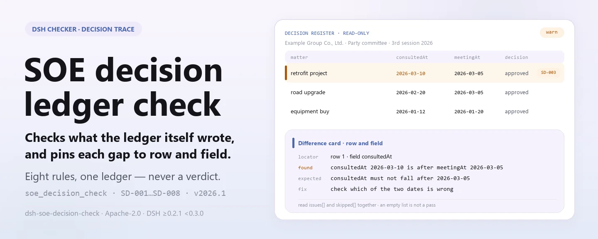

<div align="center">

<picture>
  <source media="(prefers-color-scheme: dark)" srcset="docs/assets/dsh-soe-decision-check-hero-en-dark.webp">
  
</picture>

# dsh-soe-decision-check

**Transforma um registro de assuntos de decisão «三重一大» em uma lista do que não bate, onde e o que corrigir: apenas diferenças, nunca um veredicto de conformidade.**

Um verificador do DeepSeek Harness para equipes de governança e conformidade de empresas estatais: lê um registro de decisões — o cabeçalho da empresa mais uma linha por assunto —, aplica um pacote de regras versionado e devolve achados que podem ser localizados e revisados linha por linha.

[Instalar](#instalação-em-três-passos) · [Configuração](#configuração) · [FAQ](#faq) · [简体中文](README.md) · [English](README.en.md) · [Español](README.es.md) · [Português](README.pt.md) · [हिन्दी](README.hi.md)

[](LICENSE)
[](#compatibilidade)
[](https://github.com/PerryLink/dsh-soe-decision-check/actions/workflows/ci.yml)
[](#compatibilidade)

[](https://github.com/PerryLink/dsh-soe-decision-check/stargazers)
[](https://dshfind.com/en/plugins/PerryLink/dsh-soe-decision-check?ref=badge)
[](https://securityscorecards.dev/viewer/?uri=github.com/PerryLink/dsh-soe-decision-check)
[](https://dsh.market/)
[](https://gitee.com/perrylink/dsh-soe-decision-check)

```sh
dsh plugin --profile <name> add dsh-soe-decision-check
```

</div>

<sub>Plugin da comunidade, sem afiliação com a DeepSeek. Repositório canônico: <https://github.com/PerryLink/dsh-soe-decision-check> (o Gitee é um espelho).</sub>

## O que é

O `dsh-soe-decision-check` lê um registro de assuntos de decisão «三重一大» —o cabeçalho da empresa mais uma linha por assunto— e verifica o rastro procedimental desse mesmo registro: se cada assunto regista a sua proposta ou o seu fundamento, se um assunto marcado como previamente estudado regista a data do estudo, se a data do estudo não é posterior à data da reunião, se está registada uma deliberação e se um assunto deliberado regista a votação, se a categoria do assunto vem da lista de valores que configurar, se o registo declara a empresa e o órgão decisor, e se os números de assunto não se repetem.

«三重一大» (três importantes e um grande) é o conjunto de categorias de decisão de empresa estatal citado pelo pacote de regras: decisões importantes, nomeações de pessoal-chave, grandes projetos e operações de fundos de grande montante.

O que o registo já declara, o verificador compara linha por linha; o que o registo não declara, não preenche nem adivinha. A saída é uma lista de achados com `locator` (qual linha, qual campo), `found` (o que foi lido), `expected` (o que deveria ser) e `fix` (o que corrigir), para revisão humana. ESM puro: sem rede, sem chamadas ao modelo e sem alterar o arquivo original.

<picture>
  <source media="(prefers-color-scheme: dark)" srcset="docs/assets/dsh-soe-decision-check-flow-v5-dark.svg">
  
</picture>

## Instalação em três passos

1. **Instalar**:

   ```sh
   dsh plugin --profile <name> add dsh-soe-decision-check
   ```

   Também funcionam o último `main` ou um tarball empacotado neste repositório:

   ```sh
   dsh plugin --profile web add github:PerryLink/dsh-soe-decision-check
   dsh plugin --profile web add ./dsh-soe-decision-check-<version>.tgz
   ```

   O que se publica é `lib/index.mjs` (artefato do `tsdown`), e o pacote traz `rules/`, `locale/` e `cordis.patch.yml`.

2. **Configuração mínima** (os padrões já funcionam; troque o pacote de regras ou rode um subconjunto quando precisar):

   ```yaml
   - insert:
       - id: dsh-soe-decision-check
         name: dsh-soe-decision-check
         config:
           rulesFile: rules/soe-decision-check.yaml
           disabledRules: []
   ```

3. **Verificar que monta**:

   ```sh
   dsh --profile <name> --dump-config | grep 'dsh-soe-decision-check'
   ```

   Num checkout do repositório também é possível rodar o exemplo (`pnpm install` executa o `tsdown` via `prepare`, que constrói `lib/`):

   ```sh
   node samples/quickstart/run.mjs
   ```

   ```text
   soe_decision_check: 1 issue(s) — error 0, warn 1, info 0
   skipped: 1
   ```

   A entrada do exemplo está em `samples/quickstart/input/` e o resultado esperado em `samples/quickstart/expected/result.json`; `skipped: 1` é o `SD-006`: o vocabulário de categorias vem vazio, então sem configurar ele se reporta como omitido.

**Desinstalar**: `dsh plugin --profile <name> remove dsh-soe-decision-check` (ou remova a linha do patch do perfil).

<details>
<summary>Entrar pelo WorkBuddy / Coze</summary>

Busque «Documents and Governance Suite» (文书与治理核对包) no WorkBuddy / Coze: esta verificação é uma parte do conjunto; a disponibilidade é a que constar na loja.

</details>

## Capacidades principais

Registra uma ferramenta, `soe_decision_check`: lê um registro, aplica um pacote de regras versionado e devolve um relatório. O pacote de regras é dado, não código: substituir `rules/*.yaml` troca o conjunto de regras sem tocar em TypeScript.

### Tabela de regras

| Regra | O que verifica | Nível | Tipo de base |
|---|---|---|---|
| `SD-001` | cada assunto regista a sua proposta ou o seu fundamento | warn | principle |
| `SD-002` | um assunto pré-estudado regista a data do estudo | warn | principle |
| `SD-003` | a data do estudo não é posterior à da reunião | warn | principle |
| `SD-004` | há uma deliberação registada | warn | principle |
| `SD-005` | um assunto deliberado regista a votação | warn | principle |
| `SD-006` | a categoria vem do seu vocabulário (desligada por padrão) | info | principle |
| `SD-007` | o registo declara a empresa e o órgão decisor | warn | principle |
| `SD-008` | os números de assunto são únicos | warn | principle |

*O tipo de base `principle` é `derived-from-principle` no pacote de regras: a cláusula não estabelece o requisito diretamente e a verificação se apoia num princípio geral, por isso o nível fica abaixo de `error`.*

### Exemplos

Estas são as superfícies reais do plugin; instale uma vez e chame uma.

**Saída detalhada** — ferramenta `soe_decision_check`

**Entrada**

```json
{"meetingAt":"2026-03-05","rows":[{"前置研究":"是","前置研究日期":"2026-03-10","会议日期":"2026-03-05"}]}
```

**Saída**

```json
{
  "id": "dsh-soe-decision-check.SD-003.de09b5a6",
  "ruleId": "SD-003",
  "severity": "warn",
  "locator": {
    "row": 1,
    "field": "consultedAt"
  },
  "found": "第 1 行「consultedAt」为 2026-03-10，晚于 「meetingAt」的 2026-03-05",
  "expected": "「consultedAt」不应晚于 2026-03-05",
  "fix": "前置研究日期不应晚于会议审议日期；核对两个日期的填写"
}
```

*Observed from `dsh-soe-decision-check/tests/fixtures/SD-003/SD-003-unsafe.json`*

**Exemplos curtos**: `soe_decision_check` · `node samples/quickstart/run.mjs`

### Perguntas que responde

| Você pergunta | O que ele responde |
|---|---|
| Um assunto não tem preenchidos nem a proposta nem o fundamento. Isso é reportado? | Sim. `SD-001` exige que cada linha que traga uma dessas duas colunas tenha pelo menos uma preenchida e reporta a linha quando ambas estão vazias. Verifica que exista pelo menos uma, não se o assunto pertence ao âmbito «三重一大», nem se o procedimento ou a competência foram adequados. |
| O registo marca um assunto como previamente estudado, mas a data do estudo está vazia. | `SD-002` lê a própria coluna de estudo prévio do registo e reporta a linha quando o seu valor conta como previamente estudado e a data (`consultedAt`) está vazia. Que valores contam é fixado por `conditionValues` da regra (seis valores padrão, listados em Configuração). Verifica que a data está preenchida, não que o estudo prévio tenha sido substancial nem que a sua conclusão tenha sido adotada. Se nenhuma linha trouxer tal valor, a regra reporta-se a si mesma em `skipped` em vez de passar; amplie a lista quando o registo usar outra redação. |
| A data do estudo é posterior à da reunião, ou não é legível como data. | `SD-003` compara a data do estudo (`consultedAt`) com a da reunião (`meetingAt`) e reporta quando a primeira é posterior; o mesmo dia conta como não posterior. Uma data que não consegue analisar é reportada à parte, não é omitida em silêncio. Compara apenas as duas datas: não julga se o procedimento foi realmente cumprido; um achado geralmente significa que uma das datas está errada, ou que a linha pertence a uma reunião posterior. |
| Uma linha não regista deliberação; outra regista deliberação mas não votação. | `SD-004` exige a coluna da deliberação (`decision`) em cada linha que a traga, e `SD-005` exige depois a da votação (`voteResult`) apenas nas linhas com deliberação registada. Nenhuma verifica se os votos atingiram a proporção exigida: essa proporção consta das medidas de aplicação da sua empresa e a regra não a calcula; uma votação aprovada com folga pode continuar sendo reportada, porque o que falta é o registo, não a maioria. |
| O `SD-006` nunca reporta nada no meu registo. | O seu vocabulário de categorias vem vazio, por isso sem `values` configurado o `SD-006` reporta-se a si mesmo em `skipped` em vez de passar em silêncio. Configure as suas próprias categorias e ele verificará apenas que a categoria preenchida (`category`) consta da lista; não decide se o assunto pertence ao âmbito «三重一大». |
| O mesmo número de assunto aparece em duas linhas. | `SD-008` reporta o `matterNo` repetido, ignorando espaços, porque a repetição impede apontar o assunto na ata. Que o mesmo assunto seja deliberado em várias reuniões é normal: distinga essas linhas pelo número da reunião em vez de reutilizar o número de ordem. A regra verifica apenas a unicidade. |

### Formato do material

A ferramenta aceita JSON ou YAML (o Excel pode ser convertido antes para qualquer um dos dois; no chat também, se a plataforma permitir):

```yaml
company: 某某集团有限公司
body: 党委会
meetingNo: 2026 年第 3 次
rows:
  - { 序号: '1', 决策事项: 某某技改项目立项, 事项类别: 重大项目安排,
      议题内容: 提请审议某某技改项目立项及投资概算,
      决策依据: 公司"三重一大"决策制度实施办法第 12 条, 涉及金额: 4800万元,
      前置研究: 是, 前置研究日期: 2026-02-20, 会议日期: 2026-03-05,
      决议结论: 同意立项，投资概算控制在 4800 万元以内,
      表决结果: 应到 9 人，实到 9 人，同意 9 票, 承办部门: 发展策划部 }
```

Os nomes de coluna são comparados sem diferenciar maiúsculas e ignorando espaços, sublinhados e hífens; os nomes próprios do registo são preservados, então cada achado nomeia a coluna que leu. As datas podem ser `2026-03-05` ou `2026-03-05 09:30`.

## Normas que segue

| Documento | Número | Regras que o citam |
|---|---|---|
| 《关于进一步推进国有企业贯彻落实"三重一大"决策制度的意见》 | 中办发〔2010〕17号（中共中央办公厅、国务院办公厅印发；⚠️ 党内文件，非法律、行政法规或部门规章；全文分三部分，按（一）至（二十三）编号，不设"第X条"） | SD-001, SD-002, SD-003, SD-004, SD-005, SD-006, SD-007, SD-008 |

Os dados das regras ficam separados do código: cada regra traz documento, número, cláusula na numeração própria da fonte, trecho literal e URL de origem. O carregador impõe: o trecho deve ser citação real de pelo menos oito caracteres, e uma verificação baseada apenas em princípio geral (`kind: derived-from-principle`, teto `warn`) ou em configuração institucional local (`kind: institutional-configuration`, teto `info`) nunca pode ser rotulada `error`. Um pacote de regras que infle a sua base falha ao carregar em vez de produzir um relatório falsamente seguro.

O cabeçalho do pacote declara a lacuna de citação completa, e a `note` de cada regra repete a parte que importa para aquela regra. A verificação de carga —que o trecho seja citação real de pelo menos oito caracteres— não distingue uma citação de uma descrição; por isso este pacote se apoia no cabeçalho, nas notas por regra e num teste que afirma que cada `excerpt` reconhece a lacuna.

Os limites confirmados na verificação e as conclusões deliberadamente não formuladas estão no diretório `rules/evidence/` que acompanha o pacote.

## Configuração

Todos os parâmetros ajustáveis são campos Schemastery em `src/config.ts` e mudam pelo `cordis.yml` sem editar código; os limites por verificação estão no pacote de regras em `rules/`. Uma sobrescrita por id substitui a linha inteira: reenuncie todas as chaves necessárias.

As 5 chaves:

| Chave | Padrão | Significado |
|---|---|---|
| `rulesFile` | `rules/soe-decision-check.yaml` | Caminho do pacote de regras, relativo à raiz do pacote |
| `disabledRules` | `[]` | Ids de regras a desativar; cada uma aparece em `skipped` |
| `onlyRules` | `[]` | Executar apenas estas regras; vazio executa todas |
| `skipNotes` | `""` | Nota acrescentada a cada motivo de `skipped`, por exemplo citando as suas medidas de aplicação |
| `timeoutMs` | `120000` | Orçamento de tempo limite cooperativo da ferramenta, em milissegundos |

<details>
<summary>Tabela de configuração completa (5 chaves + tipos)</summary>

| Chave | Tipo | Padrão | Significado |
|---|---|---|---|
| `rulesFile` | string | `rules/soe-decision-check.yaml` | Caminho do pacote de regras, relativo à raiz do pacote |
| `disabledRules` | string[] | `[]` | Ids de regras a desativar; cada uma aparece em `skipped` |
| `onlyRules` | string[] | `[]` | Executar apenas estas regras; vazio executa todas |
| `skipNotes` | string | `""` | Nota acrescentada a cada motivo de `skipped`, por exemplo citando as suas medidas de aplicação |
| `timeoutMs` | number | `120000` | Orçamento de tempo limite cooperativo da ferramenta, em milissegundos |

</details>

Os parâmetros por regra ficam no pacote de regras:

- `SD-002` `conditionValues`: os valores da sua coluna de estudo prévio que marcam um assunto como pré-estudado; por padrão `[是, Y, yes, true, 已研究, √]`.
- `SD-005` `conditionField` / `requiredFields`: o que aciona a exigência de votação; por padrão a coluna da deliberação, exigindo a da votação.
- `SD-006` `values`: as suas categorias de assunto, por exemplo `[重大决策, 重要人事任免, 重大项目安排, 大额度资金运作]`. Vazio significa que não se verifica.
- `SD-007` `fields`: os campos de cabeçalho que devem estar presentes; por padrão empresa e órgão decisor. Acrescente `meetingNo` se o registo anotar o número da reunião no cabeçalho.

Exemplo de sobrescrita no patch do perfil:

```yaml
- insert:
    - id: dsh-soe-decision-check
      name: dsh-soe-decision-check
      config:
        onlyRules: [SD-001, SD-002, SD-003]
        skipNotes: 本机构按实施细则第 12 条口径
```

## FAQ

<details>
<summary>O registo é alterado? Onde ficam os dados? Algo é enviado?</summary>

A ferramenta apenas lê o arquivo de material que você indica: não escreve arquivos, não altera o original, não faz requisições de rede, não chama modelo algum e não guarda credenciais. O `package.json#dsh.demo` declara `reads` como o arquivo de material indicado, `writes` vazio e `network: false`. O relatório é devolvido na sessão atual; nenhuma cópia adicional é escrita.

</details>

<details>
<summary>Se o resultado vier vazio, isso significa que o registo está certo?</summary>

Não. Um resultado vazio significa apenas que não havia diferenças literais a reportar; toda verificação que não pôde rodar aparece em `skipped` com o seu id de regra e o motivo. `SD-006` (vocabulário de categorias vazio) e `SD-002` (nenhuma linha marcada como pré-estudada) reportam-se a si mesmos em `skipped` em vez de passar em silêncio: um resultado vazio nunca pode ser lido como «não há nada errado».

</details>

<details>
<summary>Ele disputa nomes de ferramenta, chaves de serviço ou slots com outros plugins?</summary>

Não. O plugin registra exatamente uma ferramenta, `soe_decision_check`; não registra comandos, não fornece nenhuma chave de serviço, não registra nenhum slot de cliente nem prefixo `webServer`, e não observa nenhum evento de sessão. O patch do bundle apenas faz `insert` da própria linha. O argumento ponto a ponto está em «Interoperabilidade com outros plugins DSH».

</details>

<details>
<summary>Qual é a sobrecarga de desempenho?</summary>

ESM puro, zero rede, zero chamadas ao modelo: uma leitura do material, uma passada de comparações linha por linha, sem idas e voltas a serviços externos. Para um ano de reuniões use o modo de ferramenta `ptc`, assim o custo do esquema é pago uma vez.

</details>

<details>
<summary>Instala, mas a ferramenta não aparece — ou o pacote é recusado por incompatibilidade.</summary>

Primeiro confirme que `main` aponta para `lib/index.mjs` e que o arquivo foi construído; um `main` errado faz o carregador pular a entrada em silêncio. Se `dsh plugin add` recusar o pacote, verifique se o runtime está dentro da faixa de peers (cobre `0.1.x` e `0.2.x`); se precisar ficar fora, conceda isenção explícita: `dsh plugin --profile <name> allow-version dsh-soe-decision-check@<version> --dsh-version <runtime> --accept-risk`. Se `check` informar `manifest-peers` como falha, é um problema conhecido do `dsh-plugin-dev`, cujo verificador estático compara com uma faixa de peers codificada; o runtime aplica a compatibilidade de peers na instalação.

</details>

## Limites de segurança

- **Apenas diferenças, sem veredicto.** O relatório nunca se pronuncia sobre conformidade, competência, se um valor alcança o limiar de operação de fundos de grande montante, nem sobre quem é responsável; enumera diferenças literais entre o material e as cláusulas citadas, para revisão humana.
- **Somente leitura.** A ferramenta lê apenas o arquivo de material que você indica: não escreve arquivos, não altera o original, não faz requisições de rede, não chama modelo algum e não guarda credenciais.
- **Um resultado vazio não é aprovação.** Toda verificação que não pôde rodar aparece em `skipped` com o motivo; uma verificação deliberadamente sem configuração (como `SD-006`) reporta-se a si mesma em `skipped` em vez de passar em silêncio.
- **Falha fechada.** Sem `file` nem `material`, com material que não pode ser analisado ou com pacote de regras ausente, a ferramenta lança erro e nomeia o que tentou; nunca monta um relatório vazio.
- **Disciplina de citação.** Cada `excerpt` de uma regra é citação literal da cláusula que ela cita; quando o texto literal não está disponível, a regra o diz pelo seu `kind` e pela sua `note`, e o nível fica abaixo de `error`. O pacote nunca parafraseia uma cláusula e apresenta a paráfrase como citação.

## Limitações conhecidas

> ### ⚠️ O que este plugin deliberadamente não sabe
>
> **O que conta como assunto «三重一大» e a partir de que valor é definido pelas medidas de aplicação de cada empresa** —e os limiares variam por setor, nível e porte. Por isso este plugin **não codifica nenhum limiar de valor nem nenhuma lista de assuntos.** Em vez disso:
>
> - `SD-002` lê a **própria coluna de estudo prévio** do registo para decidir se um assunto precisava de estudo prévio, e os valores que contam como «pré-estudado» são configuráveis.
> - `SD-005` exige registo de votação **somente quando há deliberação registada**, e **não verifica se os votos atingem a proporção exigida** —essa proporção vem das medidas de aplicação, e um registo raramente anota o quórum e a regra de votação necessários para calculá-la.
> - O vocabulário de categorias do `SD-006` vem **vazio**; sem nada configurado ele se reporta em `skipped`.
>
> **Cada `excerpt` do pacote de regras é citação literal da cláusula que cita, e a porta de citação revisa cada segmento contra o registo em `rules/evidence/`.** O pacote enuncia um requisito literalmente quando a cláusula o enuncia, e para em `warn` quando a cláusula apenas o implica: uma verificação apoiada em princípio geral fica abaixo de `error` e o diz na sua própria `note`. O que o pacote não fará é parafrasear uma cláusula e apresentar a paráfrase como citação.
>
> Vale acrescentar outro limite: isto verifica que o **rastro** exista. Um estudo anotado na data correta não prova que o estudo prévio tenha sido substancial, e o plugin não formula nenhum achado sobre isso.

- **Só o rastro, não a substância.** Datas e colunas completas não provam que o procedimento de decisão tenha sido realmente cumprido; o plugin reporta apenas o que o próprio registo consegue mostrar linha por linha.
- **Sem maioria proporcional.** `SD-005` verifica que a votação está registada, não que atingiu a proporção exigida: isso exige o quórum e a regra de votação, que um registo raramente anota por completo.
- **`SD-006` vem desligada.** O vocabulário de categorias vem da sua instituição; sem `values` configurado ela se reporta em `skipped`, e o plugin não codifica nenhuma lista de assuntos nem limiar de valor.
- **`SD-002` depende dos valores do próprio registo.** Quando nenhuma linha traz um valor de `conditionValues`, a regra se reporta em `skipped`; amplie essa lista quando o registo usar outra redação.
- **Hora de relógio de parede.** Toda comparação de datas é aritmética de relógio de parede sobre as strings de entrada, sem conversão de fuso horário.
- **Medido apenas no Linux.** É ESM puro sem código nativo e roda em qualquer Node 22.19+; o único ambiente realmente exercitado é Linux.

## Interoperabilidade com outros plugins DSH

Verificado contra **DSH `0.2.0-rc.2`** (o runtime para o qual este README é publicado) e contra o código deste repositório. O plugin registra uma ferramenta e não toca nenhuma outra superfície de plugin:

- **Sem colisão de nome de ferramenta.** O único nome de ferramenta, `soe_decision_check`, é deste plugin e não colide com nenhuma ferramenta embutida ou de terceiros.
- **Sem colisão de chave de serviço.** Ele não fornece nenhuma chave de serviço, portanto não pode colidir em uma.
- **Sem colisão de slot.** Ele não registra nenhuma chave de slot de cliente, então não disputa um assento `shadows-shipped-ui`.
- **Sem colisão de rota HTTP.** Ele não registra nenhum prefixo `webServer`.
- **Sem colisão na cadeia de eventos.** Ele não observa nenhum evento de sessão (não há `ctx.on`), então não existe cadeia de eventos compartilhada para curto-circuitar; o registro em si é um efeito Cordis, removido ao descarregar ou recarregar a quente.
- **Sem colisão na camada de patch.** O patch do bundle apenas faz `insert` da própria linha; nunca sobrescreve o `config` de uma linha embutida.
- **Sem mutação global.** Ele não altera protótipos, não reescreve `process.env` nem substitui o dispatcher global de fetch.

O plugin declara `inject: ['tools']`: sem o serviço `tools` ele não inicia, então não deixa nenhum listener ou timer meio registrado.

## Compatibilidade

| Superfície | Estado |
|---|---|
| Harness | `engines.dsh` é `>=0.2.1-0 <0.3.0`, aplicado pelo host desde 0.2.1; a faixa de peers é `>=0.1.2-rc.1 <0.2.0 \|\| >=0.2.0-0 <0.3.0`, medida para aceitar tanto `0.2.0-rc.2` quanto `0.2.1-rc.2` |
| Node | `^22.19.0 \|\| >=24.0.0` |
| Plataformas | Qualquer host que rode ESM puro em Node 22.19+; sem código nativo, sem rede, sem chamadas ao modelo. Testado apenas no Linux |
| Modo de ferramenta | Funciona em `native` e `ptc`; para um ano de reuniões use `ptc`, assim o custo do esquema é pago uma vez |

## Ecossistema e qualidade

- [Espelho Gitee](https://gitee.com/perrylink/dsh-soe-decision-check) (espelho de sincronização; o GitHub é o canônico)
- [Página do plugin no dshfind](https://dshfind.com/en/plugins/PerryLink/dsh-soe-decision-check) (instalações e ranking)
- [Relatório OpenSSF Scorecard](https://securityscorecards.dev/viewer/?uri=github.com/PerryLink/dsh-soe-decision-check) (alimentado por [.github/workflows/scorecard.yml](.github/workflows/scorecard.yml))
- [DSH Market](https://dsh.market/) (listado)
- [Escolher um verificador por material](https://perrylink.github.io/zh/checkers/choose/) (índice de seleção da família de verificadores a que este repositório pertence)

## Desenvolvimento

```sh
pnpm install                                              # node ^22.19 || >=24; prepare executa tsdown
pnpm run typecheck                                        # tsc --noEmit
pnpm test                                                 # vitest: suíte compartilhada de plugins de tabela + fixtures pareados por regra
pnpm run build                                            # tsdown -> lib/index.mjs + lib/index.d.mts
pnpm run check:readmes                                    # porta de consistência dos README (fonte chinesa ↔ inglês)
node ../scripts/sync-shared.mjs dsh-soe-decision-check    # copia o kit compartilhado de ../_shared para src/shared/
```

Porta pré-publicação: `pnpm run typecheck && pnpm test && pnpm run build && pnpm run verify:self-contained && pnpm run check:lockfile && pnpm run check:readmes`.

O plugin é **somente dados**: `src/model.ts` declara a forma da tabela, o kit compartilhado fornece o leitor e o motor de verificação, e o pacote de regras declara cada verificação. As imagens do README são geradas programaticamente por [`scripts/gen-readme-assets.py`](scripts/gen-readme-assets.py) (Pillow para o cabeçalho, SVG escrito à mão para a estrutura) e podem ser reexecutadas sem risco: `python scripts/gen-readme-assets.py` escreve `docs/assets/dsh-soe-decision-check-hero-{zh,en}-{light,dark}.webp` e `docs/assets/dsh-soe-decision-check-flow-v5-{light,dark}.svg` (cabeçalho localizado, figura de estrutura só com tokens partilhada pelos cinco idiomas). O diagrama de fluxo antigo e as imagens de demonstração ficam em `docs/assets/` para ligações externas.

Topics: `deepseek-harness`, `dsh`, `dsh-plugin`, `cordis`, `soe`, `decision`

## Família e agradecimentos

Este projeto faz parte da família de plugins do DeepSeek Harness da [PerryLink](https://github.com/PerryLink) (todos Apache-2.0). Se for útil, **uma estrela ajuda a próxima pessoa a encontrá-lo** — nada fica bloqueado atrás dela.

- [@PerryLink](https://github.com/PerryLink) — criador e mantenedor: o pacote de regras (8 regras e o registro de verificação de citações em `rules/evidence/`), o motor de verificação compartilhado e a documentação em cinco idiomas.

Índice completo (62 verificadores + plugins gerais): [escolher um verificador por material](https://perrylink.github.io/zh/checkers/choose/) · [todos os plugins](https://github.com/PerryLink). Este repositório é um deles.

<details>
<summary>Expandir todos os plugins</summary>

| Plugin | Status |
|---|---|
| **[dsh-aqua-input-check](https://github.com/PerryLink/dsh-aqua-input-check)** |  |
| **[dsh-archive-check](https://github.com/PerryLink/dsh-archive-check)** |  |
| **[dsh-auto-review](https://github.com/PerryLink/dsh-auto-review)** |  |
| **[dsh-autotier](https://github.com/PerryLink/dsh-autotier)** | 🧊 CONGELADO — ver o README do repo |
| **[dsh-bid-ca-precheck](https://github.com/PerryLink/dsh-bid-ca-precheck)** |  |
| **[dsh-bid-qual-check](https://github.com/PerryLink/dsh-bid-qual-check)** |  |
| **[dsh-cert-mcp](https://github.com/PerryLink/dsh-cert-mcp)** | 🧊 CONGELADO — ver o README do repo |
| **[dsh-checkpoint-rewind](https://github.com/PerryLink/dsh-checkpoint-rewind)** |  |
| **[dsh-click](https://github.com/PerryLink/dsh-click)** |  |
| **[dsh-composer-history](https://github.com/PerryLink/dsh-composer-history)** |  |
| **[dsh-contract-stance](https://github.com/PerryLink/dsh-contract-stance)** |  |
| **[dsh-customs-doc-check](https://github.com/PerryLink/dsh-customs-doc-check)** |  |
| **[dsh-data-quality](https://github.com/PerryLink/dsh-data-quality)** | 🧊 CONGELADO — ver o README do repo |
| **[dsh-demurrage-ledger](https://github.com/PerryLink/dsh-demurrage-ledger)** |  |
| **[dsh-doublecheck](https://github.com/PerryLink/dsh-doublecheck)** |  |
| **[dsh-drill-script-check](https://github.com/PerryLink/dsh-drill-script-check)** |  |
| **[dsh-eia-guide-check](https://github.com/PerryLink/dsh-eia-guide-check)** |  |
| **[dsh-emergency-plan](https://github.com/PerryLink/dsh-emergency-plan)** |  |
| **[dsh-essay-rubric-check](https://github.com/PerryLink/dsh-essay-rubric-check)** |  |
| **[dsh-evidence-check](https://github.com/PerryLink/dsh-evidence-check)** |  |
| **[dsh-export-ctl-check](https://github.com/PerryLink/dsh-export-ctl-check)** |  |
| **[dsh-fast](https://github.com/PerryLink/dsh-fast)** |  |
| **[dsh-fmea-table-check](https://github.com/PerryLink/dsh-fmea-table-check)** |  |
| **[dsh-forecast-penalty](https://github.com/PerryLink/dsh-forecast-penalty)** |  |
| **[dsh-fund-research](https://github.com/PerryLink/dsh-fund-research)** |  |
| **[dsh-github](https://github.com/PerryLink/dsh-github)** |  |
| **[dsh-gongwen-flow-check](https://github.com/PerryLink/dsh-gongwen-flow-check)** |  |
| **[dsh-gongwen-word-check](https://github.com/PerryLink/dsh-gongwen-word-check)** |  |
| **[dsh-guard-plan-qc](https://github.com/PerryLink/dsh-guard-plan-qc)** |  |
| **[dsh-hazchem-check](https://github.com/PerryLink/dsh-hazchem-check)** |  |
| **[dsh-hazplan-check](https://github.com/PerryLink/dsh-hazplan-check)** |  |
| **[dsh-hidden-risk-map](https://github.com/PerryLink/dsh-hidden-risk-map)** |  |
| **[dsh-hs-classify](https://github.com/PerryLink/dsh-hs-classify)** |  |
| **[dsh-icd-rule-check](https://github.com/PerryLink/dsh-icd-rule-check)** |  |
| **[dsh-industry-research](https://github.com/PerryLink/dsh-industry-research)** |  |
| **[dsh-lawcite-adapter](https://github.com/PerryLink/dsh-lawcite-adapter)** |  |
| **[dsh-laya](https://github.com/PerryLink/dsh-laya)** |  |
| **[dsh-lc-doc-check](https://github.com/PerryLink/dsh-lc-doc-check)** |  |
| **[dsh-learning-gap-check](https://github.com/PerryLink/dsh-learning-gap-check)** |  |
| **[dsh-library](https://github.com/PerryLink/dsh-library)** |  |
| **[dsh-local-ai](https://github.com/PerryLink/dsh-local-ai)** |  |
| **[dsh-lsp-actions](https://github.com/PerryLink/dsh-lsp-actions)** |  |
| **[dsh-mask](https://github.com/PerryLink/dsh-mask)** |  |
| **[dsh-mcp-panel](https://github.com/PerryLink/dsh-mcp-panel)** |  |
| **[dsh-medrec-qc](https://github.com/PerryLink/dsh-medrec-qc)** |  |
| **[dsh-memento](https://github.com/PerryLink/dsh-memento)** | 🧊 CONGELADO — ver o README do repo |
| **[dsh-nsfc-form-check](https://github.com/PerryLink/dsh-nsfc-form-check)** |  |
| **[dsh-nurse-record-check](https://github.com/PerryLink/dsh-nurse-record-check)** |  |
| **[dsh-observe](https://github.com/PerryLink/dsh-observe)** |  |
| **[dsh-origin-rvc-check](https://github.com/PerryLink/dsh-origin-rvc-check)** |  |
| **[dsh-ota-review-check](https://github.com/PerryLink/dsh-ota-review-check)** |  |
| **[dsh-output-styles](https://github.com/PerryLink/dsh-output-styles)** |  |
| **[dsh-paper-doc-adapter](https://github.com/PerryLink/dsh-paper-doc-adapter)** |  |
| **[dsh-permission-rules](https://github.com/PerryLink/dsh-permission-rules)** |  |
| **[dsh-permit-report-check](https://github.com/PerryLink/dsh-permit-report-check)** |  |
| **[dsh-pipeline-check](https://github.com/PerryLink/dsh-pipeline-check)** |  |
| **[dsh-pleading-draft](https://github.com/PerryLink/dsh-pleading-draft)** |  |
| **[dsh-plugin-doctor](https://github.com/PerryLink/dsh-plugin-doctor)** | 🚫 APOSENTADO (repo arquivado) |
| **[dsh-plugin-guide](https://github.com/PerryLink/dsh-plugin-guide)** |  |
| **[dsh-plugin-kit](https://github.com/PerryLink/dsh-plugin-kit)** | 🚫 APOSENTADO (repo arquivado) |
| **[dsh-plugin-upgrade](https://github.com/PerryLink/dsh-plugin-upgrade)** | 🚫 APOSENTADO (repo arquivado) |
| **[dsh-policy-brief-draft](https://github.com/PerryLink/dsh-policy-brief-draft)** |  |
| **[dsh-power-loss-split](https://github.com/PerryLink/dsh-power-loss-split)** |  |
| **[dsh-power-ticket-check](https://github.com/PerryLink/dsh-power-ticket-check)** |  |
| **[dsh-ppap-check](https://github.com/PerryLink/dsh-ppap-check)** |  |
| **[dsh-protest-deadline](https://github.com/PerryLink/dsh-protest-deadline)** |  |
| **[dsh-railway-window](https://github.com/PerryLink/dsh-railway-window)** |  |
| **[dsh-repair-order-qc](https://github.com/PerryLink/dsh-repair-order-qc)** |  |
| **[dsh-research-report](https://github.com/PerryLink/dsh-research-report)** |  |
| **[dsh-review-reply-check](https://github.com/PerryLink/dsh-review-reply-check)** |  |
| **[dsh-rulefile-check](https://github.com/PerryLink/dsh-rulefile-check)** |  |
| **[dsh-safety-brief-check](https://github.com/PerryLink/dsh-safety-brief-check)** |  |
| **[dsh-score](https://github.com/PerryLink/dsh-score)** | 🧊 CONGELADO — ver o README do repo |
| **[dsh-session-sync](https://github.com/PerryLink/dsh-session-sync)** |  |
| **[dsh-site-log-check](https://github.com/PerryLink/dsh-site-log-check)** |  |
| **[dsh-skill-pack-security](https://github.com/PerryLink/dsh-skill-pack-security)** |  |
| **[dsh-soe-decision-check](https://github.com/PerryLink/dsh-soe-decision-check)** |  |
| **[dsh-soilwater-check](https://github.com/PerryLink/dsh-soilwater-check)** |  |
| **[dsh-sop-sync-check](https://github.com/PerryLink/dsh-sop-sync-check)** |  |
| **[dsh-spc-gbt-adapter](https://github.com/PerryLink/dsh-spc-gbt-adapter)** |  |
| **[dsh-talk](https://github.com/PerryLink/dsh-talk)** |  |
| **[dsh-tender-extract](https://github.com/PerryLink/dsh-tender-extract)** |  |
| **[dsh-tender-matrix](https://github.com/PerryLink/dsh-tender-matrix)** |  |
| **[dsh-test-drive](https://github.com/PerryLink/dsh-test-drive)** |  |
| **[dsh-ticktick](https://github.com/PerryLink/dsh-ticktick)** | 🚫 APOSENTADO (repo arquivado) |
| **[dsh-translate](https://github.com/PerryLink/dsh-translate)** |  |
| **[dsh-warranty-calc](https://github.com/PerryLink/dsh-warranty-calc)** |  |
| **[dsh-budget](https://github.com/PerryLink/dsh-budget)** | 🧊 CONGELADO — ver o README do repo |
| **[dsh-claude-move](https://github.com/PerryLink/dsh-claude-move)** | 🧊 CONGELADO — ver o README do repo |
| **[dsh-defend](https://github.com/PerryLink/dsh-defend)** | 🧊 CONGELADO — ver o README do repo |
| **[dsh-draw](https://github.com/PerryLink/dsh-draw)** | 🧊 CONGELADO — ver o README do repo |
| **[dsh-reach](https://github.com/PerryLink/dsh-reach)** | 🧊 CONGELADO — ver o README do repo |
| **[dsh-background-agents](https://github.com/PerryLink/dsh-background-agents)** | 🚫 APOSENTADO (repo arquivado) |
| **[dsh-session-pin](https://github.com/PerryLink/dsh-session-pin)** | 🚫 APOSENTADO (repo arquivado) |
| **[dsh-team-rooms](https://github.com/PerryLink/dsh-team-rooms)** | 🚫 APOSENTADO (repo arquivado) |

</details>

## Licença

[LICENSE](LICENSE) (Apache License 2.0) © 2026 dsh-soe-decision-check contributors

<p align="center"><sub>Apache-2.0 · Plugin da comunidade, sem afiliação com a DeepSeek.</sub></p>
